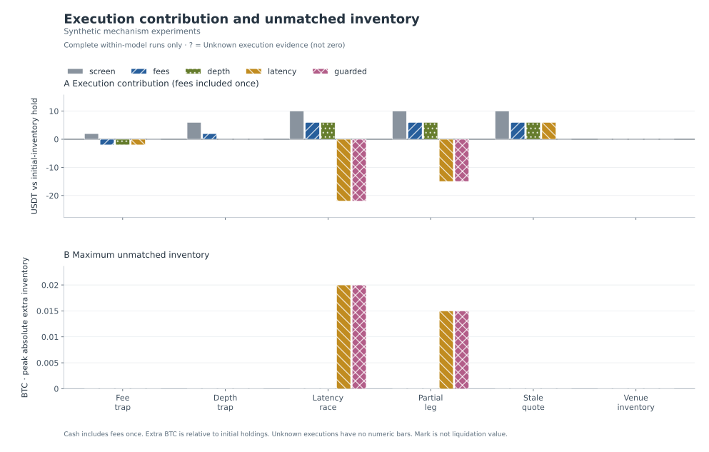

# BTC Cross-Venue Execution Lab

**When does a visible spread survive fees, depth, latency and inventory risk?**

A reproducible BTC/USDT spot research project with a receive-time replay engine, independent venue ledgers, adversarial synthetic scenarios and a small historical-data study. It evaluates execution assumptions rather than predicting BTC's direction.

中文：研究跨所价差扣除成本、考虑盘口深度和执行失败后还剩多少。先用可解释的合成实验验证机制，再用历史盘口样本检验假设。代码与研究材料使用 AI 辅助完成；个人学习与修改记录应据实说明。



[Synthetic research report](docs/demo/research_report.md) · [Historical sample report](docs/real-sample/research_report.md) · [Fee / latency sensitivity](docs/real-sample/sensitivity.md) · [Methodology](docs/methodology.md) · [中文学习路线](docs/LEARNING_PATH.zh-CN.md)

## Findings you can reproduce

The synthetic experiments deliberately isolate failure mechanisms. These are constructed examples, not discovered market opportunities. Each experiment allows one submitted pair; the values below are execution contribution relative to holding the same initial inventory, with fees included once.

| Experiment | Optimistic screen | Model with costs / execution | What it demonstrates |
| --- | ---: | ---: | --- |
| Fee trap | +2 USDT | −2.002 USDT with fees | A positive gross spread can lose money. |
| Depth trap | +6 USDT | No trade with visible-depth entry | The best quote cannot price the entire order. |
| Latency race | +10 USDT | −22 USDT with 100 ms delay | The buy fills while the sell opportunity disappears. |
| Partial leg | +10 USDT | −15.0025 USDT with delay | A 0.015 BTC residual remains; halting new orders does not hedge it. |
| Stale quote | +10 USDT | No guarded trade | A stale book can create a false opportunity. |
| Venue inventory | No trade | No trade | Aggregate capital cannot replace the right asset at the right venue. |

The historical study uses **8,765 reconstructed top-five snapshots across two venues over 600 seconds on 2026-10-01**. With an assumed 10 bps taker fee per side, a 0.005 BTC target order and a 100-pair budget:

| Model | Submitted pairs | Execution contribution, USDT | Peak extra BTC |
| --- | ---: | ---: | ---: |
| Screen: no fees or delay | 100 | ≈ +1 | 0 |
| Fees | 100 | ≈ −82 | 0 |
| Visible depth + fees | 100 | ≈ −82 | 0 |
| Depth + fees + 100 ms delay | 100 | ≈ −76 | 0.01 |
| Net-edge entry + quote gates + halt | 0 | 0 | 0 |

Historical public amounts are rounded to 1 USDT, extra BTC to 0.001 BTC; exact venue balances and tick traces are excluded. Exact accounting is checked before export. The guarded model rejects every candidate in this short window. This supports a narrow finding about this sample and these assumptions, not a claim that arbitrage is impossible. Different models select different trades and quantities, so their differences are **not** a strict additive cost attribution. Total portfolio PnL also includes the initial BTC inventory's price movement; the synthetic report demonstrates the holding benchmark. Fees and added latency are assumptions, not measured account costs or achievable network performance.

## Run locally

Python **3.11+**. The replay engine uses the standard library. Reports additionally use Matplotlib. No exchange account, API key or real funds are needed.

```bash
python3 -m venv .venv
source .venv/bin/activate
python -m pip install -r requirements-research.txt
python -m pip install .
python -m unittest discover -s tests -v
python -m crossvenue demo --output outputs/demo
```

Open `outputs/demo/research_report.html` in a browser, or read the Markdown report. The HTML is self-contained and works offline. SVG/PNG figures, canonical result JSON and a run manifest accompany it. Synthetic input hashes and parameters are recorded for reproducibility. CI runs the same synthetic study without network data downloads.

Replay a single checked-in experiment:

```bash
python -m crossvenue replay \
  --input datasets/synthetic/latency_race.jsonl \
  --model all \
  --output outputs/latency-race
```

The adjacent synthetic manifest is checksum-verified before applying that scenario's inventory and terminal-mark settings. Custom historical input requires an explicit JSON configuration; see the [data contract](docs/data_contract.md).

## Historical sample, explicit opt-in

```bash
python -m crossvenue sample \
  --day 2026-10-01 \
  --window-seconds 600 \
  --max-events 100000 \
  --timeout 120 \
  --sweep \
  --output outputs/real-sample
```

This command downloads the vendor's monthly first-day Binance spot and Bybit spot BTCUSDT samples. It does not connect to either exchange's account or order endpoints. Raw archives and normalized ticks stay in ignored `data/`; complete validated cached downloads are reused. The published historical report contains rounded aggregate research only. `--sweep` adds a predefined 5 × 4 fee/latency sensitivity grid on the same sample, not a search for an optimal live strategy. Availability and licence terms remain controlled by the provider. See [source, timing and reproduction details](docs/REAL_DATA.md).

Tardis arrival timestamps describe its capture infrastructure. They are not the user's receive times. Receipt is rounded up to a 1 ms bucket endpoint to avoid submillisecond lookahead. There are only five known levels per side, no disconnect messages, and the source row ordinal is not an exchange sequence number. Historical displayed depth does not prove a simulated order would have filled.

## What the engine makes explicit

- **Causal replay:** decisions use snapshots already received; IOC limits are fixed at decision time, while fills use usable depth at arrival.
- **Finite liquidity:** quantity-dependent VWAP, partial fills and virtual depth consumption; duplicate snapshots cannot replenish consumed depth.
- **Independent assets:** each venue must hold its own buying cash and selling BTC. No instant transfer, borrowing or shared collateral.
- **Order uncertainty:** evidence failures after submission remain `execution_unknown`; arrivals beyond coverage remain `censored`. Neither becomes a fabricated zero fill. Incomplete runs have no numeric performance bar.
- **Data quality:** stale/skew checks, malformed snapshot rejection and venue quarantine on comparable event-clock regressions.
- **Accounting:** `Decimal` cash, fees and quantities; initial-inventory PnL separated from execution contribution; exact settlement identities checked.

Only one pair is pending at a time. Residual BTC limits halt new submissions; v1 does not automatically hedge existing risk. Later historical snapshots reset virtual depth, although those snapshots were not generated in response to this simulated trader. No maker queue, exchange size/precision rules, transfer costs, funding, liquidation or counterparty-loss model is implemented. See [the full assumptions](docs/methodology.md).

## Repository map

| Path | Purpose |
| --- | --- |
| [`crossvenue/engine.py`](crossvenue/engine.py) | Replay, IOC execution, balances and risk states |
| [`crossvenue/data.py`](crossvenue/data.py) | Five model presets and six constructed experiments |
| [`crossvenue/tardis.py`](crossvenue/tardis.py) | Bounded, source-declared historical sample importer |
| [`crossvenue/report.py`](crossvenue/report.py) | Accounting checks, aggregate public export and figures |
| [`crossvenue/sensitivity.py`](crossvenue/sensitivity.py) | Fixed fee / latency grid, including unresolved outcomes |
| [`datasets/synthetic/`](datasets/synthetic/) | Redistributable constructed fixtures and hashes |
| [`docs/demo/`](docs/demo/) | Checked-in synthetic results and inspectable traces |
| [`docs/real-sample/`](docs/real-sample/) | Aggregate historical study and source hashes |
| [`tests/`](tests/) | Causal timing, costs, balances, partial fills, uncertainty and data checks |
| [`exercises/`](exercises/) / [`examples/`](examples/) | Earlier guided Python, SQL and ledger learning work |

## Guided ledger exercises

The learner supplied the sell-side cash/BTC branches, the ending-balance expressions, the complete equity aggregation query, and the cash-coverage comparison after a surplus-cash counterexample. The assistant supplied fixtures, SQL scaffolds, the CTE/view runner and execution checks. These contributions are separate from the AI-assisted replay engine.

Run the fixed synthetic, in-memory fixture:

```bash
python exercises/day04_trade_cashflows.py
python exercises/day04_trade_cashflows.py --sql exercises/day04_trade_balances.sql
python exercises/day04_trade_cashflows.py --sql exercises/day04_trade_equity.sql
python exercises/day05_can_buy.py
```

The equity query returns 9,997.4925 USDT, 0.1 BTC, 10.0075 USDT of disclosed fees and 19,997.4925 USDT of equity at a common mark of 100,000. Fees are already included in cash. At a terminal mark of 90,000, the hold benchmark is 19,000 and the execution contribution remains −2.5075 USDT.

Fixture scope: complete confirmed BTC/USDT spot fills, USDT fees, both venues trading and no other asset movements. The balance query's inner join relies on both venues having fills. SQLite `REAL` is used for query practice; local checks compare it with the independent `Decimal` reference ledger within a stated numerical tolerance. `can_buy` assumes valid inputs and checks one leg's cash requirement only.

The zero-fill extension adds venue C with 1,000 USDT and no BTC, confirmed to have no fills or other asset movements. The learner explained the missing-venue cause and repair conditions, then filled the three numeric fields in the assistant's `LEFT JOIN` / `COALESCE` scaffold:

```bash
python exercises/day04_trade_cashflows.py --include-idle-venue --sql exercises/day06_zero_fill_balances.sql
python exercises/day04_trade_cashflows.py --include-idle-venue --sql exercises/day04_trade_equity.sql
```

The shared `ending_balances` view now uses this coverage-preserving query. C retains 1,000 USDT, zero BTC and zero trade fees; A/B and their fees stay unchanged. The total equity becomes 20,997.4925 USDT at the same 100,000 mark. This restores omitted initial assets rather than creating 1,000 USDT of strategy profit. Missing query results or incomplete collection still require an unknown state; this fixture's confirmed zero activity is the reason its missing changes can be zero-filled.

## Explain it, then improve it

Start with the [Chinese learning route](docs/LEARNING_PATH.zh-CN.md) and [interview walkthrough](docs/INTERVIEW.md). A useful next contribution is a failing counterexample plus a small fix, accompanied by a predicted result and a reproducible run. A working repository alone does not demonstrate that its author understands every assumption.

The implementation and writing are AI-assisted. No company code, proprietary strategy, account history or credentials are included. The source code does not grant redistribution rights to third-party market data. No live-trading performance, production deployment or annualized Sharpe ratio is claimed.
