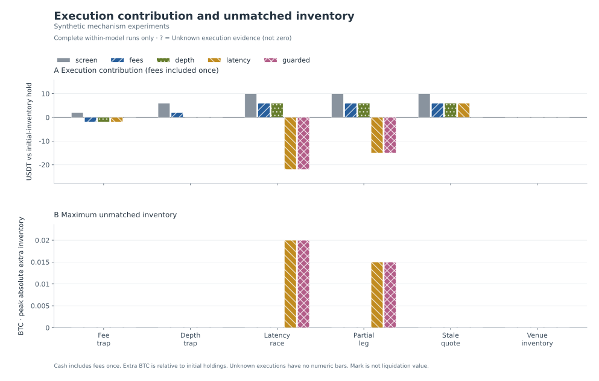

# Cross-Venue Execution Lab

**Synthetic Mechanism Experiments**

All inputs are synthetic. These are deterministic mechanism tests, not historical market results, real trading profits, production incidents, or evidence of a profitable strategy.

Synthetic traces are inspectable below.

30 runs · 6 scenarios · 5 models.

All supplied runs reconcile the five displayed accounting identities exactly. This is arithmetic validation, not evidence of realistic fills or profitability.

## Execution assumptions change the result

Each numeric bar represents one complete-within-model run. ? = Unknown execution evidence; incomplete runs have no numeric performance or exposure bar. Missing combinations are not zero. Published values and evidence status follow.

## Settlement comparison

| Scenario | Model | Valuation | Execution USDT | Inventory PnL USDT | Total PnL USDT | Known fees USDT | Peak extra BTC | Unhedged ms | Accounting |
| --- | --- | --- | --- | --- | --- | --- | --- | --- | --- |
| fee_trap | screen | COMPLETE WITHIN MODEL | 2 | 0 | 2 | 0 | 0 | 0 | PASS |
| fee_trap | fees | COMPLETE WITHIN MODEL | -2.002 | 0 | -2.002 | 4.002 | 0 | 0 | PASS |
| fee_trap | depth | COMPLETE WITHIN MODEL | -2.002 | 0 | -2.002 | 4.002 | 0 | 0 | PASS |
| fee_trap | latency | COMPLETE WITHIN MODEL | -2.002 | 0 | -2.002 | 4.002 | 0 | 0 | PASS |
| fee_trap | guarded | COMPLETE WITHIN MODEL | 0 | 0 | 0 | 0 | 0 | 0 | PASS |
| depth_trap | screen | COMPLETE WITHIN MODEL | 6 | 0 | 6 | 0 | 0 | 0 | PASS |
| depth_trap | fees | COMPLETE WITHIN MODEL | 1.994 | 0 | 1.994 | 4.006 | 0 | 0 | PASS |
| depth_trap | depth | COMPLETE WITHIN MODEL | 0 | 0 | 0 | 0 | 0 | 0 | PASS |
| depth_trap | latency | COMPLETE WITHIN MODEL | 0 | 0 | 0 | 0 | 0 | 0 | PASS |
| depth_trap | guarded | COMPLETE WITHIN MODEL | 0 | 0 | 0 | 0 | 0 | 0 | PASS |
| latency_race | screen | COMPLETE WITHIN MODEL | 10 | -200 | -190 | 0 | 0 | 0 | PASS |
| latency_race | fees | COMPLETE WITHIN MODEL | 5.99 | -200 | -194.01 | 4.01 | 0 | 0 | PASS |
| latency_race | depth | COMPLETE WITHIN MODEL | 5.99 | -200 | -194.01 | 4.01 | 0 | 0 | PASS |
| latency_race | latency | COMPLETE WITHIN MODEL | -22 | -200 | -222 | 2 | 0.02 | 200 | PASS |
| latency_race | guarded | COMPLETE WITHIN MODEL | -22 | -200 | -222 | 2 | 0.02 | 200 | PASS |
| partial_leg | screen | COMPLETE WITHIN MODEL | 10 | -200 | -190 | 0 | 0 | 0 | PASS |
| partial_leg | fees | COMPLETE WITHIN MODEL | 5.99 | -200 | -194.01 | 4.01 | 0 | 0 | PASS |
| partial_leg | depth | COMPLETE WITHIN MODEL | 5.99 | -200 | -194.01 | 4.01 | 0 | 0 | PASS |
| partial_leg | latency | COMPLETE WITHIN MODEL | -15.0025 | -200 | -215.0025 | 2.5025 | 0.015 | 200 | PASS |
| partial_leg | guarded | COMPLETE WITHIN MODEL | -15.0025 | -200 | -215.0025 | 2.5025 | 0.015 | 200 | PASS |
| stale_quote | screen | COMPLETE WITHIN MODEL | 10 | 0 | 10 | 0 | 0 | 0 | PASS |
| stale_quote | fees | COMPLETE WITHIN MODEL | 5.99 | 0 | 5.99 | 4.01 | 0 | 0 | PASS |
| stale_quote | depth | COMPLETE WITHIN MODEL | 5.99 | 0 | 5.99 | 4.01 | 0 | 0 | PASS |
| stale_quote | latency | COMPLETE WITHIN MODEL | 5.99 | 0 | 5.99 | 4.01 | 0 | 0 | PASS |
| stale_quote | guarded | COMPLETE WITHIN MODEL | 0 | 0 | 0 | 0 | 0 | 0 | PASS |
| venue_inventory | screen | COMPLETE WITHIN MODEL | 0 | 0 | 0 | 0 | 0 | 0 | PASS |
| venue_inventory | fees | COMPLETE WITHIN MODEL | 0 | 0 | 0 | 0 | 0 | 0 | PASS |
| venue_inventory | depth | COMPLETE WITHIN MODEL | 0 | 0 | 0 | 0 | 0 | 0 | PASS |
| venue_inventory | latency | COMPLETE WITHIN MODEL | 0 | 0 | 0 | 0 | 0 | 0 | PASS |
| venue_inventory | guarded | COMPLETE WITHIN MODEL | 0 | 0 | 0 | 0 | 0 | 0 | PASS |

## Accounting and interpretation

- Initial BTC is a real directional inventory exposure in this model. The hold benchmark retains the exact initial BTC and USDT at the same final common mark.
- Execution contribution = ending equity − hold benchmark = Δcash + ΔBTC × final mark. Total PnL = initial-inventory PnL + execution contribution.
- Fees are already deducted in cash and ending equity. The fee metric is a disclosure, not a second deduction from execution contribution.
- Common-mark equity and the equity curve are valuations, not realizable liquidation proceeds. Exit depth, fees and venue availability can change realizable value.
- Models change execution assumptions, filters and potentially fill quantities. Their differences are counterfactual comparisons, not strict additive cost attribution.
- Orders use separate prefunded venue inventories; spot borrowing and instantaneous cross-venue transfers are not assumed. Peak extra BTC is max(abs(total BTC − initial total BTC)); ending extra BTC is signed.
- Exposure peaks are sampled after both same-time leg attempts, not a measurement of intramillisecond leg risk. Parameters list actual resolved fees, latency, order size, thresholds and model switches.
- Decision-time information and subsequent execution must be separated by the simulator. This report displays supplied results and accounting checks; it does not independently certify causal replay correctness.
- round_trips_complete is the simulator's paired-leg completion counter, not proof that initial BTC inventory was liquidated or that capital completed a transfer cycle.
- Censored pairs and execution_unknown_pairs are separate from confirmed no-fill pairs. Incomplete runs expose only the known-fill ledger; complete performance, ending actual exposure and peak actual exposure remain unknown. The five arithmetic checks validate that ledger only.

## Run evidence

### fee_trap / screen

Source: synthetic.

COMPLETE WITHIN MODEL: executions are resolved under the simulator's assumptions; this does not prove real-world fills.

#### Metrics

| Metric | Value |
| --- | --- |
| candidates | 3 |
| submitted_pairs | 1 |
| round_trips_complete | 1 |
| partial_pairs | 0 |
| single_leg_pairs | 0 |
| no_fill_pairs | 0 |
| censored_pairs | 0 |
| execution_unknown_pairs | 0 |
| max_unhedged_duration_ms | 0 |
| risk_halts | 0 |
| fees_usdt | 0 |
| initial_equity_usdt | 40000 |
| ending_equity_usdt | 40002 |
| hold_benchmark_usdt | 40000 |
| total_pnl_usdt | 2 |
| inventory_pnl_usdt | 0 |
| execution_contribution_usdt | 2 |
| max_extra_btc | 0 |
| ending_extra_btc | 0 |

#### Venue settlement

| Stage | Venue | USDT | BTC |
| --- | --- | --- | --- |
| initial | alpha | 10000 | 0.1 |
| initial | beta | 10000 | 0.1 |
| final | alpha | 8000 | 0.12 |
| final | beta | 12002 | 0.08 |

#### Accounting identities

| Identity | Status | Exact residual |
| --- | --- | --- |
| Ending equity − initial equity = total PnL | PASS | 0 |
| Hold benchmark − initial equity = inventory PnL | PASS | 0 |
| Ending equity − hold benchmark = execution contribution | PASS | 0 |
| Total PnL = inventory PnL + execution contribution | PASS | 0 |
| Final BTC − initial BTC = ending extra BTC | PASS | 0 |

#### Rejection reasons

| Reason | Count |
| --- | --- |
| pair_budget | 2 |

#### parameters

    {
      "depth_mode": "top",
      "fee_bps": {
        "alpha": "0",
        "beta": "0"
      },
      "latency_ms": 0,
      "max_event_skew_ms": 100,
      "max_pairs": 1,
      "max_quote_age_ms": 250,
      "max_unhedged_btc": "0.005",
      "min_edge_bps": "0",
      "order_qty": "0.02",
      "quality_gates": false,
      "require_event_time": true,
      "risk_halt": false,
      "signal_policy": "gross"
    }

#### assumptions

    [
      "Offline supplied depth snapshots only; no exchange account, network, or real orders. Source is labelled separately.",
      "Same-ms batches are available at the end of the declared clock bucket; all bucket receipts precede due execution and decisions.",
      "Initial capital is separate per venue; spot borrowing and cross-venue balance transfers are forbidden.",
      "Decision requires both known books and balances to cover target quantity; later IOC fills may be partial.",
      "IOC limits are the worst decision-time consumed price; execution uses only depth received by its due time.",
      "Virtual depth is depleted until a strictly newer sequence replaces that venue snapshot; sequence gaps are not assumed missing packets.",
      "Malformed new snapshots and regressing comparable event clocks quarantine the venue until a newer valid snapshot restores its trusted event-time watermark.",
      "Edge must strictly exceed min_edge_bps; candidate count is one evaluation per new two-book version pair.",
      "Pair outcome categories are exclusive; risk observations are after both same-time leg attempts.",
      "Unhedged duration tracks any nonzero extra BTC over initial holdings; halt threshold is separate.",
      "Common marks value all BTC and are not executable liquidation prices; terminal mark is explicit.",
      "Fees are already deducted from cash; inventory PnL is initial BTC mark change, not strategy alpha.",
      "No automatic hedge, queue position, borrowing, funding, transfer, or exchange credit-risk model.",
      "End-of-data orders are censored, not known zero fills; inadequate execution evidence blocks new orders rather than cancelling already submitted orders.",
      "When valuation_status is incomplete_execution_evidence, balances, fees and PnL describe only the known-fill ledger and do not establish actual ending exposure or performance.",
      "Optimistic top-price model: each new snapshot top is enlarged to at least one target order, then consumed.",
      "Gross signal ignores fees when screening; the ledger still charges every filled leg.",
      "Age and cross-venue timestamp-skew gates are disabled; malformed/future/old-sequence events remain rejected."
    ]

#### decisions

    [
      {
        "action": "submitted",
        "buy_limit": "100000",
        "buy_venue": "alpha",
        "decision_ms": 0,
        "expected_fees_usdt": "0.00",
        "expected_gross_usdt": "2.00",
        "expected_net_usdt": "2.00",
        "pair_id": 1,
        "qty": "0.02",
        "reason": "edge_above_minimum",
        "score_bps": "10.000",
        "sell_limit": "100100",
        "sell_venue": "beta"
      }
    ]

#### fills

    [
      {
        "execution_ms": 0,
        "fee_usdt": "0.00",
        "limit_price": "100000",
        "notional_usdt": "2000.00",
        "pair_id": 1,
        "qty": "0.02",
        "reason": "filled",
        "requested_qty": "0.02",
        "scheduled_execution_ms": 0,
        "side": "buy",
        "status": "filled",
        "venue": "alpha",
        "vwap": "100000"
      },
      {
        "execution_ms": 0,
        "fee_usdt": "0.00",
        "limit_price": "100100",
        "notional_usdt": "2002.00",
        "pair_id": 1,
        "qty": "0.02",
        "reason": "filled",
        "requested_qty": "0.02",
        "scheduled_execution_ms": 0,
        "side": "sell",
        "status": "filled",
        "venue": "beta",
        "vwap": "100100"
      }
    ]

#### equity_curve

    [
      {
        "equity_usdt": "40000.0",
        "execution_contribution_usdt": "0.0",
        "extra_btc": "0.0",
        "hold_benchmark_usdt": "40000.0",
        "mark": "100000",
        "recv_ms": 0,
        "valuation_basis": "explicit_initial_mark"
      },
      {
        "equity_usdt": "40012.00",
        "execution_contribution_usdt": "2.00",
        "extra_btc": "0.00",
        "hold_benchmark_usdt": "40010.0",
        "mark": "100050",
        "recv_ms": 0,
        "valuation_basis": "received_book_mid"
      },
      {
        "equity_usdt": "40012.00",
        "execution_contribution_usdt": "2.00",
        "extra_btc": "0.00",
        "hold_benchmark_usdt": "40010.0",
        "mark": "100050",
        "recv_ms": 99,
        "valuation_basis": "received_book_mid"
      },
      {
        "equity_usdt": "40002.00",
        "execution_contribution_usdt": "2.00",
        "extra_btc": "0.00",
        "hold_benchmark_usdt": "40000.0",
        "mark": "100000",
        "recv_ms": 300,
        "valuation_basis": "received_book_mid"
      },
      {
        "equity_usdt": "40002.00",
        "execution_contribution_usdt": "2.00",
        "extra_btc": "0.00",
        "hold_benchmark_usdt": "40000.0",
        "mark": "100000",
        "recv_ms": 300,
        "valuation_basis": "explicit_terminal_mark_not_liquidation"
      }
    ]

#### quality_events

    [
      {
        "reason": "pair_budget",
        "recv_ms": 99,
        "venue": null
      },
      {
        "reason": "pair_budget",
        "recv_ms": 300,
        "venue": null
      }
    ]

### fee_trap / fees

Source: synthetic.

COMPLETE WITHIN MODEL: executions are resolved under the simulator's assumptions; this does not prove real-world fills.

#### Metrics

| Metric | Value |
| --- | --- |
| candidates | 3 |
| submitted_pairs | 1 |
| round_trips_complete | 1 |
| partial_pairs | 0 |
| single_leg_pairs | 0 |
| no_fill_pairs | 0 |
| censored_pairs | 0 |
| execution_unknown_pairs | 0 |
| max_unhedged_duration_ms | 0 |
| risk_halts | 0 |
| fees_usdt | 4.002 |
| initial_equity_usdt | 40000 |
| ending_equity_usdt | 39997.998 |
| hold_benchmark_usdt | 40000 |
| total_pnl_usdt | -2.002 |
| inventory_pnl_usdt | 0 |
| execution_contribution_usdt | -2.002 |
| max_extra_btc | 0 |
| ending_extra_btc | 0 |

#### Venue settlement

| Stage | Venue | USDT | BTC |
| --- | --- | --- | --- |
| initial | alpha | 10000 | 0.1 |
| initial | beta | 10000 | 0.1 |
| final | alpha | 7998 | 0.12 |
| final | beta | 11999.998 | 0.08 |

#### Accounting identities

| Identity | Status | Exact residual |
| --- | --- | --- |
| Ending equity − initial equity = total PnL | PASS | 0 |
| Hold benchmark − initial equity = inventory PnL | PASS | 0 |
| Ending equity − hold benchmark = execution contribution | PASS | 0 |
| Total PnL = inventory PnL + execution contribution | PASS | 0 |
| Final BTC − initial BTC = ending extra BTC | PASS | 0 |

#### Rejection reasons

| Reason | Count |
| --- | --- |
| pair_budget | 2 |

#### parameters

    {
      "depth_mode": "top",
      "fee_bps": {
        "alpha": "10.000",
        "beta": "10.000"
      },
      "latency_ms": 0,
      "max_event_skew_ms": 100,
      "max_pairs": 1,
      "max_quote_age_ms": 250,
      "max_unhedged_btc": "0.005",
      "min_edge_bps": "0",
      "order_qty": "0.02",
      "quality_gates": false,
      "require_event_time": true,
      "risk_halt": false,
      "signal_policy": "gross"
    }

#### assumptions

    [
      "Offline supplied depth snapshots only; no exchange account, network, or real orders. Source is labelled separately.",
      "Same-ms batches are available at the end of the declared clock bucket; all bucket receipts precede due execution and decisions.",
      "Initial capital is separate per venue; spot borrowing and cross-venue balance transfers are forbidden.",
      "Decision requires both known books and balances to cover target quantity; later IOC fills may be partial.",
      "IOC limits are the worst decision-time consumed price; execution uses only depth received by its due time.",
      "Virtual depth is depleted until a strictly newer sequence replaces that venue snapshot; sequence gaps are not assumed missing packets.",
      "Malformed new snapshots and regressing comparable event clocks quarantine the venue until a newer valid snapshot restores its trusted event-time watermark.",
      "Edge must strictly exceed min_edge_bps; candidate count is one evaluation per new two-book version pair.",
      "Pair outcome categories are exclusive; risk observations are after both same-time leg attempts.",
      "Unhedged duration tracks any nonzero extra BTC over initial holdings; halt threshold is separate.",
      "Common marks value all BTC and are not executable liquidation prices; terminal mark is explicit.",
      "Fees are already deducted from cash; inventory PnL is initial BTC mark change, not strategy alpha.",
      "No automatic hedge, queue position, borrowing, funding, transfer, or exchange credit-risk model.",
      "End-of-data orders are censored, not known zero fills; inadequate execution evidence blocks new orders rather than cancelling already submitted orders.",
      "When valuation_status is incomplete_execution_evidence, balances, fees and PnL describe only the known-fill ledger and do not establish actual ending exposure or performance.",
      "Optimistic top-price model: each new snapshot top is enlarged to at least one target order, then consumed.",
      "Gross signal ignores fees when screening; the ledger still charges every filled leg.",
      "Age and cross-venue timestamp-skew gates are disabled; malformed/future/old-sequence events remain rejected."
    ]

#### decisions

    [
      {
        "action": "submitted",
        "buy_limit": "100000",
        "buy_venue": "alpha",
        "decision_ms": 0,
        "expected_fees_usdt": "4.00200",
        "expected_gross_usdt": "2.00",
        "expected_net_usdt": "-2.00200",
        "pair_id": 1,
        "qty": "0.02",
        "reason": "edge_above_minimum",
        "score_bps": "10.000",
        "sell_limit": "100100",
        "sell_venue": "beta"
      }
    ]

#### fills

    [
      {
        "execution_ms": 0,
        "fee_usdt": "2.00000",
        "limit_price": "100000",
        "notional_usdt": "2000.00",
        "pair_id": 1,
        "qty": "0.02",
        "reason": "filled",
        "requested_qty": "0.02",
        "scheduled_execution_ms": 0,
        "side": "buy",
        "status": "filled",
        "venue": "alpha",
        "vwap": "100000"
      },
      {
        "execution_ms": 0,
        "fee_usdt": "2.00200",
        "limit_price": "100100",
        "notional_usdt": "2002.00",
        "pair_id": 1,
        "qty": "0.02",
        "reason": "filled",
        "requested_qty": "0.02",
        "scheduled_execution_ms": 0,
        "side": "sell",
        "status": "filled",
        "venue": "beta",
        "vwap": "100100"
      }
    ]

#### equity_curve

    [
      {
        "equity_usdt": "40000.0",
        "execution_contribution_usdt": "0.0",
        "extra_btc": "0.0",
        "hold_benchmark_usdt": "40000.0",
        "mark": "100000",
        "recv_ms": 0,
        "valuation_basis": "explicit_initial_mark"
      },
      {
        "equity_usdt": "40007.99800",
        "execution_contribution_usdt": "-2.00200",
        "extra_btc": "0.00",
        "hold_benchmark_usdt": "40010.0",
        "mark": "100050",
        "recv_ms": 0,
        "valuation_basis": "received_book_mid"
      },
      {
        "equity_usdt": "40007.99800",
        "execution_contribution_usdt": "-2.00200",
        "extra_btc": "0.00",
        "hold_benchmark_usdt": "40010.0",
        "mark": "100050",
        "recv_ms": 99,
        "valuation_basis": "received_book_mid"
      },
      {
        "equity_usdt": "39997.99800",
        "execution_contribution_usdt": "-2.00200",
        "extra_btc": "0.00",
        "hold_benchmark_usdt": "40000.0",
        "mark": "100000",
        "recv_ms": 300,
        "valuation_basis": "received_book_mid"
      },
      {
        "equity_usdt": "39997.99800",
        "execution_contribution_usdt": "-2.00200",
        "extra_btc": "0.00",
        "hold_benchmark_usdt": "40000.0",
        "mark": "100000",
        "recv_ms": 300,
        "valuation_basis": "explicit_terminal_mark_not_liquidation"
      }
    ]

#### quality_events

    [
      {
        "reason": "pair_budget",
        "recv_ms": 99,
        "venue": null
      },
      {
        "reason": "pair_budget",
        "recv_ms": 300,
        "venue": null
      }
    ]

### fee_trap / depth

Source: synthetic.

COMPLETE WITHIN MODEL: executions are resolved under the simulator's assumptions; this does not prove real-world fills.

#### Metrics

| Metric | Value |
| --- | --- |
| candidates | 3 |
| submitted_pairs | 1 |
| round_trips_complete | 1 |
| partial_pairs | 0 |
| single_leg_pairs | 0 |
| no_fill_pairs | 0 |
| censored_pairs | 0 |
| execution_unknown_pairs | 0 |
| max_unhedged_duration_ms | 0 |
| risk_halts | 0 |
| fees_usdt | 4.002 |
| initial_equity_usdt | 40000 |
| ending_equity_usdt | 39997.998 |
| hold_benchmark_usdt | 40000 |
| total_pnl_usdt | -2.002 |
| inventory_pnl_usdt | 0 |
| execution_contribution_usdt | -2.002 |
| max_extra_btc | 0 |
| ending_extra_btc | 0 |

#### Venue settlement

| Stage | Venue | USDT | BTC |
| --- | --- | --- | --- |
| initial | alpha | 10000 | 0.1 |
| initial | beta | 10000 | 0.1 |
| final | alpha | 7998 | 0.12 |
| final | beta | 11999.998 | 0.08 |

#### Accounting identities

| Identity | Status | Exact residual |
| --- | --- | --- |
| Ending equity − initial equity = total PnL | PASS | 0 |
| Hold benchmark − initial equity = inventory PnL | PASS | 0 |
| Ending equity − hold benchmark = execution contribution | PASS | 0 |
| Total PnL = inventory PnL + execution contribution | PASS | 0 |
| Final BTC − initial BTC = ending extra BTC | PASS | 0 |

#### Rejection reasons

| Reason | Count |
| --- | --- |
| pair_budget | 2 |

#### parameters

    {
      "depth_mode": "l2",
      "fee_bps": {
        "alpha": "10.000",
        "beta": "10.000"
      },
      "latency_ms": 0,
      "max_event_skew_ms": 100,
      "max_pairs": 1,
      "max_quote_age_ms": 250,
      "max_unhedged_btc": "0.005",
      "min_edge_bps": "0",
      "order_qty": "0.02",
      "quality_gates": false,
      "require_event_time": true,
      "risk_halt": false,
      "signal_policy": "gross"
    }

#### assumptions

    [
      "Offline supplied depth snapshots only; no exchange account, network, or real orders. Source is labelled separately.",
      "Same-ms batches are available at the end of the declared clock bucket; all bucket receipts precede due execution and decisions.",
      "Initial capital is separate per venue; spot borrowing and cross-venue balance transfers are forbidden.",
      "Decision requires both known books and balances to cover target quantity; later IOC fills may be partial.",
      "IOC limits are the worst decision-time consumed price; execution uses only depth received by its due time.",
      "Virtual depth is depleted until a strictly newer sequence replaces that venue snapshot; sequence gaps are not assumed missing packets.",
      "Malformed new snapshots and regressing comparable event clocks quarantine the venue until a newer valid snapshot restores its trusted event-time watermark.",
      "Edge must strictly exceed min_edge_bps; candidate count is one evaluation per new two-book version pair.",
      "Pair outcome categories are exclusive; risk observations are after both same-time leg attempts.",
      "Unhedged duration tracks any nonzero extra BTC over initial holdings; halt threshold is separate.",
      "Common marks value all BTC and are not executable liquidation prices; terminal mark is explicit.",
      "Fees are already deducted from cash; inventory PnL is initial BTC mark change, not strategy alpha.",
      "No automatic hedge, queue position, borrowing, funding, transfer, or exchange credit-risk model.",
      "End-of-data orders are censored, not known zero fills; inadequate execution evidence blocks new orders rather than cancelling already submitted orders.",
      "When valuation_status is incomplete_execution_evidence, balances, fees and PnL describe only the known-fill ledger and do not establish actual ending exposure or performance.",
      "Gross signal ignores fees when screening; the ledger still charges every filled leg.",
      "Age and cross-venue timestamp-skew gates are disabled; malformed/future/old-sequence events remain rejected."
    ]

#### decisions

    [
      {
        "action": "submitted",
        "buy_limit": "100000",
        "buy_venue": "alpha",
        "decision_ms": 0,
        "expected_fees_usdt": "4.00200",
        "expected_gross_usdt": "2.00",
        "expected_net_usdt": "-2.00200",
        "pair_id": 1,
        "qty": "0.02",
        "reason": "edge_above_minimum",
        "score_bps": "10.000",
        "sell_limit": "100100",
        "sell_venue": "beta"
      }
    ]

#### fills

    [
      {
        "execution_ms": 0,
        "fee_usdt": "2.00000",
        "limit_price": "100000",
        "notional_usdt": "2000.00",
        "pair_id": 1,
        "qty": "0.02",
        "reason": "filled",
        "requested_qty": "0.02",
        "scheduled_execution_ms": 0,
        "side": "buy",
        "status": "filled",
        "venue": "alpha",
        "vwap": "100000"
      },
      {
        "execution_ms": 0,
        "fee_usdt": "2.00200",
        "limit_price": "100100",
        "notional_usdt": "2002.00",
        "pair_id": 1,
        "qty": "0.02",
        "reason": "filled",
        "requested_qty": "0.02",
        "scheduled_execution_ms": 0,
        "side": "sell",
        "status": "filled",
        "venue": "beta",
        "vwap": "100100"
      }
    ]

#### equity_curve

    [
      {
        "equity_usdt": "40000.0",
        "execution_contribution_usdt": "0.0",
        "extra_btc": "0.0",
        "hold_benchmark_usdt": "40000.0",
        "mark": "100000",
        "recv_ms": 0,
        "valuation_basis": "explicit_initial_mark"
      },
      {
        "equity_usdt": "40007.99800",
        "execution_contribution_usdt": "-2.00200",
        "extra_btc": "0.00",
        "hold_benchmark_usdt": "40010.0",
        "mark": "100050",
        "recv_ms": 0,
        "valuation_basis": "received_book_mid"
      },
      {
        "equity_usdt": "40007.99800",
        "execution_contribution_usdt": "-2.00200",
        "extra_btc": "0.00",
        "hold_benchmark_usdt": "40010.0",
        "mark": "100050",
        "recv_ms": 99,
        "valuation_basis": "received_book_mid"
      },
      {
        "equity_usdt": "39997.99800",
        "execution_contribution_usdt": "-2.00200",
        "extra_btc": "0.00",
        "hold_benchmark_usdt": "40000.0",
        "mark": "100000",
        "recv_ms": 300,
        "valuation_basis": "received_book_mid"
      },
      {
        "equity_usdt": "39997.99800",
        "execution_contribution_usdt": "-2.00200",
        "extra_btc": "0.00",
        "hold_benchmark_usdt": "40000.0",
        "mark": "100000",
        "recv_ms": 300,
        "valuation_basis": "explicit_terminal_mark_not_liquidation"
      }
    ]

#### quality_events

    [
      {
        "reason": "pair_budget",
        "recv_ms": 99,
        "venue": null
      },
      {
        "reason": "pair_budget",
        "recv_ms": 300,
        "venue": null
      }
    ]

### fee_trap / latency

Source: synthetic.

COMPLETE WITHIN MODEL: executions are resolved under the simulator's assumptions; this does not prove real-world fills.

#### Metrics

| Metric | Value |
| --- | --- |
| candidates | 3 |
| submitted_pairs | 1 |
| round_trips_complete | 1 |
| partial_pairs | 0 |
| single_leg_pairs | 0 |
| no_fill_pairs | 0 |
| censored_pairs | 0 |
| execution_unknown_pairs | 0 |
| max_unhedged_duration_ms | 0 |
| risk_halts | 0 |
| fees_usdt | 4.002 |
| initial_equity_usdt | 40000 |
| ending_equity_usdt | 39997.998 |
| hold_benchmark_usdt | 40000 |
| total_pnl_usdt | -2.002 |
| inventory_pnl_usdt | 0 |
| execution_contribution_usdt | -2.002 |
| max_extra_btc | 0 |
| ending_extra_btc | 0 |

#### Venue settlement

| Stage | Venue | USDT | BTC |
| --- | --- | --- | --- |
| initial | alpha | 10000 | 0.1 |
| initial | beta | 10000 | 0.1 |
| final | alpha | 7998 | 0.12 |
| final | beta | 11999.998 | 0.08 |

#### Accounting identities

| Identity | Status | Exact residual |
| --- | --- | --- |
| Ending equity − initial equity = total PnL | PASS | 0 |
| Hold benchmark − initial equity = inventory PnL | PASS | 0 |
| Ending equity − hold benchmark = execution contribution | PASS | 0 |
| Total PnL = inventory PnL + execution contribution | PASS | 0 |
| Final BTC − initial BTC = ending extra BTC | PASS | 0 |

#### Rejection reasons

| Reason | Count |
| --- | --- |
| pair_budget | 2 |

#### parameters

    {
      "depth_mode": "l2",
      "fee_bps": {
        "alpha": "10.000",
        "beta": "10.000"
      },
      "latency_ms": 100,
      "max_event_skew_ms": 100,
      "max_pairs": 1,
      "max_quote_age_ms": 250,
      "max_unhedged_btc": "0.005",
      "min_edge_bps": "0",
      "order_qty": "0.02",
      "quality_gates": false,
      "require_event_time": true,
      "risk_halt": false,
      "signal_policy": "gross"
    }

#### assumptions

    [
      "Offline supplied depth snapshots only; no exchange account, network, or real orders. Source is labelled separately.",
      "Same-ms batches are available at the end of the declared clock bucket; all bucket receipts precede due execution and decisions.",
      "Initial capital is separate per venue; spot borrowing and cross-venue balance transfers are forbidden.",
      "Decision requires both known books and balances to cover target quantity; later IOC fills may be partial.",
      "IOC limits are the worst decision-time consumed price; execution uses only depth received by its due time.",
      "Virtual depth is depleted until a strictly newer sequence replaces that venue snapshot; sequence gaps are not assumed missing packets.",
      "Malformed new snapshots and regressing comparable event clocks quarantine the venue until a newer valid snapshot restores its trusted event-time watermark.",
      "Edge must strictly exceed min_edge_bps; candidate count is one evaluation per new two-book version pair.",
      "Pair outcome categories are exclusive; risk observations are after both same-time leg attempts.",
      "Unhedged duration tracks any nonzero extra BTC over initial holdings; halt threshold is separate.",
      "Common marks value all BTC and are not executable liquidation prices; terminal mark is explicit.",
      "Fees are already deducted from cash; inventory PnL is initial BTC mark change, not strategy alpha.",
      "No automatic hedge, queue position, borrowing, funding, transfer, or exchange credit-risk model.",
      "End-of-data orders are censored, not known zero fills; inadequate execution evidence blocks new orders rather than cancelling already submitted orders.",
      "When valuation_status is incomplete_execution_evidence, balances, fees and PnL describe only the known-fill ledger and do not establish actual ending exposure or performance.",
      "Gross signal ignores fees when screening; the ledger still charges every filled leg.",
      "Age and cross-venue timestamp-skew gates are disabled; malformed/future/old-sequence events remain rejected."
    ]

#### decisions

    [
      {
        "action": "submitted",
        "buy_limit": "100000",
        "buy_venue": "alpha",
        "decision_ms": 0,
        "expected_fees_usdt": "4.00200",
        "expected_gross_usdt": "2.00",
        "expected_net_usdt": "-2.00200",
        "pair_id": 1,
        "qty": "0.02",
        "reason": "edge_above_minimum",
        "score_bps": "10.000",
        "sell_limit": "100100",
        "sell_venue": "beta"
      }
    ]

#### fills

    [
      {
        "execution_ms": 100,
        "fee_usdt": "2.00000",
        "limit_price": "100000",
        "notional_usdt": "2000.00",
        "pair_id": 1,
        "qty": "0.02",
        "reason": "filled",
        "requested_qty": "0.02",
        "scheduled_execution_ms": 100,
        "side": "buy",
        "status": "filled",
        "venue": "alpha",
        "vwap": "100000"
      },
      {
        "execution_ms": 100,
        "fee_usdt": "2.00200",
        "limit_price": "100100",
        "notional_usdt": "2002.00",
        "pair_id": 1,
        "qty": "0.02",
        "reason": "filled",
        "requested_qty": "0.02",
        "scheduled_execution_ms": 100,
        "side": "sell",
        "status": "filled",
        "venue": "beta",
        "vwap": "100100"
      }
    ]

#### equity_curve

    [
      {
        "equity_usdt": "40000.0",
        "execution_contribution_usdt": "0.0",
        "extra_btc": "0.0",
        "hold_benchmark_usdt": "40000.0",
        "mark": "100000",
        "recv_ms": 0,
        "valuation_basis": "explicit_initial_mark"
      },
      {
        "equity_usdt": "40010.0",
        "execution_contribution_usdt": "0.0",
        "extra_btc": "0.0",
        "hold_benchmark_usdt": "40010.0",
        "mark": "100050",
        "recv_ms": 0,
        "valuation_basis": "received_book_mid"
      },
      {
        "equity_usdt": "40010.0",
        "execution_contribution_usdt": "0.0",
        "extra_btc": "0.0",
        "hold_benchmark_usdt": "40010.0",
        "mark": "100050",
        "recv_ms": 99,
        "valuation_basis": "received_book_mid"
      },
      {
        "equity_usdt": "40007.99800",
        "execution_contribution_usdt": "-2.00200",
        "extra_btc": "0.00",
        "hold_benchmark_usdt": "40010.0",
        "mark": "100050",
        "recv_ms": 100,
        "valuation_basis": "received_book_mid"
      },
      {
        "equity_usdt": "39997.99800",
        "execution_contribution_usdt": "-2.00200",
        "extra_btc": "0.00",
        "hold_benchmark_usdt": "40000.0",
        "mark": "100000",
        "recv_ms": 300,
        "valuation_basis": "received_book_mid"
      },
      {
        "equity_usdt": "39997.99800",
        "execution_contribution_usdt": "-2.00200",
        "extra_btc": "0.00",
        "hold_benchmark_usdt": "40000.0",
        "mark": "100000",
        "recv_ms": 300,
        "valuation_basis": "explicit_terminal_mark_not_liquidation"
      }
    ]

#### quality_events

    [
      {
        "reason": "pair_budget",
        "recv_ms": 100,
        "venue": null
      },
      {
        "reason": "pair_budget",
        "recv_ms": 300,
        "venue": null
      }
    ]

### fee_trap / guarded

Source: synthetic.

COMPLETE WITHIN MODEL: executions are resolved under the simulator's assumptions; this does not prove real-world fills.

#### Metrics

| Metric | Value |
| --- | --- |
| candidates | 3 |
| submitted_pairs | 0 |
| round_trips_complete | 0 |
| partial_pairs | 0 |
| single_leg_pairs | 0 |
| no_fill_pairs | 0 |
| censored_pairs | 0 |
| execution_unknown_pairs | 0 |
| max_unhedged_duration_ms | 0 |
| risk_halts | 0 |
| fees_usdt | 0 |
| initial_equity_usdt | 40000 |
| ending_equity_usdt | 40000 |
| hold_benchmark_usdt | 40000 |
| total_pnl_usdt | 0 |
| inventory_pnl_usdt | 0 |
| execution_contribution_usdt | 0 |
| max_extra_btc | 0 |
| ending_extra_btc | 0 |

#### Venue settlement

| Stage | Venue | USDT | BTC |
| --- | --- | --- | --- |
| initial | alpha | 10000 | 0.1 |
| initial | beta | 10000 | 0.1 |
| final | alpha | 10000 | 0.1 |
| final | beta | 10000 | 0.1 |

#### Accounting identities

| Identity | Status | Exact residual |
| --- | --- | --- |
| Ending equity − initial equity = total PnL | PASS | 0 |
| Hold benchmark − initial equity = inventory PnL | PASS | 0 |
| Ending equity − hold benchmark = execution contribution | PASS | 0 |
| Total PnL = inventory PnL + execution contribution | PASS | 0 |
| Final BTC − initial BTC = ending extra BTC | PASS | 0 |

#### Rejection reasons

| Reason | Count |
| --- | --- |
| edge_not_above_minimum | 3 |

#### parameters

    {
      "depth_mode": "l2",
      "fee_bps": {
        "alpha": "10.000",
        "beta": "10.000"
      },
      "latency_ms": 100,
      "max_event_skew_ms": 100,
      "max_pairs": 1,
      "max_quote_age_ms": 250,
      "max_unhedged_btc": "0.005",
      "min_edge_bps": "0",
      "order_qty": "0.02",
      "quality_gates": true,
      "require_event_time": true,
      "risk_halt": true,
      "signal_policy": "net"
    }

#### assumptions

    [
      "Offline supplied depth snapshots only; no exchange account, network, or real orders. Source is labelled separately.",
      "Same-ms batches are available at the end of the declared clock bucket; all bucket receipts precede due execution and decisions.",
      "Initial capital is separate per venue; spot borrowing and cross-venue balance transfers are forbidden.",
      "Decision requires both known books and balances to cover target quantity; later IOC fills may be partial.",
      "IOC limits are the worst decision-time consumed price; execution uses only depth received by its due time.",
      "Virtual depth is depleted until a strictly newer sequence replaces that venue snapshot; sequence gaps are not assumed missing packets.",
      "Malformed new snapshots and regressing comparable event clocks quarantine the venue until a newer valid snapshot restores its trusted event-time watermark.",
      "Edge must strictly exceed min_edge_bps; candidate count is one evaluation per new two-book version pair.",
      "Pair outcome categories are exclusive; risk observations are after both same-time leg attempts.",
      "Unhedged duration tracks any nonzero extra BTC over initial holdings; halt threshold is separate.",
      "Common marks value all BTC and are not executable liquidation prices; terminal mark is explicit.",
      "Fees are already deducted from cash; inventory PnL is initial BTC mark change, not strategy alpha.",
      "No automatic hedge, queue position, borrowing, funding, transfer, or exchange credit-risk model.",
      "End-of-data orders are censored, not known zero fills; inadequate execution evidence blocks new orders rather than cancelling already submitted orders.",
      "When valuation_status is incomplete_execution_evidence, balances, fees and PnL describe only the known-fill ledger and do not establish actual ending exposure or performance."
    ]

#### decisions

    [
      {
        "action": "rejected",
        "buy_limit": "100000",
        "buy_venue": "alpha",
        "decision_ms": 0,
        "expected_fees_usdt": "4.00200",
        "expected_gross_usdt": "2.00",
        "expected_net_usdt": "-2.00200",
        "qty": "0.02",
        "reason": "edge_not_above_minimum",
        "score_bps": "-10.010000",
        "sell_limit": "100100",
        "sell_venue": "beta"
      },
      {
        "action": "rejected",
        "buy_limit": "100000",
        "buy_venue": "alpha",
        "decision_ms": 99,
        "expected_fees_usdt": "4.00200",
        "expected_gross_usdt": "2.00",
        "expected_net_usdt": "-2.00200",
        "qty": "0.02",
        "reason": "edge_not_above_minimum",
        "score_bps": "-10.010000",
        "sell_limit": "100100",
        "sell_venue": "beta"
      },
      {
        "action": "rejected",
        "buy_limit": "100010",
        "buy_venue": "alpha",
        "decision_ms": 300,
        "expected_fees_usdt": "4.00000",
        "expected_gross_usdt": "-0.40",
        "expected_net_usdt": "-4.40000",
        "qty": "0.02",
        "reason": "edge_not_above_minimum",
        "score_bps": "-21.99780021997800219978002200",
        "sell_limit": "99990",
        "sell_venue": "beta"
      }
    ]

#### fills

    []

#### equity_curve

    [
      {
        "equity_usdt": "40000.0",
        "execution_contribution_usdt": "0.0",
        "extra_btc": "0.0",
        "hold_benchmark_usdt": "40000.0",
        "mark": "100000",
        "recv_ms": 0,
        "valuation_basis": "explicit_initial_mark"
      },
      {
        "equity_usdt": "40010.0",
        "execution_contribution_usdt": "0.0",
        "extra_btc": "0.0",
        "hold_benchmark_usdt": "40010.0",
        "mark": "100050",
        "recv_ms": 0,
        "valuation_basis": "received_book_mid"
      },
      {
        "equity_usdt": "40010.0",
        "execution_contribution_usdt": "0.0",
        "extra_btc": "0.0",
        "hold_benchmark_usdt": "40010.0",
        "mark": "100050",
        "recv_ms": 99,
        "valuation_basis": "received_book_mid"
      },
      {
        "equity_usdt": "40000.0",
        "execution_contribution_usdt": "0.0",
        "extra_btc": "0.0",
        "hold_benchmark_usdt": "40000.0",
        "mark": "100000",
        "recv_ms": 300,
        "valuation_basis": "received_book_mid"
      },
      {
        "equity_usdt": "40000.0",
        "execution_contribution_usdt": "0.0",
        "extra_btc": "0.0",
        "hold_benchmark_usdt": "40000.0",
        "mark": "100000",
        "recv_ms": 300,
        "valuation_basis": "explicit_terminal_mark_not_liquidation"
      }
    ]

#### quality_events

    []

### depth_trap / screen

Source: synthetic.

COMPLETE WITHIN MODEL: executions are resolved under the simulator's assumptions; this does not prove real-world fills.

#### Metrics

| Metric | Value |
| --- | --- |
| candidates | 3 |
| submitted_pairs | 1 |
| round_trips_complete | 1 |
| partial_pairs | 0 |
| single_leg_pairs | 0 |
| no_fill_pairs | 0 |
| censored_pairs | 0 |
| execution_unknown_pairs | 0 |
| max_unhedged_duration_ms | 0 |
| risk_halts | 0 |
| fees_usdt | 0 |
| initial_equity_usdt | 40000 |
| ending_equity_usdt | 40006 |
| hold_benchmark_usdt | 40000 |
| total_pnl_usdt | 6 |
| inventory_pnl_usdt | 0 |
| execution_contribution_usdt | 6 |
| max_extra_btc | 0 |
| ending_extra_btc | 0 |

#### Venue settlement

| Stage | Venue | USDT | BTC |
| --- | --- | --- | --- |
| initial | alpha | 10000 | 0.1 |
| initial | beta | 10000 | 0.1 |
| final | alpha | 8000 | 0.12 |
| final | beta | 12006 | 0.08 |

#### Accounting identities

| Identity | Status | Exact residual |
| --- | --- | --- |
| Ending equity − initial equity = total PnL | PASS | 0 |
| Hold benchmark − initial equity = inventory PnL | PASS | 0 |
| Ending equity − hold benchmark = execution contribution | PASS | 0 |
| Total PnL = inventory PnL + execution contribution | PASS | 0 |
| Final BTC − initial BTC = ending extra BTC | PASS | 0 |

#### Rejection reasons

| Reason | Count |
| --- | --- |
| pair_budget | 2 |

#### parameters

    {
      "depth_mode": "top",
      "fee_bps": {
        "alpha": "0",
        "beta": "0"
      },
      "latency_ms": 0,
      "max_event_skew_ms": 100,
      "max_pairs": 1,
      "max_quote_age_ms": 250,
      "max_unhedged_btc": "0.005",
      "min_edge_bps": "0",
      "order_qty": "0.02",
      "quality_gates": false,
      "require_event_time": true,
      "risk_halt": false,
      "signal_policy": "gross"
    }

#### assumptions

    [
      "Offline supplied depth snapshots only; no exchange account, network, or real orders. Source is labelled separately.",
      "Same-ms batches are available at the end of the declared clock bucket; all bucket receipts precede due execution and decisions.",
      "Initial capital is separate per venue; spot borrowing and cross-venue balance transfers are forbidden.",
      "Decision requires both known books and balances to cover target quantity; later IOC fills may be partial.",
      "IOC limits are the worst decision-time consumed price; execution uses only depth received by its due time.",
      "Virtual depth is depleted until a strictly newer sequence replaces that venue snapshot; sequence gaps are not assumed missing packets.",
      "Malformed new snapshots and regressing comparable event clocks quarantine the venue until a newer valid snapshot restores its trusted event-time watermark.",
      "Edge must strictly exceed min_edge_bps; candidate count is one evaluation per new two-book version pair.",
      "Pair outcome categories are exclusive; risk observations are after both same-time leg attempts.",
      "Unhedged duration tracks any nonzero extra BTC over initial holdings; halt threshold is separate.",
      "Common marks value all BTC and are not executable liquidation prices; terminal mark is explicit.",
      "Fees are already deducted from cash; inventory PnL is initial BTC mark change, not strategy alpha.",
      "No automatic hedge, queue position, borrowing, funding, transfer, or exchange credit-risk model.",
      "End-of-data orders are censored, not known zero fills; inadequate execution evidence blocks new orders rather than cancelling already submitted orders.",
      "When valuation_status is incomplete_execution_evidence, balances, fees and PnL describe only the known-fill ledger and do not establish actual ending exposure or performance.",
      "Optimistic top-price model: each new snapshot top is enlarged to at least one target order, then consumed.",
      "Gross signal ignores fees when screening; the ledger still charges every filled leg.",
      "Age and cross-venue timestamp-skew gates are disabled; malformed/future/old-sequence events remain rejected."
    ]

#### decisions

    [
      {
        "action": "submitted",
        "buy_limit": "100000",
        "buy_venue": "alpha",
        "decision_ms": 0,
        "expected_fees_usdt": "0.00",
        "expected_gross_usdt": "6.00",
        "expected_net_usdt": "6.00",
        "pair_id": 1,
        "qty": "0.02",
        "reason": "edge_above_minimum",
        "score_bps": "30.000",
        "sell_limit": "100300",
        "sell_venue": "beta"
      }
    ]

#### fills

    [
      {
        "execution_ms": 0,
        "fee_usdt": "0.00",
        "limit_price": "100000",
        "notional_usdt": "2000.00",
        "pair_id": 1,
        "qty": "0.02",
        "reason": "filled",
        "requested_qty": "0.02",
        "scheduled_execution_ms": 0,
        "side": "buy",
        "status": "filled",
        "venue": "alpha",
        "vwap": "100000"
      },
      {
        "execution_ms": 0,
        "fee_usdt": "0.00",
        "limit_price": "100300",
        "notional_usdt": "2006.00",
        "pair_id": 1,
        "qty": "0.02",
        "reason": "filled",
        "requested_qty": "0.02",
        "scheduled_execution_ms": 0,
        "side": "sell",
        "status": "filled",
        "venue": "beta",
        "vwap": "100300"
      }
    ]

#### equity_curve

    [
      {
        "equity_usdt": "40000.0",
        "execution_contribution_usdt": "0.0",
        "extra_btc": "0.0",
        "hold_benchmark_usdt": "40000.0",
        "mark": "100000",
        "recv_ms": 0,
        "valuation_basis": "explicit_initial_mark"
      },
      {
        "equity_usdt": "40036.00",
        "execution_contribution_usdt": "6.00",
        "extra_btc": "0.00",
        "hold_benchmark_usdt": "40030.0",
        "mark": "100150",
        "recv_ms": 0,
        "valuation_basis": "received_book_mid"
      },
      {
        "equity_usdt": "40036.00",
        "execution_contribution_usdt": "6.00",
        "extra_btc": "0.00",
        "hold_benchmark_usdt": "40030.0",
        "mark": "100150",
        "recv_ms": 99,
        "valuation_basis": "received_book_mid"
      },
      {
        "equity_usdt": "40006.00",
        "execution_contribution_usdt": "6.00",
        "extra_btc": "0.00",
        "hold_benchmark_usdt": "40000.0",
        "mark": "100000",
        "recv_ms": 300,
        "valuation_basis": "received_book_mid"
      },
      {
        "equity_usdt": "40006.00",
        "execution_contribution_usdt": "6.00",
        "extra_btc": "0.00",
        "hold_benchmark_usdt": "40000.0",
        "mark": "100000",
        "recv_ms": 300,
        "valuation_basis": "explicit_terminal_mark_not_liquidation"
      }
    ]

#### quality_events

    [
      {
        "reason": "pair_budget",
        "recv_ms": 99,
        "venue": null
      },
      {
        "reason": "pair_budget",
        "recv_ms": 300,
        "venue": null
      }
    ]

### depth_trap / fees

Source: synthetic.

COMPLETE WITHIN MODEL: executions are resolved under the simulator's assumptions; this does not prove real-world fills.

#### Metrics

| Metric | Value |
| --- | --- |
| candidates | 3 |
| submitted_pairs | 1 |
| round_trips_complete | 1 |
| partial_pairs | 0 |
| single_leg_pairs | 0 |
| no_fill_pairs | 0 |
| censored_pairs | 0 |
| execution_unknown_pairs | 0 |
| max_unhedged_duration_ms | 0 |
| risk_halts | 0 |
| fees_usdt | 4.006 |
| initial_equity_usdt | 40000 |
| ending_equity_usdt | 40001.994 |
| hold_benchmark_usdt | 40000 |
| total_pnl_usdt | 1.994 |
| inventory_pnl_usdt | 0 |
| execution_contribution_usdt | 1.994 |
| max_extra_btc | 0 |
| ending_extra_btc | 0 |

#### Venue settlement

| Stage | Venue | USDT | BTC |
| --- | --- | --- | --- |
| initial | alpha | 10000 | 0.1 |
| initial | beta | 10000 | 0.1 |
| final | alpha | 7998 | 0.12 |
| final | beta | 12003.994 | 0.08 |

#### Accounting identities

| Identity | Status | Exact residual |
| --- | --- | --- |
| Ending equity − initial equity = total PnL | PASS | 0 |
| Hold benchmark − initial equity = inventory PnL | PASS | 0 |
| Ending equity − hold benchmark = execution contribution | PASS | 0 |
| Total PnL = inventory PnL + execution contribution | PASS | 0 |
| Final BTC − initial BTC = ending extra BTC | PASS | 0 |

#### Rejection reasons

| Reason | Count |
| --- | --- |
| pair_budget | 2 |

#### parameters

    {
      "depth_mode": "top",
      "fee_bps": {
        "alpha": "10.000",
        "beta": "10.000"
      },
      "latency_ms": 0,
      "max_event_skew_ms": 100,
      "max_pairs": 1,
      "max_quote_age_ms": 250,
      "max_unhedged_btc": "0.005",
      "min_edge_bps": "0",
      "order_qty": "0.02",
      "quality_gates": false,
      "require_event_time": true,
      "risk_halt": false,
      "signal_policy": "gross"
    }

#### assumptions

    [
      "Offline supplied depth snapshots only; no exchange account, network, or real orders. Source is labelled separately.",
      "Same-ms batches are available at the end of the declared clock bucket; all bucket receipts precede due execution and decisions.",
      "Initial capital is separate per venue; spot borrowing and cross-venue balance transfers are forbidden.",
      "Decision requires both known books and balances to cover target quantity; later IOC fills may be partial.",
      "IOC limits are the worst decision-time consumed price; execution uses only depth received by its due time.",
      "Virtual depth is depleted until a strictly newer sequence replaces that venue snapshot; sequence gaps are not assumed missing packets.",
      "Malformed new snapshots and regressing comparable event clocks quarantine the venue until a newer valid snapshot restores its trusted event-time watermark.",
      "Edge must strictly exceed min_edge_bps; candidate count is one evaluation per new two-book version pair.",
      "Pair outcome categories are exclusive; risk observations are after both same-time leg attempts.",
      "Unhedged duration tracks any nonzero extra BTC over initial holdings; halt threshold is separate.",
      "Common marks value all BTC and are not executable liquidation prices; terminal mark is explicit.",
      "Fees are already deducted from cash; inventory PnL is initial BTC mark change, not strategy alpha.",
      "No automatic hedge, queue position, borrowing, funding, transfer, or exchange credit-risk model.",
      "End-of-data orders are censored, not known zero fills; inadequate execution evidence blocks new orders rather than cancelling already submitted orders.",
      "When valuation_status is incomplete_execution_evidence, balances, fees and PnL describe only the known-fill ledger and do not establish actual ending exposure or performance.",
      "Optimistic top-price model: each new snapshot top is enlarged to at least one target order, then consumed.",
      "Gross signal ignores fees when screening; the ledger still charges every filled leg.",
      "Age and cross-venue timestamp-skew gates are disabled; malformed/future/old-sequence events remain rejected."
    ]

#### decisions

    [
      {
        "action": "submitted",
        "buy_limit": "100000",
        "buy_venue": "alpha",
        "decision_ms": 0,
        "expected_fees_usdt": "4.00600",
        "expected_gross_usdt": "6.00",
        "expected_net_usdt": "1.99400",
        "pair_id": 1,
        "qty": "0.02",
        "reason": "edge_above_minimum",
        "score_bps": "30.000",
        "sell_limit": "100300",
        "sell_venue": "beta"
      }
    ]

#### fills

    [
      {
        "execution_ms": 0,
        "fee_usdt": "2.00000",
        "limit_price": "100000",
        "notional_usdt": "2000.00",
        "pair_id": 1,
        "qty": "0.02",
        "reason": "filled",
        "requested_qty": "0.02",
        "scheduled_execution_ms": 0,
        "side": "buy",
        "status": "filled",
        "venue": "alpha",
        "vwap": "100000"
      },
      {
        "execution_ms": 0,
        "fee_usdt": "2.00600",
        "limit_price": "100300",
        "notional_usdt": "2006.00",
        "pair_id": 1,
        "qty": "0.02",
        "reason": "filled",
        "requested_qty": "0.02",
        "scheduled_execution_ms": 0,
        "side": "sell",
        "status": "filled",
        "venue": "beta",
        "vwap": "100300"
      }
    ]

#### equity_curve

    [
      {
        "equity_usdt": "40000.0",
        "execution_contribution_usdt": "0.0",
        "extra_btc": "0.0",
        "hold_benchmark_usdt": "40000.0",
        "mark": "100000",
        "recv_ms": 0,
        "valuation_basis": "explicit_initial_mark"
      },
      {
        "equity_usdt": "40031.99400",
        "execution_contribution_usdt": "1.99400",
        "extra_btc": "0.00",
        "hold_benchmark_usdt": "40030.0",
        "mark": "100150",
        "recv_ms": 0,
        "valuation_basis": "received_book_mid"
      },
      {
        "equity_usdt": "40031.99400",
        "execution_contribution_usdt": "1.99400",
        "extra_btc": "0.00",
        "hold_benchmark_usdt": "40030.0",
        "mark": "100150",
        "recv_ms": 99,
        "valuation_basis": "received_book_mid"
      },
      {
        "equity_usdt": "40001.99400",
        "execution_contribution_usdt": "1.99400",
        "extra_btc": "0.00",
        "hold_benchmark_usdt": "40000.0",
        "mark": "100000",
        "recv_ms": 300,
        "valuation_basis": "received_book_mid"
      },
      {
        "equity_usdt": "40001.99400",
        "execution_contribution_usdt": "1.99400",
        "extra_btc": "0.00",
        "hold_benchmark_usdt": "40000.0",
        "mark": "100000",
        "recv_ms": 300,
        "valuation_basis": "explicit_terminal_mark_not_liquidation"
      }
    ]

#### quality_events

    [
      {
        "reason": "pair_budget",
        "recv_ms": 99,
        "venue": null
      },
      {
        "reason": "pair_budget",
        "recv_ms": 300,
        "venue": null
      }
    ]

### depth_trap / depth

Source: synthetic.

COMPLETE WITHIN MODEL: executions are resolved under the simulator's assumptions; this does not prove real-world fills.

#### Metrics

| Metric | Value |
| --- | --- |
| candidates | 3 |
| submitted_pairs | 0 |
| round_trips_complete | 0 |
| partial_pairs | 0 |
| single_leg_pairs | 0 |
| no_fill_pairs | 0 |
| censored_pairs | 0 |
| execution_unknown_pairs | 0 |
| max_unhedged_duration_ms | 0 |
| risk_halts | 0 |
| fees_usdt | 0 |
| initial_equity_usdt | 40000 |
| ending_equity_usdt | 40000 |
| hold_benchmark_usdt | 40000 |
| total_pnl_usdt | 0 |
| inventory_pnl_usdt | 0 |
| execution_contribution_usdt | 0 |
| max_extra_btc | 0 |
| ending_extra_btc | 0 |

#### Venue settlement

| Stage | Venue | USDT | BTC |
| --- | --- | --- | --- |
| initial | alpha | 10000 | 0.1 |
| initial | beta | 10000 | 0.1 |
| final | alpha | 10000 | 0.1 |
| final | beta | 10000 | 0.1 |

#### Accounting identities

| Identity | Status | Exact residual |
| --- | --- | --- |
| Ending equity − initial equity = total PnL | PASS | 0 |
| Hold benchmark − initial equity = inventory PnL | PASS | 0 |
| Ending equity − hold benchmark = execution contribution | PASS | 0 |
| Total PnL = inventory PnL + execution contribution | PASS | 0 |
| Final BTC − initial BTC = ending extra BTC | PASS | 0 |

#### Rejection reasons

| Reason | Count |
| --- | --- |
| edge_not_above_minimum | 3 |

#### parameters

    {
      "depth_mode": "l2",
      "fee_bps": {
        "alpha": "10.000",
        "beta": "10.000"
      },
      "latency_ms": 0,
      "max_event_skew_ms": 100,
      "max_pairs": 1,
      "max_quote_age_ms": 250,
      "max_unhedged_btc": "0.005",
      "min_edge_bps": "0",
      "order_qty": "0.02",
      "quality_gates": false,
      "require_event_time": true,
      "risk_halt": false,
      "signal_policy": "gross"
    }

#### assumptions

    [
      "Offline supplied depth snapshots only; no exchange account, network, or real orders. Source is labelled separately.",
      "Same-ms batches are available at the end of the declared clock bucket; all bucket receipts precede due execution and decisions.",
      "Initial capital is separate per venue; spot borrowing and cross-venue balance transfers are forbidden.",
      "Decision requires both known books and balances to cover target quantity; later IOC fills may be partial.",
      "IOC limits are the worst decision-time consumed price; execution uses only depth received by its due time.",
      "Virtual depth is depleted until a strictly newer sequence replaces that venue snapshot; sequence gaps are not assumed missing packets.",
      "Malformed new snapshots and regressing comparable event clocks quarantine the venue until a newer valid snapshot restores its trusted event-time watermark.",
      "Edge must strictly exceed min_edge_bps; candidate count is one evaluation per new two-book version pair.",
      "Pair outcome categories are exclusive; risk observations are after both same-time leg attempts.",
      "Unhedged duration tracks any nonzero extra BTC over initial holdings; halt threshold is separate.",
      "Common marks value all BTC and are not executable liquidation prices; terminal mark is explicit.",
      "Fees are already deducted from cash; inventory PnL is initial BTC mark change, not strategy alpha.",
      "No automatic hedge, queue position, borrowing, funding, transfer, or exchange credit-risk model.",
      "End-of-data orders are censored, not known zero fills; inadequate execution evidence blocks new orders rather than cancelling already submitted orders.",
      "When valuation_status is incomplete_execution_evidence, balances, fees and PnL describe only the known-fill ledger and do not establish actual ending exposure or performance.",
      "Gross signal ignores fees when screening; the ledger still charges every filled leg.",
      "Age and cross-venue timestamp-skew gates are disabled; malformed/future/old-sequence events remain rejected."
    ]

#### decisions

    [
      {
        "action": "rejected",
        "buy_limit": "100200",
        "buy_venue": "alpha",
        "decision_ms": 0,
        "expected_fees_usdt": "4.004500",
        "expected_gross_usdt": "-1.500",
        "expected_net_usdt": "-5.504500",
        "qty": "0.02",
        "reason": "edge_not_above_minimum",
        "score_bps": "-7.488766849725411882176734898",
        "sell_limit": "100000",
        "sell_venue": "beta"
      },
      {
        "action": "rejected",
        "buy_limit": "100200",
        "buy_venue": "alpha",
        "decision_ms": 99,
        "expected_fees_usdt": "4.004500",
        "expected_gross_usdt": "-1.500",
        "expected_net_usdt": "-5.504500",
        "qty": "0.02",
        "reason": "edge_not_above_minimum",
        "score_bps": "-7.488766849725411882176734898",
        "sell_limit": "100000",
        "sell_venue": "beta"
      },
      {
        "action": "rejected",
        "buy_limit": "100010",
        "buy_venue": "alpha",
        "decision_ms": 300,
        "expected_fees_usdt": "4.00000",
        "expected_gross_usdt": "-0.40",
        "expected_net_usdt": "-4.40000",
        "qty": "0.02",
        "reason": "edge_not_above_minimum",
        "score_bps": "-1.999800019998000199980002000",
        "sell_limit": "99990",
        "sell_venue": "beta"
      }
    ]

#### fills

    []

#### equity_curve

    [
      {
        "equity_usdt": "40000.0",
        "execution_contribution_usdt": "0.0",
        "extra_btc": "0.0",
        "hold_benchmark_usdt": "40000.0",
        "mark": "100000",
        "recv_ms": 0,
        "valuation_basis": "explicit_initial_mark"
      },
      {
        "equity_usdt": "40030.0",
        "execution_contribution_usdt": "0.0",
        "extra_btc": "0.0",
        "hold_benchmark_usdt": "40030.0",
        "mark": "100150",
        "recv_ms": 0,
        "valuation_basis": "received_book_mid"
      },
      {
        "equity_usdt": "40030.0",
        "execution_contribution_usdt": "0.0",
        "extra_btc": "0.0",
        "hold_benchmark_usdt": "40030.0",
        "mark": "100150",
        "recv_ms": 99,
        "valuation_basis": "received_book_mid"
      },
      {
        "equity_usdt": "40000.0",
        "execution_contribution_usdt": "0.0",
        "extra_btc": "0.0",
        "hold_benchmark_usdt": "40000.0",
        "mark": "100000",
        "recv_ms": 300,
        "valuation_basis": "received_book_mid"
      },
      {
        "equity_usdt": "40000.0",
        "execution_contribution_usdt": "0.0",
        "extra_btc": "0.0",
        "hold_benchmark_usdt": "40000.0",
        "mark": "100000",
        "recv_ms": 300,
        "valuation_basis": "explicit_terminal_mark_not_liquidation"
      }
    ]

#### quality_events

    []

### depth_trap / latency

Source: synthetic.

COMPLETE WITHIN MODEL: executions are resolved under the simulator's assumptions; this does not prove real-world fills.

#### Metrics

| Metric | Value |
| --- | --- |
| candidates | 3 |
| submitted_pairs | 0 |
| round_trips_complete | 0 |
| partial_pairs | 0 |
| single_leg_pairs | 0 |
| no_fill_pairs | 0 |
| censored_pairs | 0 |
| execution_unknown_pairs | 0 |
| max_unhedged_duration_ms | 0 |
| risk_halts | 0 |
| fees_usdt | 0 |
| initial_equity_usdt | 40000 |
| ending_equity_usdt | 40000 |
| hold_benchmark_usdt | 40000 |
| total_pnl_usdt | 0 |
| inventory_pnl_usdt | 0 |
| execution_contribution_usdt | 0 |
| max_extra_btc | 0 |
| ending_extra_btc | 0 |

#### Venue settlement

| Stage | Venue | USDT | BTC |
| --- | --- | --- | --- |
| initial | alpha | 10000 | 0.1 |
| initial | beta | 10000 | 0.1 |
| final | alpha | 10000 | 0.1 |
| final | beta | 10000 | 0.1 |

#### Accounting identities

| Identity | Status | Exact residual |
| --- | --- | --- |
| Ending equity − initial equity = total PnL | PASS | 0 |
| Hold benchmark − initial equity = inventory PnL | PASS | 0 |
| Ending equity − hold benchmark = execution contribution | PASS | 0 |
| Total PnL = inventory PnL + execution contribution | PASS | 0 |
| Final BTC − initial BTC = ending extra BTC | PASS | 0 |

#### Rejection reasons

| Reason | Count |
| --- | --- |
| edge_not_above_minimum | 3 |

#### parameters

    {
      "depth_mode": "l2",
      "fee_bps": {
        "alpha": "10.000",
        "beta": "10.000"
      },
      "latency_ms": 100,
      "max_event_skew_ms": 100,
      "max_pairs": 1,
      "max_quote_age_ms": 250,
      "max_unhedged_btc": "0.005",
      "min_edge_bps": "0",
      "order_qty": "0.02",
      "quality_gates": false,
      "require_event_time": true,
      "risk_halt": false,
      "signal_policy": "gross"
    }

#### assumptions

    [
      "Offline supplied depth snapshots only; no exchange account, network, or real orders. Source is labelled separately.",
      "Same-ms batches are available at the end of the declared clock bucket; all bucket receipts precede due execution and decisions.",
      "Initial capital is separate per venue; spot borrowing and cross-venue balance transfers are forbidden.",
      "Decision requires both known books and balances to cover target quantity; later IOC fills may be partial.",
      "IOC limits are the worst decision-time consumed price; execution uses only depth received by its due time.",
      "Virtual depth is depleted until a strictly newer sequence replaces that venue snapshot; sequence gaps are not assumed missing packets.",
      "Malformed new snapshots and regressing comparable event clocks quarantine the venue until a newer valid snapshot restores its trusted event-time watermark.",
      "Edge must strictly exceed min_edge_bps; candidate count is one evaluation per new two-book version pair.",
      "Pair outcome categories are exclusive; risk observations are after both same-time leg attempts.",
      "Unhedged duration tracks any nonzero extra BTC over initial holdings; halt threshold is separate.",
      "Common marks value all BTC and are not executable liquidation prices; terminal mark is explicit.",
      "Fees are already deducted from cash; inventory PnL is initial BTC mark change, not strategy alpha.",
      "No automatic hedge, queue position, borrowing, funding, transfer, or exchange credit-risk model.",
      "End-of-data orders are censored, not known zero fills; inadequate execution evidence blocks new orders rather than cancelling already submitted orders.",
      "When valuation_status is incomplete_execution_evidence, balances, fees and PnL describe only the known-fill ledger and do not establish actual ending exposure or performance.",
      "Gross signal ignores fees when screening; the ledger still charges every filled leg.",
      "Age and cross-venue timestamp-skew gates are disabled; malformed/future/old-sequence events remain rejected."
    ]

#### decisions

    [
      {
        "action": "rejected",
        "buy_limit": "100200",
        "buy_venue": "alpha",
        "decision_ms": 0,
        "expected_fees_usdt": "4.004500",
        "expected_gross_usdt": "-1.500",
        "expected_net_usdt": "-5.504500",
        "qty": "0.02",
        "reason": "edge_not_above_minimum",
        "score_bps": "-7.488766849725411882176734898",
        "sell_limit": "100000",
        "sell_venue": "beta"
      },
      {
        "action": "rejected",
        "buy_limit": "100200",
        "buy_venue": "alpha",
        "decision_ms": 99,
        "expected_fees_usdt": "4.004500",
        "expected_gross_usdt": "-1.500",
        "expected_net_usdt": "-5.504500",
        "qty": "0.02",
        "reason": "edge_not_above_minimum",
        "score_bps": "-7.488766849725411882176734898",
        "sell_limit": "100000",
        "sell_venue": "beta"
      },
      {
        "action": "rejected",
        "buy_limit": "100010",
        "buy_venue": "alpha",
        "decision_ms": 300,
        "expected_fees_usdt": "4.00000",
        "expected_gross_usdt": "-0.40",
        "expected_net_usdt": "-4.40000",
        "qty": "0.02",
        "reason": "edge_not_above_minimum",
        "score_bps": "-1.999800019998000199980002000",
        "sell_limit": "99990",
        "sell_venue": "beta"
      }
    ]

#### fills

    []

#### equity_curve

    [
      {
        "equity_usdt": "40000.0",
        "execution_contribution_usdt": "0.0",
        "extra_btc": "0.0",
        "hold_benchmark_usdt": "40000.0",
        "mark": "100000",
        "recv_ms": 0,
        "valuation_basis": "explicit_initial_mark"
      },
      {
        "equity_usdt": "40030.0",
        "execution_contribution_usdt": "0.0",
        "extra_btc": "0.0",
        "hold_benchmark_usdt": "40030.0",
        "mark": "100150",
        "recv_ms": 0,
        "valuation_basis": "received_book_mid"
      },
      {
        "equity_usdt": "40030.0",
        "execution_contribution_usdt": "0.0",
        "extra_btc": "0.0",
        "hold_benchmark_usdt": "40030.0",
        "mark": "100150",
        "recv_ms": 99,
        "valuation_basis": "received_book_mid"
      },
      {
        "equity_usdt": "40000.0",
        "execution_contribution_usdt": "0.0",
        "extra_btc": "0.0",
        "hold_benchmark_usdt": "40000.0",
        "mark": "100000",
        "recv_ms": 300,
        "valuation_basis": "received_book_mid"
      },
      {
        "equity_usdt": "40000.0",
        "execution_contribution_usdt": "0.0",
        "extra_btc": "0.0",
        "hold_benchmark_usdt": "40000.0",
        "mark": "100000",
        "recv_ms": 300,
        "valuation_basis": "explicit_terminal_mark_not_liquidation"
      }
    ]

#### quality_events

    []

### depth_trap / guarded

Source: synthetic.

COMPLETE WITHIN MODEL: executions are resolved under the simulator's assumptions; this does not prove real-world fills.

#### Metrics

| Metric | Value |
| --- | --- |
| candidates | 3 |
| submitted_pairs | 0 |
| round_trips_complete | 0 |
| partial_pairs | 0 |
| single_leg_pairs | 0 |
| no_fill_pairs | 0 |
| censored_pairs | 0 |
| execution_unknown_pairs | 0 |
| max_unhedged_duration_ms | 0 |
| risk_halts | 0 |
| fees_usdt | 0 |
| initial_equity_usdt | 40000 |
| ending_equity_usdt | 40000 |
| hold_benchmark_usdt | 40000 |
| total_pnl_usdt | 0 |
| inventory_pnl_usdt | 0 |
| execution_contribution_usdt | 0 |
| max_extra_btc | 0 |
| ending_extra_btc | 0 |

#### Venue settlement

| Stage | Venue | USDT | BTC |
| --- | --- | --- | --- |
| initial | alpha | 10000 | 0.1 |
| initial | beta | 10000 | 0.1 |
| final | alpha | 10000 | 0.1 |
| final | beta | 10000 | 0.1 |

#### Accounting identities

| Identity | Status | Exact residual |
| --- | --- | --- |
| Ending equity − initial equity = total PnL | PASS | 0 |
| Hold benchmark − initial equity = inventory PnL | PASS | 0 |
| Ending equity − hold benchmark = execution contribution | PASS | 0 |
| Total PnL = inventory PnL + execution contribution | PASS | 0 |
| Final BTC − initial BTC = ending extra BTC | PASS | 0 |

#### Rejection reasons

| Reason | Count |
| --- | --- |
| edge_not_above_minimum | 3 |

#### parameters

    {
      "depth_mode": "l2",
      "fee_bps": {
        "alpha": "10.000",
        "beta": "10.000"
      },
      "latency_ms": 100,
      "max_event_skew_ms": 100,
      "max_pairs": 1,
      "max_quote_age_ms": 250,
      "max_unhedged_btc": "0.005",
      "min_edge_bps": "0",
      "order_qty": "0.02",
      "quality_gates": true,
      "require_event_time": true,
      "risk_halt": true,
      "signal_policy": "net"
    }

#### assumptions

    [
      "Offline supplied depth snapshots only; no exchange account, network, or real orders. Source is labelled separately.",
      "Same-ms batches are available at the end of the declared clock bucket; all bucket receipts precede due execution and decisions.",
      "Initial capital is separate per venue; spot borrowing and cross-venue balance transfers are forbidden.",
      "Decision requires both known books and balances to cover target quantity; later IOC fills may be partial.",
      "IOC limits are the worst decision-time consumed price; execution uses only depth received by its due time.",
      "Virtual depth is depleted until a strictly newer sequence replaces that venue snapshot; sequence gaps are not assumed missing packets.",
      "Malformed new snapshots and regressing comparable event clocks quarantine the venue until a newer valid snapshot restores its trusted event-time watermark.",
      "Edge must strictly exceed min_edge_bps; candidate count is one evaluation per new two-book version pair.",
      "Pair outcome categories are exclusive; risk observations are after both same-time leg attempts.",
      "Unhedged duration tracks any nonzero extra BTC over initial holdings; halt threshold is separate.",
      "Common marks value all BTC and are not executable liquidation prices; terminal mark is explicit.",
      "Fees are already deducted from cash; inventory PnL is initial BTC mark change, not strategy alpha.",
      "No automatic hedge, queue position, borrowing, funding, transfer, or exchange credit-risk model.",
      "End-of-data orders are censored, not known zero fills; inadequate execution evidence blocks new orders rather than cancelling already submitted orders.",
      "When valuation_status is incomplete_execution_evidence, balances, fees and PnL describe only the known-fill ledger and do not establish actual ending exposure or performance."
    ]

#### decisions

    [
      {
        "action": "rejected",
        "buy_limit": "100200",
        "buy_venue": "alpha",
        "decision_ms": 0,
        "expected_fees_usdt": "4.004500",
        "expected_gross_usdt": "-1.500",
        "expected_net_usdt": "-5.504500",
        "qty": "0.02",
        "reason": "edge_not_above_minimum",
        "score_bps": "-27.48127808287568647029455816",
        "sell_limit": "100000",
        "sell_venue": "beta"
      },
      {
        "action": "rejected",
        "buy_limit": "100200",
        "buy_venue": "alpha",
        "decision_ms": 99,
        "expected_fees_usdt": "4.004500",
        "expected_gross_usdt": "-1.500",
        "expected_net_usdt": "-5.504500",
        "qty": "0.02",
        "reason": "edge_not_above_minimum",
        "score_bps": "-27.48127808287568647029455816",
        "sell_limit": "100000",
        "sell_venue": "beta"
      },
      {
        "action": "rejected",
        "buy_limit": "100010",
        "buy_venue": "alpha",
        "decision_ms": 300,
        "expected_fees_usdt": "4.00000",
        "expected_gross_usdt": "-0.40",
        "expected_net_usdt": "-4.40000",
        "qty": "0.02",
        "reason": "edge_not_above_minimum",
        "score_bps": "-21.99780021997800219978002200",
        "sell_limit": "99990",
        "sell_venue": "beta"
      }
    ]

#### fills

    []

#### equity_curve

    [
      {
        "equity_usdt": "40000.0",
        "execution_contribution_usdt": "0.0",
        "extra_btc": "0.0",
        "hold_benchmark_usdt": "40000.0",
        "mark": "100000",
        "recv_ms": 0,
        "valuation_basis": "explicit_initial_mark"
      },
      {
        "equity_usdt": "40030.0",
        "execution_contribution_usdt": "0.0",
        "extra_btc": "0.0",
        "hold_benchmark_usdt": "40030.0",
        "mark": "100150",
        "recv_ms": 0,
        "valuation_basis": "received_book_mid"
      },
      {
        "equity_usdt": "40030.0",
        "execution_contribution_usdt": "0.0",
        "extra_btc": "0.0",
        "hold_benchmark_usdt": "40030.0",
        "mark": "100150",
        "recv_ms": 99,
        "valuation_basis": "received_book_mid"
      },
      {
        "equity_usdt": "40000.0",
        "execution_contribution_usdt": "0.0",
        "extra_btc": "0.0",
        "hold_benchmark_usdt": "40000.0",
        "mark": "100000",
        "recv_ms": 300,
        "valuation_basis": "received_book_mid"
      },
      {
        "equity_usdt": "40000.0",
        "execution_contribution_usdt": "0.0",
        "extra_btc": "0.0",
        "hold_benchmark_usdt": "40000.0",
        "mark": "100000",
        "recv_ms": 300,
        "valuation_basis": "explicit_terminal_mark_not_liquidation"
      }
    ]

#### quality_events

    []

### latency_race / screen

Source: synthetic.

COMPLETE WITHIN MODEL: executions are resolved under the simulator's assumptions; this does not prove real-world fills.

#### Metrics

| Metric | Value |
| --- | --- |
| candidates | 3 |
| submitted_pairs | 1 |
| round_trips_complete | 1 |
| partial_pairs | 0 |
| single_leg_pairs | 0 |
| no_fill_pairs | 0 |
| censored_pairs | 0 |
| execution_unknown_pairs | 0 |
| max_unhedged_duration_ms | 0 |
| risk_halts | 0 |
| fees_usdt | 0 |
| initial_equity_usdt | 40000 |
| ending_equity_usdt | 39810 |
| hold_benchmark_usdt | 39800 |
| total_pnl_usdt | -190 |
| inventory_pnl_usdt | -200 |
| execution_contribution_usdt | 10 |
| max_extra_btc | 0 |
| ending_extra_btc | 0 |

#### Venue settlement

| Stage | Venue | USDT | BTC |
| --- | --- | --- | --- |
| initial | alpha | 10000 | 0.1 |
| initial | beta | 10000 | 0.1 |
| final | alpha | 8000 | 0.12 |
| final | beta | 12010 | 0.08 |

#### Accounting identities

| Identity | Status | Exact residual |
| --- | --- | --- |
| Ending equity − initial equity = total PnL | PASS | 0 |
| Hold benchmark − initial equity = inventory PnL | PASS | 0 |
| Ending equity − hold benchmark = execution contribution | PASS | 0 |
| Total PnL = inventory PnL + execution contribution | PASS | 0 |
| Final BTC − initial BTC = ending extra BTC | PASS | 0 |

#### Rejection reasons

| Reason | Count |
| --- | --- |
| pair_budget | 2 |

#### parameters

    {
      "depth_mode": "top",
      "fee_bps": {
        "alpha": "0",
        "beta": "0"
      },
      "latency_ms": 0,
      "max_event_skew_ms": 100,
      "max_pairs": 1,
      "max_quote_age_ms": 250,
      "max_unhedged_btc": "0.005",
      "min_edge_bps": "0",
      "order_qty": "0.02",
      "quality_gates": false,
      "require_event_time": true,
      "risk_halt": false,
      "signal_policy": "gross"
    }

#### assumptions

    [
      "Offline supplied depth snapshots only; no exchange account, network, or real orders. Source is labelled separately.",
      "Same-ms batches are available at the end of the declared clock bucket; all bucket receipts precede due execution and decisions.",
      "Initial capital is separate per venue; spot borrowing and cross-venue balance transfers are forbidden.",
      "Decision requires both known books and balances to cover target quantity; later IOC fills may be partial.",
      "IOC limits are the worst decision-time consumed price; execution uses only depth received by its due time.",
      "Virtual depth is depleted until a strictly newer sequence replaces that venue snapshot; sequence gaps are not assumed missing packets.",
      "Malformed new snapshots and regressing comparable event clocks quarantine the venue until a newer valid snapshot restores its trusted event-time watermark.",
      "Edge must strictly exceed min_edge_bps; candidate count is one evaluation per new two-book version pair.",
      "Pair outcome categories are exclusive; risk observations are after both same-time leg attempts.",
      "Unhedged duration tracks any nonzero extra BTC over initial holdings; halt threshold is separate.",
      "Common marks value all BTC and are not executable liquidation prices; terminal mark is explicit.",
      "Fees are already deducted from cash; inventory PnL is initial BTC mark change, not strategy alpha.",
      "No automatic hedge, queue position, borrowing, funding, transfer, or exchange credit-risk model.",
      "End-of-data orders are censored, not known zero fills; inadequate execution evidence blocks new orders rather than cancelling already submitted orders.",
      "When valuation_status is incomplete_execution_evidence, balances, fees and PnL describe only the known-fill ledger and do not establish actual ending exposure or performance.",
      "Optimistic top-price model: each new snapshot top is enlarged to at least one target order, then consumed.",
      "Gross signal ignores fees when screening; the ledger still charges every filled leg.",
      "Age and cross-venue timestamp-skew gates are disabled; malformed/future/old-sequence events remain rejected."
    ]

#### decisions

    [
      {
        "action": "submitted",
        "buy_limit": "100000",
        "buy_venue": "alpha",
        "decision_ms": 0,
        "expected_fees_usdt": "0.00",
        "expected_gross_usdt": "10.00",
        "expected_net_usdt": "10.00",
        "pair_id": 1,
        "qty": "0.02",
        "reason": "edge_above_minimum",
        "score_bps": "50.000",
        "sell_limit": "100500",
        "sell_venue": "beta"
      }
    ]

#### fills

    [
      {
        "execution_ms": 0,
        "fee_usdt": "0.00",
        "limit_price": "100000",
        "notional_usdt": "2000.00",
        "pair_id": 1,
        "qty": "0.02",
        "reason": "filled",
        "requested_qty": "0.02",
        "scheduled_execution_ms": 0,
        "side": "buy",
        "status": "filled",
        "venue": "alpha",
        "vwap": "100000"
      },
      {
        "execution_ms": 0,
        "fee_usdt": "0.00",
        "limit_price": "100500",
        "notional_usdt": "2010.00",
        "pair_id": 1,
        "qty": "0.02",
        "reason": "filled",
        "requested_qty": "0.02",
        "scheduled_execution_ms": 0,
        "side": "sell",
        "status": "filled",
        "venue": "beta",
        "vwap": "100500"
      }
    ]

#### equity_curve

    [
      {
        "equity_usdt": "40000.0",
        "execution_contribution_usdt": "0.0",
        "extra_btc": "0.0",
        "hold_benchmark_usdt": "40000.0",
        "mark": "100000",
        "recv_ms": 0,
        "valuation_basis": "explicit_initial_mark"
      },
      {
        "equity_usdt": "40060.00",
        "execution_contribution_usdt": "10.00",
        "extra_btc": "0.00",
        "hold_benchmark_usdt": "40050.0",
        "mark": "100250",
        "recv_ms": 0,
        "valuation_basis": "received_book_mid"
      },
      {
        "equity_usdt": "39910.00",
        "execution_contribution_usdt": "10.00",
        "extra_btc": "0.00",
        "hold_benchmark_usdt": "39900.0",
        "mark": "99500",
        "recv_ms": 99,
        "valuation_basis": "received_book_mid"
      },
      {
        "equity_usdt": "39810.00",
        "execution_contribution_usdt": "10.00",
        "extra_btc": "0.00",
        "hold_benchmark_usdt": "39800.0",
        "mark": "99000",
        "recv_ms": 300,
        "valuation_basis": "received_book_mid"
      },
      {
        "equity_usdt": "39810.00",
        "execution_contribution_usdt": "10.00",
        "extra_btc": "0.00",
        "hold_benchmark_usdt": "39800.0",
        "mark": "99000",
        "recv_ms": 300,
        "valuation_basis": "explicit_terminal_mark_not_liquidation"
      }
    ]

#### quality_events

    [
      {
        "reason": "pair_budget",
        "recv_ms": 99,
        "venue": null
      },
      {
        "reason": "pair_budget",
        "recv_ms": 300,
        "venue": null
      }
    ]

### latency_race / fees

Source: synthetic.

COMPLETE WITHIN MODEL: executions are resolved under the simulator's assumptions; this does not prove real-world fills.

#### Metrics

| Metric | Value |
| --- | --- |
| candidates | 3 |
| submitted_pairs | 1 |
| round_trips_complete | 1 |
| partial_pairs | 0 |
| single_leg_pairs | 0 |
| no_fill_pairs | 0 |
| censored_pairs | 0 |
| execution_unknown_pairs | 0 |
| max_unhedged_duration_ms | 0 |
| risk_halts | 0 |
| fees_usdt | 4.01 |
| initial_equity_usdt | 40000 |
| ending_equity_usdt | 39805.99 |
| hold_benchmark_usdt | 39800 |
| total_pnl_usdt | -194.01 |
| inventory_pnl_usdt | -200 |
| execution_contribution_usdt | 5.99 |
| max_extra_btc | 0 |
| ending_extra_btc | 0 |

#### Venue settlement

| Stage | Venue | USDT | BTC |
| --- | --- | --- | --- |
| initial | alpha | 10000 | 0.1 |
| initial | beta | 10000 | 0.1 |
| final | alpha | 7998 | 0.12 |
| final | beta | 12007.99 | 0.08 |

#### Accounting identities

| Identity | Status | Exact residual |
| --- | --- | --- |
| Ending equity − initial equity = total PnL | PASS | 0 |
| Hold benchmark − initial equity = inventory PnL | PASS | 0 |
| Ending equity − hold benchmark = execution contribution | PASS | 0 |
| Total PnL = inventory PnL + execution contribution | PASS | 0 |
| Final BTC − initial BTC = ending extra BTC | PASS | 0 |

#### Rejection reasons

| Reason | Count |
| --- | --- |
| pair_budget | 2 |

#### parameters

    {
      "depth_mode": "top",
      "fee_bps": {
        "alpha": "10.000",
        "beta": "10.000"
      },
      "latency_ms": 0,
      "max_event_skew_ms": 100,
      "max_pairs": 1,
      "max_quote_age_ms": 250,
      "max_unhedged_btc": "0.005",
      "min_edge_bps": "0",
      "order_qty": "0.02",
      "quality_gates": false,
      "require_event_time": true,
      "risk_halt": false,
      "signal_policy": "gross"
    }

#### assumptions

    [
      "Offline supplied depth snapshots only; no exchange account, network, or real orders. Source is labelled separately.",
      "Same-ms batches are available at the end of the declared clock bucket; all bucket receipts precede due execution and decisions.",
      "Initial capital is separate per venue; spot borrowing and cross-venue balance transfers are forbidden.",
      "Decision requires both known books and balances to cover target quantity; later IOC fills may be partial.",
      "IOC limits are the worst decision-time consumed price; execution uses only depth received by its due time.",
      "Virtual depth is depleted until a strictly newer sequence replaces that venue snapshot; sequence gaps are not assumed missing packets.",
      "Malformed new snapshots and regressing comparable event clocks quarantine the venue until a newer valid snapshot restores its trusted event-time watermark.",
      "Edge must strictly exceed min_edge_bps; candidate count is one evaluation per new two-book version pair.",
      "Pair outcome categories are exclusive; risk observations are after both same-time leg attempts.",
      "Unhedged duration tracks any nonzero extra BTC over initial holdings; halt threshold is separate.",
      "Common marks value all BTC and are not executable liquidation prices; terminal mark is explicit.",
      "Fees are already deducted from cash; inventory PnL is initial BTC mark change, not strategy alpha.",
      "No automatic hedge, queue position, borrowing, funding, transfer, or exchange credit-risk model.",
      "End-of-data orders are censored, not known zero fills; inadequate execution evidence blocks new orders rather than cancelling already submitted orders.",
      "When valuation_status is incomplete_execution_evidence, balances, fees and PnL describe only the known-fill ledger and do not establish actual ending exposure or performance.",
      "Optimistic top-price model: each new snapshot top is enlarged to at least one target order, then consumed.",
      "Gross signal ignores fees when screening; the ledger still charges every filled leg.",
      "Age and cross-venue timestamp-skew gates are disabled; malformed/future/old-sequence events remain rejected."
    ]

#### decisions

    [
      {
        "action": "submitted",
        "buy_limit": "100000",
        "buy_venue": "alpha",
        "decision_ms": 0,
        "expected_fees_usdt": "4.01000",
        "expected_gross_usdt": "10.00",
        "expected_net_usdt": "5.99000",
        "pair_id": 1,
        "qty": "0.02",
        "reason": "edge_above_minimum",
        "score_bps": "50.000",
        "sell_limit": "100500",
        "sell_venue": "beta"
      }
    ]

#### fills

    [
      {
        "execution_ms": 0,
        "fee_usdt": "2.00000",
        "limit_price": "100000",
        "notional_usdt": "2000.00",
        "pair_id": 1,
        "qty": "0.02",
        "reason": "filled",
        "requested_qty": "0.02",
        "scheduled_execution_ms": 0,
        "side": "buy",
        "status": "filled",
        "venue": "alpha",
        "vwap": "100000"
      },
      {
        "execution_ms": 0,
        "fee_usdt": "2.01000",
        "limit_price": "100500",
        "notional_usdt": "2010.00",
        "pair_id": 1,
        "qty": "0.02",
        "reason": "filled",
        "requested_qty": "0.02",
        "scheduled_execution_ms": 0,
        "side": "sell",
        "status": "filled",
        "venue": "beta",
        "vwap": "100500"
      }
    ]

#### equity_curve

    [
      {
        "equity_usdt": "40000.0",
        "execution_contribution_usdt": "0.0",
        "extra_btc": "0.0",
        "hold_benchmark_usdt": "40000.0",
        "mark": "100000",
        "recv_ms": 0,
        "valuation_basis": "explicit_initial_mark"
      },
      {
        "equity_usdt": "40055.99000",
        "execution_contribution_usdt": "5.99000",
        "extra_btc": "0.00",
        "hold_benchmark_usdt": "40050.0",
        "mark": "100250",
        "recv_ms": 0,
        "valuation_basis": "received_book_mid"
      },
      {
        "equity_usdt": "39905.99000",
        "execution_contribution_usdt": "5.99000",
        "extra_btc": "0.00",
        "hold_benchmark_usdt": "39900.0",
        "mark": "99500",
        "recv_ms": 99,
        "valuation_basis": "received_book_mid"
      },
      {
        "equity_usdt": "39805.99000",
        "execution_contribution_usdt": "5.99000",
        "extra_btc": "0.00",
        "hold_benchmark_usdt": "39800.0",
        "mark": "99000",
        "recv_ms": 300,
        "valuation_basis": "received_book_mid"
      },
      {
        "equity_usdt": "39805.99000",
        "execution_contribution_usdt": "5.99000",
        "extra_btc": "0.00",
        "hold_benchmark_usdt": "39800.0",
        "mark": "99000",
        "recv_ms": 300,
        "valuation_basis": "explicit_terminal_mark_not_liquidation"
      }
    ]

#### quality_events

    [
      {
        "reason": "pair_budget",
        "recv_ms": 99,
        "venue": null
      },
      {
        "reason": "pair_budget",
        "recv_ms": 300,
        "venue": null
      }
    ]

### latency_race / depth

Source: synthetic.

COMPLETE WITHIN MODEL: executions are resolved under the simulator's assumptions; this does not prove real-world fills.

#### Metrics

| Metric | Value |
| --- | --- |
| candidates | 3 |
| submitted_pairs | 1 |
| round_trips_complete | 1 |
| partial_pairs | 0 |
| single_leg_pairs | 0 |
| no_fill_pairs | 0 |
| censored_pairs | 0 |
| execution_unknown_pairs | 0 |
| max_unhedged_duration_ms | 0 |
| risk_halts | 0 |
| fees_usdt | 4.01 |
| initial_equity_usdt | 40000 |
| ending_equity_usdt | 39805.99 |
| hold_benchmark_usdt | 39800 |
| total_pnl_usdt | -194.01 |
| inventory_pnl_usdt | -200 |
| execution_contribution_usdt | 5.99 |
| max_extra_btc | 0 |
| ending_extra_btc | 0 |

#### Venue settlement

| Stage | Venue | USDT | BTC |
| --- | --- | --- | --- |
| initial | alpha | 10000 | 0.1 |
| initial | beta | 10000 | 0.1 |
| final | alpha | 7998 | 0.12 |
| final | beta | 12007.99 | 0.08 |

#### Accounting identities

| Identity | Status | Exact residual |
| --- | --- | --- |
| Ending equity − initial equity = total PnL | PASS | 0 |
| Hold benchmark − initial equity = inventory PnL | PASS | 0 |
| Ending equity − hold benchmark = execution contribution | PASS | 0 |
| Total PnL = inventory PnL + execution contribution | PASS | 0 |
| Final BTC − initial BTC = ending extra BTC | PASS | 0 |

#### Rejection reasons

| Reason | Count |
| --- | --- |
| pair_budget | 2 |

#### parameters

    {
      "depth_mode": "l2",
      "fee_bps": {
        "alpha": "10.000",
        "beta": "10.000"
      },
      "latency_ms": 0,
      "max_event_skew_ms": 100,
      "max_pairs": 1,
      "max_quote_age_ms": 250,
      "max_unhedged_btc": "0.005",
      "min_edge_bps": "0",
      "order_qty": "0.02",
      "quality_gates": false,
      "require_event_time": true,
      "risk_halt": false,
      "signal_policy": "gross"
    }

#### assumptions

    [
      "Offline supplied depth snapshots only; no exchange account, network, or real orders. Source is labelled separately.",
      "Same-ms batches are available at the end of the declared clock bucket; all bucket receipts precede due execution and decisions.",
      "Initial capital is separate per venue; spot borrowing and cross-venue balance transfers are forbidden.",
      "Decision requires both known books and balances to cover target quantity; later IOC fills may be partial.",
      "IOC limits are the worst decision-time consumed price; execution uses only depth received by its due time.",
      "Virtual depth is depleted until a strictly newer sequence replaces that venue snapshot; sequence gaps are not assumed missing packets.",
      "Malformed new snapshots and regressing comparable event clocks quarantine the venue until a newer valid snapshot restores its trusted event-time watermark.",
      "Edge must strictly exceed min_edge_bps; candidate count is one evaluation per new two-book version pair.",
      "Pair outcome categories are exclusive; risk observations are after both same-time leg attempts.",
      "Unhedged duration tracks any nonzero extra BTC over initial holdings; halt threshold is separate.",
      "Common marks value all BTC and are not executable liquidation prices; terminal mark is explicit.",
      "Fees are already deducted from cash; inventory PnL is initial BTC mark change, not strategy alpha.",
      "No automatic hedge, queue position, borrowing, funding, transfer, or exchange credit-risk model.",
      "End-of-data orders are censored, not known zero fills; inadequate execution evidence blocks new orders rather than cancelling already submitted orders.",
      "When valuation_status is incomplete_execution_evidence, balances, fees and PnL describe only the known-fill ledger and do not establish actual ending exposure or performance.",
      "Gross signal ignores fees when screening; the ledger still charges every filled leg.",
      "Age and cross-venue timestamp-skew gates are disabled; malformed/future/old-sequence events remain rejected."
    ]

#### decisions

    [
      {
        "action": "submitted",
        "buy_limit": "100000",
        "buy_venue": "alpha",
        "decision_ms": 0,
        "expected_fees_usdt": "4.01000",
        "expected_gross_usdt": "10.00",
        "expected_net_usdt": "5.99000",
        "pair_id": 1,
        "qty": "0.02",
        "reason": "edge_above_minimum",
        "score_bps": "50.000",
        "sell_limit": "100500",
        "sell_venue": "beta"
      }
    ]

#### fills

    [
      {
        "execution_ms": 0,
        "fee_usdt": "2.00000",
        "limit_price": "100000",
        "notional_usdt": "2000.00",
        "pair_id": 1,
        "qty": "0.02",
        "reason": "filled",
        "requested_qty": "0.02",
        "scheduled_execution_ms": 0,
        "side": "buy",
        "status": "filled",
        "venue": "alpha",
        "vwap": "100000"
      },
      {
        "execution_ms": 0,
        "fee_usdt": "2.01000",
        "limit_price": "100500",
        "notional_usdt": "2010.00",
        "pair_id": 1,
        "qty": "0.02",
        "reason": "filled",
        "requested_qty": "0.02",
        "scheduled_execution_ms": 0,
        "side": "sell",
        "status": "filled",
        "venue": "beta",
        "vwap": "100500"
      }
    ]

#### equity_curve

    [
      {
        "equity_usdt": "40000.0",
        "execution_contribution_usdt": "0.0",
        "extra_btc": "0.0",
        "hold_benchmark_usdt": "40000.0",
        "mark": "100000",
        "recv_ms": 0,
        "valuation_basis": "explicit_initial_mark"
      },
      {
        "equity_usdt": "40055.99000",
        "execution_contribution_usdt": "5.99000",
        "extra_btc": "0.00",
        "hold_benchmark_usdt": "40050.0",
        "mark": "100250",
        "recv_ms": 0,
        "valuation_basis": "received_book_mid"
      },
      {
        "equity_usdt": "39905.99000",
        "execution_contribution_usdt": "5.99000",
        "extra_btc": "0.00",
        "hold_benchmark_usdt": "39900.0",
        "mark": "99500",
        "recv_ms": 99,
        "valuation_basis": "received_book_mid"
      },
      {
        "equity_usdt": "39805.99000",
        "execution_contribution_usdt": "5.99000",
        "extra_btc": "0.00",
        "hold_benchmark_usdt": "39800.0",
        "mark": "99000",
        "recv_ms": 300,
        "valuation_basis": "received_book_mid"
      },
      {
        "equity_usdt": "39805.99000",
        "execution_contribution_usdt": "5.99000",
        "extra_btc": "0.00",
        "hold_benchmark_usdt": "39800.0",
        "mark": "99000",
        "recv_ms": 300,
        "valuation_basis": "explicit_terminal_mark_not_liquidation"
      }
    ]

#### quality_events

    [
      {
        "reason": "pair_budget",
        "recv_ms": 99,
        "venue": null
      },
      {
        "reason": "pair_budget",
        "recv_ms": 300,
        "venue": null
      }
    ]

### latency_race / latency

Source: synthetic.

COMPLETE WITHIN MODEL: executions are resolved under the simulator's assumptions; this does not prove real-world fills.

#### Metrics

| Metric | Value |
| --- | --- |
| candidates | 3 |
| submitted_pairs | 1 |
| round_trips_complete | 0 |
| partial_pairs | 0 |
| single_leg_pairs | 1 |
| no_fill_pairs | 0 |
| censored_pairs | 0 |
| execution_unknown_pairs | 0 |
| max_unhedged_duration_ms | 200 |
| risk_halts | 0 |
| fees_usdt | 2 |
| initial_equity_usdt | 40000 |
| ending_equity_usdt | 39778 |
| hold_benchmark_usdt | 39800 |
| total_pnl_usdt | -222 |
| inventory_pnl_usdt | -200 |
| execution_contribution_usdt | -22 |
| max_extra_btc | 0.02 |
| ending_extra_btc | 0.02 |

#### Venue settlement

| Stage | Venue | USDT | BTC |
| --- | --- | --- | --- |
| initial | alpha | 10000 | 0.1 |
| initial | beta | 10000 | 0.1 |
| final | alpha | 7998 | 0.12 |
| final | beta | 10000 | 0.1 |

#### Accounting identities

| Identity | Status | Exact residual |
| --- | --- | --- |
| Ending equity − initial equity = total PnL | PASS | 0 |
| Hold benchmark − initial equity = inventory PnL | PASS | 0 |
| Ending equity − hold benchmark = execution contribution | PASS | 0 |
| Total PnL = inventory PnL + execution contribution | PASS | 0 |
| Final BTC − initial BTC = ending extra BTC | PASS | 0 |

#### Rejection reasons

| Reason | Count |
| --- | --- |
| pair_budget | 2 |

#### parameters

    {
      "depth_mode": "l2",
      "fee_bps": {
        "alpha": "10.000",
        "beta": "10.000"
      },
      "latency_ms": 100,
      "max_event_skew_ms": 100,
      "max_pairs": 1,
      "max_quote_age_ms": 250,
      "max_unhedged_btc": "0.005",
      "min_edge_bps": "0",
      "order_qty": "0.02",
      "quality_gates": false,
      "require_event_time": true,
      "risk_halt": false,
      "signal_policy": "gross"
    }

#### assumptions

    [
      "Offline supplied depth snapshots only; no exchange account, network, or real orders. Source is labelled separately.",
      "Same-ms batches are available at the end of the declared clock bucket; all bucket receipts precede due execution and decisions.",
      "Initial capital is separate per venue; spot borrowing and cross-venue balance transfers are forbidden.",
      "Decision requires both known books and balances to cover target quantity; later IOC fills may be partial.",
      "IOC limits are the worst decision-time consumed price; execution uses only depth received by its due time.",
      "Virtual depth is depleted until a strictly newer sequence replaces that venue snapshot; sequence gaps are not assumed missing packets.",
      "Malformed new snapshots and regressing comparable event clocks quarantine the venue until a newer valid snapshot restores its trusted event-time watermark.",
      "Edge must strictly exceed min_edge_bps; candidate count is one evaluation per new two-book version pair.",
      "Pair outcome categories are exclusive; risk observations are after both same-time leg attempts.",
      "Unhedged duration tracks any nonzero extra BTC over initial holdings; halt threshold is separate.",
      "Common marks value all BTC and are not executable liquidation prices; terminal mark is explicit.",
      "Fees are already deducted from cash; inventory PnL is initial BTC mark change, not strategy alpha.",
      "No automatic hedge, queue position, borrowing, funding, transfer, or exchange credit-risk model.",
      "End-of-data orders are censored, not known zero fills; inadequate execution evidence blocks new orders rather than cancelling already submitted orders.",
      "When valuation_status is incomplete_execution_evidence, balances, fees and PnL describe only the known-fill ledger and do not establish actual ending exposure or performance.",
      "Gross signal ignores fees when screening; the ledger still charges every filled leg.",
      "Age and cross-venue timestamp-skew gates are disabled; malformed/future/old-sequence events remain rejected."
    ]

#### decisions

    [
      {
        "action": "submitted",
        "buy_limit": "100000",
        "buy_venue": "alpha",
        "decision_ms": 0,
        "expected_fees_usdt": "4.01000",
        "expected_gross_usdt": "10.00",
        "expected_net_usdt": "5.99000",
        "pair_id": 1,
        "qty": "0.02",
        "reason": "edge_above_minimum",
        "score_bps": "50.000",
        "sell_limit": "100500",
        "sell_venue": "beta"
      }
    ]

#### fills

    [
      {
        "execution_ms": 100,
        "fee_usdt": "2.00000",
        "limit_price": "100000",
        "notional_usdt": "2000.00",
        "pair_id": 1,
        "qty": "0.02",
        "reason": "filled",
        "requested_qty": "0.02",
        "scheduled_execution_ms": 100,
        "side": "buy",
        "status": "filled",
        "venue": "alpha",
        "vwap": "100000"
      },
      {
        "execution_ms": 100,
        "fee_usdt": "0.000",
        "limit_price": "100500",
        "notional_usdt": "0",
        "pair_id": 1,
        "qty": "0",
        "reason": "no_marketable_depth",
        "requested_qty": "0.02",
        "scheduled_execution_ms": 100,
        "side": "sell",
        "status": "no_fill",
        "venue": "beta",
        "vwap": null
      }
    ]

#### equity_curve

    [
      {
        "equity_usdt": "40000.0",
        "execution_contribution_usdt": "0.0",
        "extra_btc": "0.0",
        "hold_benchmark_usdt": "40000.0",
        "mark": "100000",
        "recv_ms": 0,
        "valuation_basis": "explicit_initial_mark"
      },
      {
        "equity_usdt": "40050.0",
        "execution_contribution_usdt": "0.0",
        "extra_btc": "0.0",
        "hold_benchmark_usdt": "40050.0",
        "mark": "100250",
        "recv_ms": 0,
        "valuation_basis": "received_book_mid"
      },
      {
        "equity_usdt": "39900.0",
        "execution_contribution_usdt": "0.0",
        "extra_btc": "0.0",
        "hold_benchmark_usdt": "39900.0",
        "mark": "99500",
        "recv_ms": 99,
        "valuation_basis": "received_book_mid"
      },
      {
        "equity_usdt": "39888.00000",
        "execution_contribution_usdt": "-12.00000",
        "extra_btc": "0.02",
        "hold_benchmark_usdt": "39900.0",
        "mark": "99500",
        "recv_ms": 100,
        "valuation_basis": "received_book_mid"
      },
      {
        "equity_usdt": "39778.00000",
        "execution_contribution_usdt": "-22.00000",
        "extra_btc": "0.02",
        "hold_benchmark_usdt": "39800.0",
        "mark": "99000",
        "recv_ms": 300,
        "valuation_basis": "received_book_mid"
      },
      {
        "equity_usdt": "39778.00000",
        "execution_contribution_usdt": "-22.00000",
        "extra_btc": "0.02",
        "hold_benchmark_usdt": "39800.0",
        "mark": "99000",
        "recv_ms": 300,
        "valuation_basis": "explicit_terminal_mark_not_liquidation"
      }
    ]

#### quality_events

    [
      {
        "reason": "pair_budget",
        "recv_ms": 100,
        "venue": null
      },
      {
        "reason": "pair_budget",
        "recv_ms": 300,
        "venue": null
      }
    ]

### latency_race / guarded

Source: synthetic.

COMPLETE WITHIN MODEL: executions are resolved under the simulator's assumptions; this does not prove real-world fills.

#### Metrics

| Metric | Value |
| --- | --- |
| candidates | 3 |
| submitted_pairs | 1 |
| round_trips_complete | 0 |
| partial_pairs | 0 |
| single_leg_pairs | 1 |
| no_fill_pairs | 0 |
| censored_pairs | 0 |
| execution_unknown_pairs | 0 |
| max_unhedged_duration_ms | 200 |
| risk_halts | 1 |
| fees_usdt | 2 |
| initial_equity_usdt | 40000 |
| ending_equity_usdt | 39778 |
| hold_benchmark_usdt | 39800 |
| total_pnl_usdt | -222 |
| inventory_pnl_usdt | -200 |
| execution_contribution_usdt | -22 |
| max_extra_btc | 0.02 |
| ending_extra_btc | 0.02 |

#### Venue settlement

| Stage | Venue | USDT | BTC |
| --- | --- | --- | --- |
| initial | alpha | 10000 | 0.1 |
| initial | beta | 10000 | 0.1 |
| final | alpha | 7998 | 0.12 |
| final | beta | 10000 | 0.1 |

#### Accounting identities

| Identity | Status | Exact residual |
| --- | --- | --- |
| Ending equity − initial equity = total PnL | PASS | 0 |
| Hold benchmark − initial equity = inventory PnL | PASS | 0 |
| Ending equity − hold benchmark = execution contribution | PASS | 0 |
| Total PnL = inventory PnL + execution contribution | PASS | 0 |
| Final BTC − initial BTC = ending extra BTC | PASS | 0 |

#### Rejection reasons

| Reason | Count |
| --- | --- |
| risk_halted | 2 |

#### parameters

    {
      "depth_mode": "l2",
      "fee_bps": {
        "alpha": "10.000",
        "beta": "10.000"
      },
      "latency_ms": 100,
      "max_event_skew_ms": 100,
      "max_pairs": 1,
      "max_quote_age_ms": 250,
      "max_unhedged_btc": "0.005",
      "min_edge_bps": "0",
      "order_qty": "0.02",
      "quality_gates": true,
      "require_event_time": true,
      "risk_halt": true,
      "signal_policy": "net"
    }

#### assumptions

    [
      "Offline supplied depth snapshots only; no exchange account, network, or real orders. Source is labelled separately.",
      "Same-ms batches are available at the end of the declared clock bucket; all bucket receipts precede due execution and decisions.",
      "Initial capital is separate per venue; spot borrowing and cross-venue balance transfers are forbidden.",
      "Decision requires both known books and balances to cover target quantity; later IOC fills may be partial.",
      "IOC limits are the worst decision-time consumed price; execution uses only depth received by its due time.",
      "Virtual depth is depleted until a strictly newer sequence replaces that venue snapshot; sequence gaps are not assumed missing packets.",
      "Malformed new snapshots and regressing comparable event clocks quarantine the venue until a newer valid snapshot restores its trusted event-time watermark.",
      "Edge must strictly exceed min_edge_bps; candidate count is one evaluation per new two-book version pair.",
      "Pair outcome categories are exclusive; risk observations are after both same-time leg attempts.",
      "Unhedged duration tracks any nonzero extra BTC over initial holdings; halt threshold is separate.",
      "Common marks value all BTC and are not executable liquidation prices; terminal mark is explicit.",
      "Fees are already deducted from cash; inventory PnL is initial BTC mark change, not strategy alpha.",
      "No automatic hedge, queue position, borrowing, funding, transfer, or exchange credit-risk model.",
      "End-of-data orders are censored, not known zero fills; inadequate execution evidence blocks new orders rather than cancelling already submitted orders.",
      "When valuation_status is incomplete_execution_evidence, balances, fees and PnL describe only the known-fill ledger and do not establish actual ending exposure or performance."
    ]

#### decisions

    [
      {
        "action": "submitted",
        "buy_limit": "100000",
        "buy_venue": "alpha",
        "decision_ms": 0,
        "expected_fees_usdt": "4.01000",
        "expected_gross_usdt": "10.00",
        "expected_net_usdt": "5.99000",
        "pair_id": 1,
        "qty": "0.02",
        "reason": "edge_above_minimum",
        "score_bps": "29.950000",
        "sell_limit": "100500",
        "sell_venue": "beta"
      }
    ]

#### fills

    [
      {
        "execution_ms": 100,
        "fee_usdt": "2.00000",
        "limit_price": "100000",
        "notional_usdt": "2000.00",
        "pair_id": 1,
        "qty": "0.02",
        "reason": "filled",
        "requested_qty": "0.02",
        "scheduled_execution_ms": 100,
        "side": "buy",
        "status": "filled",
        "venue": "alpha",
        "vwap": "100000"
      },
      {
        "execution_ms": 100,
        "fee_usdt": "0.000",
        "limit_price": "100500",
        "notional_usdt": "0",
        "pair_id": 1,
        "qty": "0",
        "reason": "no_marketable_depth",
        "requested_qty": "0.02",
        "scheduled_execution_ms": 100,
        "side": "sell",
        "status": "no_fill",
        "venue": "beta",
        "vwap": null
      }
    ]

#### equity_curve

    [
      {
        "equity_usdt": "40000.0",
        "execution_contribution_usdt": "0.0",
        "extra_btc": "0.0",
        "hold_benchmark_usdt": "40000.0",
        "mark": "100000",
        "recv_ms": 0,
        "valuation_basis": "explicit_initial_mark"
      },
      {
        "equity_usdt": "40050.0",
        "execution_contribution_usdt": "0.0",
        "extra_btc": "0.0",
        "hold_benchmark_usdt": "40050.0",
        "mark": "100250",
        "recv_ms": 0,
        "valuation_basis": "received_book_mid"
      },
      {
        "equity_usdt": "39900.0",
        "execution_contribution_usdt": "0.0",
        "extra_btc": "0.0",
        "hold_benchmark_usdt": "39900.0",
        "mark": "99500",
        "recv_ms": 99,
        "valuation_basis": "received_book_mid"
      },
      {
        "equity_usdt": "39888.00000",
        "execution_contribution_usdt": "-12.00000",
        "extra_btc": "0.02",
        "hold_benchmark_usdt": "39900.0",
        "mark": "99500",
        "recv_ms": 100,
        "valuation_basis": "received_book_mid"
      },
      {
        "equity_usdt": "39778.00000",
        "execution_contribution_usdt": "-22.00000",
        "extra_btc": "0.02",
        "hold_benchmark_usdt": "39800.0",
        "mark": "99000",
        "recv_ms": 300,
        "valuation_basis": "received_book_mid"
      },
      {
        "equity_usdt": "39778.00000",
        "execution_contribution_usdt": "-22.00000",
        "extra_btc": "0.02",
        "hold_benchmark_usdt": "39800.0",
        "mark": "99000",
        "recv_ms": 300,
        "valuation_basis": "explicit_terminal_mark_not_liquidation"
      }
    ]

#### quality_events

    [
      {
        "extra_btc": "0.02",
        "limit_btc": "0.005",
        "reason": "unhedged_limit_halt",
        "recv_ms": 100,
        "venue": null
      },
      {
        "reason": "risk_halted",
        "recv_ms": 100,
        "venue": null
      },
      {
        "reason": "risk_halted",
        "recv_ms": 300,
        "venue": null
      }
    ]

### partial_leg / screen

Source: synthetic.

COMPLETE WITHIN MODEL: executions are resolved under the simulator's assumptions; this does not prove real-world fills.

#### Metrics

| Metric | Value |
| --- | --- |
| candidates | 3 |
| submitted_pairs | 1 |
| round_trips_complete | 1 |
| partial_pairs | 0 |
| single_leg_pairs | 0 |
| no_fill_pairs | 0 |
| censored_pairs | 0 |
| execution_unknown_pairs | 0 |
| max_unhedged_duration_ms | 0 |
| risk_halts | 0 |
| fees_usdt | 0 |
| initial_equity_usdt | 40000 |
| ending_equity_usdt | 39810 |
| hold_benchmark_usdt | 39800 |
| total_pnl_usdt | -190 |
| inventory_pnl_usdt | -200 |
| execution_contribution_usdt | 10 |
| max_extra_btc | 0 |
| ending_extra_btc | 0 |

#### Venue settlement

| Stage | Venue | USDT | BTC |
| --- | --- | --- | --- |
| initial | alpha | 10000 | 0.1 |
| initial | beta | 10000 | 0.1 |
| final | alpha | 8000 | 0.12 |
| final | beta | 12010 | 0.08 |

#### Accounting identities

| Identity | Status | Exact residual |
| --- | --- | --- |
| Ending equity − initial equity = total PnL | PASS | 0 |
| Hold benchmark − initial equity = inventory PnL | PASS | 0 |
| Ending equity − hold benchmark = execution contribution | PASS | 0 |
| Total PnL = inventory PnL + execution contribution | PASS | 0 |
| Final BTC − initial BTC = ending extra BTC | PASS | 0 |

#### Rejection reasons

| Reason | Count |
| --- | --- |
| pair_budget | 2 |

#### parameters

    {
      "depth_mode": "top",
      "fee_bps": {
        "alpha": "0",
        "beta": "0"
      },
      "latency_ms": 0,
      "max_event_skew_ms": 100,
      "max_pairs": 1,
      "max_quote_age_ms": 250,
      "max_unhedged_btc": "0.005",
      "min_edge_bps": "0",
      "order_qty": "0.02",
      "quality_gates": false,
      "require_event_time": true,
      "risk_halt": false,
      "signal_policy": "gross"
    }

#### assumptions

    [
      "Offline supplied depth snapshots only; no exchange account, network, or real orders. Source is labelled separately.",
      "Same-ms batches are available at the end of the declared clock bucket; all bucket receipts precede due execution and decisions.",
      "Initial capital is separate per venue; spot borrowing and cross-venue balance transfers are forbidden.",
      "Decision requires both known books and balances to cover target quantity; later IOC fills may be partial.",
      "IOC limits are the worst decision-time consumed price; execution uses only depth received by its due time.",
      "Virtual depth is depleted until a strictly newer sequence replaces that venue snapshot; sequence gaps are not assumed missing packets.",
      "Malformed new snapshots and regressing comparable event clocks quarantine the venue until a newer valid snapshot restores its trusted event-time watermark.",
      "Edge must strictly exceed min_edge_bps; candidate count is one evaluation per new two-book version pair.",
      "Pair outcome categories are exclusive; risk observations are after both same-time leg attempts.",
      "Unhedged duration tracks any nonzero extra BTC over initial holdings; halt threshold is separate.",
      "Common marks value all BTC and are not executable liquidation prices; terminal mark is explicit.",
      "Fees are already deducted from cash; inventory PnL is initial BTC mark change, not strategy alpha.",
      "No automatic hedge, queue position, borrowing, funding, transfer, or exchange credit-risk model.",
      "End-of-data orders are censored, not known zero fills; inadequate execution evidence blocks new orders rather than cancelling already submitted orders.",
      "When valuation_status is incomplete_execution_evidence, balances, fees and PnL describe only the known-fill ledger and do not establish actual ending exposure or performance.",
      "Optimistic top-price model: each new snapshot top is enlarged to at least one target order, then consumed.",
      "Gross signal ignores fees when screening; the ledger still charges every filled leg.",
      "Age and cross-venue timestamp-skew gates are disabled; malformed/future/old-sequence events remain rejected."
    ]

#### decisions

    [
      {
        "action": "submitted",
        "buy_limit": "100000",
        "buy_venue": "alpha",
        "decision_ms": 0,
        "expected_fees_usdt": "0.00",
        "expected_gross_usdt": "10.00",
        "expected_net_usdt": "10.00",
        "pair_id": 1,
        "qty": "0.02",
        "reason": "edge_above_minimum",
        "score_bps": "50.000",
        "sell_limit": "100500",
        "sell_venue": "beta"
      }
    ]

#### fills

    [
      {
        "execution_ms": 0,
        "fee_usdt": "0.00",
        "limit_price": "100000",
        "notional_usdt": "2000.00",
        "pair_id": 1,
        "qty": "0.02",
        "reason": "filled",
        "requested_qty": "0.02",
        "scheduled_execution_ms": 0,
        "side": "buy",
        "status": "filled",
        "venue": "alpha",
        "vwap": "100000"
      },
      {
        "execution_ms": 0,
        "fee_usdt": "0.00",
        "limit_price": "100500",
        "notional_usdt": "2010.00",
        "pair_id": 1,
        "qty": "0.02",
        "reason": "filled",
        "requested_qty": "0.02",
        "scheduled_execution_ms": 0,
        "side": "sell",
        "status": "filled",
        "venue": "beta",
        "vwap": "100500"
      }
    ]

#### equity_curve

    [
      {
        "equity_usdt": "40000.0",
        "execution_contribution_usdt": "0.0",
        "extra_btc": "0.0",
        "hold_benchmark_usdt": "40000.0",
        "mark": "100000",
        "recv_ms": 0,
        "valuation_basis": "explicit_initial_mark"
      },
      {
        "equity_usdt": "40060.00",
        "execution_contribution_usdt": "10.00",
        "extra_btc": "0.00",
        "hold_benchmark_usdt": "40050.0",
        "mark": "100250",
        "recv_ms": 0,
        "valuation_basis": "received_book_mid"
      },
      {
        "equity_usdt": "40060.00",
        "execution_contribution_usdt": "10.00",
        "extra_btc": "0.00",
        "hold_benchmark_usdt": "40050.0",
        "mark": "100250",
        "recv_ms": 99,
        "valuation_basis": "received_book_mid"
      },
      {
        "equity_usdt": "39810.00",
        "execution_contribution_usdt": "10.00",
        "extra_btc": "0.00",
        "hold_benchmark_usdt": "39800.0",
        "mark": "99000",
        "recv_ms": 300,
        "valuation_basis": "received_book_mid"
      },
      {
        "equity_usdt": "39810.00",
        "execution_contribution_usdt": "10.00",
        "extra_btc": "0.00",
        "hold_benchmark_usdt": "39800.0",
        "mark": "99000",
        "recv_ms": 300,
        "valuation_basis": "explicit_terminal_mark_not_liquidation"
      }
    ]

#### quality_events

    [
      {
        "reason": "pair_budget",
        "recv_ms": 99,
        "venue": null
      },
      {
        "reason": "pair_budget",
        "recv_ms": 300,
        "venue": null
      }
    ]

### partial_leg / fees

Source: synthetic.

COMPLETE WITHIN MODEL: executions are resolved under the simulator's assumptions; this does not prove real-world fills.

#### Metrics

| Metric | Value |
| --- | --- |
| candidates | 3 |
| submitted_pairs | 1 |
| round_trips_complete | 1 |
| partial_pairs | 0 |
| single_leg_pairs | 0 |
| no_fill_pairs | 0 |
| censored_pairs | 0 |
| execution_unknown_pairs | 0 |
| max_unhedged_duration_ms | 0 |
| risk_halts | 0 |
| fees_usdt | 4.01 |
| initial_equity_usdt | 40000 |
| ending_equity_usdt | 39805.99 |
| hold_benchmark_usdt | 39800 |
| total_pnl_usdt | -194.01 |
| inventory_pnl_usdt | -200 |
| execution_contribution_usdt | 5.99 |
| max_extra_btc | 0 |
| ending_extra_btc | 0 |

#### Venue settlement

| Stage | Venue | USDT | BTC |
| --- | --- | --- | --- |
| initial | alpha | 10000 | 0.1 |
| initial | beta | 10000 | 0.1 |
| final | alpha | 7998 | 0.12 |
| final | beta | 12007.99 | 0.08 |

#### Accounting identities

| Identity | Status | Exact residual |
| --- | --- | --- |
| Ending equity − initial equity = total PnL | PASS | 0 |
| Hold benchmark − initial equity = inventory PnL | PASS | 0 |
| Ending equity − hold benchmark = execution contribution | PASS | 0 |
| Total PnL = inventory PnL + execution contribution | PASS | 0 |
| Final BTC − initial BTC = ending extra BTC | PASS | 0 |

#### Rejection reasons

| Reason | Count |
| --- | --- |
| pair_budget | 2 |

#### parameters

    {
      "depth_mode": "top",
      "fee_bps": {
        "alpha": "10.000",
        "beta": "10.000"
      },
      "latency_ms": 0,
      "max_event_skew_ms": 100,
      "max_pairs": 1,
      "max_quote_age_ms": 250,
      "max_unhedged_btc": "0.005",
      "min_edge_bps": "0",
      "order_qty": "0.02",
      "quality_gates": false,
      "require_event_time": true,
      "risk_halt": false,
      "signal_policy": "gross"
    }

#### assumptions

    [
      "Offline supplied depth snapshots only; no exchange account, network, or real orders. Source is labelled separately.",
      "Same-ms batches are available at the end of the declared clock bucket; all bucket receipts precede due execution and decisions.",
      "Initial capital is separate per venue; spot borrowing and cross-venue balance transfers are forbidden.",
      "Decision requires both known books and balances to cover target quantity; later IOC fills may be partial.",
      "IOC limits are the worst decision-time consumed price; execution uses only depth received by its due time.",
      "Virtual depth is depleted until a strictly newer sequence replaces that venue snapshot; sequence gaps are not assumed missing packets.",
      "Malformed new snapshots and regressing comparable event clocks quarantine the venue until a newer valid snapshot restores its trusted event-time watermark.",
      "Edge must strictly exceed min_edge_bps; candidate count is one evaluation per new two-book version pair.",
      "Pair outcome categories are exclusive; risk observations are after both same-time leg attempts.",
      "Unhedged duration tracks any nonzero extra BTC over initial holdings; halt threshold is separate.",
      "Common marks value all BTC and are not executable liquidation prices; terminal mark is explicit.",
      "Fees are already deducted from cash; inventory PnL is initial BTC mark change, not strategy alpha.",
      "No automatic hedge, queue position, borrowing, funding, transfer, or exchange credit-risk model.",
      "End-of-data orders are censored, not known zero fills; inadequate execution evidence blocks new orders rather than cancelling already submitted orders.",
      "When valuation_status is incomplete_execution_evidence, balances, fees and PnL describe only the known-fill ledger and do not establish actual ending exposure or performance.",
      "Optimistic top-price model: each new snapshot top is enlarged to at least one target order, then consumed.",
      "Gross signal ignores fees when screening; the ledger still charges every filled leg.",
      "Age and cross-venue timestamp-skew gates are disabled; malformed/future/old-sequence events remain rejected."
    ]

#### decisions

    [
      {
        "action": "submitted",
        "buy_limit": "100000",
        "buy_venue": "alpha",
        "decision_ms": 0,
        "expected_fees_usdt": "4.01000",
        "expected_gross_usdt": "10.00",
        "expected_net_usdt": "5.99000",
        "pair_id": 1,
        "qty": "0.02",
        "reason": "edge_above_minimum",
        "score_bps": "50.000",
        "sell_limit": "100500",
        "sell_venue": "beta"
      }
    ]

#### fills

    [
      {
        "execution_ms": 0,
        "fee_usdt": "2.00000",
        "limit_price": "100000",
        "notional_usdt": "2000.00",
        "pair_id": 1,
        "qty": "0.02",
        "reason": "filled",
        "requested_qty": "0.02",
        "scheduled_execution_ms": 0,
        "side": "buy",
        "status": "filled",
        "venue": "alpha",
        "vwap": "100000"
      },
      {
        "execution_ms": 0,
        "fee_usdt": "2.01000",
        "limit_price": "100500",
        "notional_usdt": "2010.00",
        "pair_id": 1,
        "qty": "0.02",
        "reason": "filled",
        "requested_qty": "0.02",
        "scheduled_execution_ms": 0,
        "side": "sell",
        "status": "filled",
        "venue": "beta",
        "vwap": "100500"
      }
    ]

#### equity_curve

    [
      {
        "equity_usdt": "40000.0",
        "execution_contribution_usdt": "0.0",
        "extra_btc": "0.0",
        "hold_benchmark_usdt": "40000.0",
        "mark": "100000",
        "recv_ms": 0,
        "valuation_basis": "explicit_initial_mark"
      },
      {
        "equity_usdt": "40055.99000",
        "execution_contribution_usdt": "5.99000",
        "extra_btc": "0.00",
        "hold_benchmark_usdt": "40050.0",
        "mark": "100250",
        "recv_ms": 0,
        "valuation_basis": "received_book_mid"
      },
      {
        "equity_usdt": "40055.99000",
        "execution_contribution_usdt": "5.99000",
        "extra_btc": "0.00",
        "hold_benchmark_usdt": "40050.0",
        "mark": "100250",
        "recv_ms": 99,
        "valuation_basis": "received_book_mid"
      },
      {
        "equity_usdt": "39805.99000",
        "execution_contribution_usdt": "5.99000",
        "extra_btc": "0.00",
        "hold_benchmark_usdt": "39800.0",
        "mark": "99000",
        "recv_ms": 300,
        "valuation_basis": "received_book_mid"
      },
      {
        "equity_usdt": "39805.99000",
        "execution_contribution_usdt": "5.99000",
        "extra_btc": "0.00",
        "hold_benchmark_usdt": "39800.0",
        "mark": "99000",
        "recv_ms": 300,
        "valuation_basis": "explicit_terminal_mark_not_liquidation"
      }
    ]

#### quality_events

    [
      {
        "reason": "pair_budget",
        "recv_ms": 99,
        "venue": null
      },
      {
        "reason": "pair_budget",
        "recv_ms": 300,
        "venue": null
      }
    ]

### partial_leg / depth

Source: synthetic.

COMPLETE WITHIN MODEL: executions are resolved under the simulator's assumptions; this does not prove real-world fills.

#### Metrics

| Metric | Value |
| --- | --- |
| candidates | 3 |
| submitted_pairs | 1 |
| round_trips_complete | 1 |
| partial_pairs | 0 |
| single_leg_pairs | 0 |
| no_fill_pairs | 0 |
| censored_pairs | 0 |
| execution_unknown_pairs | 0 |
| max_unhedged_duration_ms | 0 |
| risk_halts | 0 |
| fees_usdt | 4.01 |
| initial_equity_usdt | 40000 |
| ending_equity_usdt | 39805.99 |
| hold_benchmark_usdt | 39800 |
| total_pnl_usdt | -194.01 |
| inventory_pnl_usdt | -200 |
| execution_contribution_usdt | 5.99 |
| max_extra_btc | 0 |
| ending_extra_btc | 0 |

#### Venue settlement

| Stage | Venue | USDT | BTC |
| --- | --- | --- | --- |
| initial | alpha | 10000 | 0.1 |
| initial | beta | 10000 | 0.1 |
| final | alpha | 7998 | 0.12 |
| final | beta | 12007.99 | 0.08 |

#### Accounting identities

| Identity | Status | Exact residual |
| --- | --- | --- |
| Ending equity − initial equity = total PnL | PASS | 0 |
| Hold benchmark − initial equity = inventory PnL | PASS | 0 |
| Ending equity − hold benchmark = execution contribution | PASS | 0 |
| Total PnL = inventory PnL + execution contribution | PASS | 0 |
| Final BTC − initial BTC = ending extra BTC | PASS | 0 |

#### Rejection reasons

| Reason | Count |
| --- | --- |
| pair_budget | 2 |

#### parameters

    {
      "depth_mode": "l2",
      "fee_bps": {
        "alpha": "10.000",
        "beta": "10.000"
      },
      "latency_ms": 0,
      "max_event_skew_ms": 100,
      "max_pairs": 1,
      "max_quote_age_ms": 250,
      "max_unhedged_btc": "0.005",
      "min_edge_bps": "0",
      "order_qty": "0.02",
      "quality_gates": false,
      "require_event_time": true,
      "risk_halt": false,
      "signal_policy": "gross"
    }

#### assumptions

    [
      "Offline supplied depth snapshots only; no exchange account, network, or real orders. Source is labelled separately.",
      "Same-ms batches are available at the end of the declared clock bucket; all bucket receipts precede due execution and decisions.",
      "Initial capital is separate per venue; spot borrowing and cross-venue balance transfers are forbidden.",
      "Decision requires both known books and balances to cover target quantity; later IOC fills may be partial.",
      "IOC limits are the worst decision-time consumed price; execution uses only depth received by its due time.",
      "Virtual depth is depleted until a strictly newer sequence replaces that venue snapshot; sequence gaps are not assumed missing packets.",
      "Malformed new snapshots and regressing comparable event clocks quarantine the venue until a newer valid snapshot restores its trusted event-time watermark.",
      "Edge must strictly exceed min_edge_bps; candidate count is one evaluation per new two-book version pair.",
      "Pair outcome categories are exclusive; risk observations are after both same-time leg attempts.",
      "Unhedged duration tracks any nonzero extra BTC over initial holdings; halt threshold is separate.",
      "Common marks value all BTC and are not executable liquidation prices; terminal mark is explicit.",
      "Fees are already deducted from cash; inventory PnL is initial BTC mark change, not strategy alpha.",
      "No automatic hedge, queue position, borrowing, funding, transfer, or exchange credit-risk model.",
      "End-of-data orders are censored, not known zero fills; inadequate execution evidence blocks new orders rather than cancelling already submitted orders.",
      "When valuation_status is incomplete_execution_evidence, balances, fees and PnL describe only the known-fill ledger and do not establish actual ending exposure or performance.",
      "Gross signal ignores fees when screening; the ledger still charges every filled leg.",
      "Age and cross-venue timestamp-skew gates are disabled; malformed/future/old-sequence events remain rejected."
    ]

#### decisions

    [
      {
        "action": "submitted",
        "buy_limit": "100000",
        "buy_venue": "alpha",
        "decision_ms": 0,
        "expected_fees_usdt": "4.01000",
        "expected_gross_usdt": "10.00",
        "expected_net_usdt": "5.99000",
        "pair_id": 1,
        "qty": "0.02",
        "reason": "edge_above_minimum",
        "score_bps": "50.000",
        "sell_limit": "100500",
        "sell_venue": "beta"
      }
    ]

#### fills

    [
      {
        "execution_ms": 0,
        "fee_usdt": "2.00000",
        "limit_price": "100000",
        "notional_usdt": "2000.00",
        "pair_id": 1,
        "qty": "0.02",
        "reason": "filled",
        "requested_qty": "0.02",
        "scheduled_execution_ms": 0,
        "side": "buy",
        "status": "filled",
        "venue": "alpha",
        "vwap": "100000"
      },
      {
        "execution_ms": 0,
        "fee_usdt": "2.01000",
        "limit_price": "100500",
        "notional_usdt": "2010.00",
        "pair_id": 1,
        "qty": "0.02",
        "reason": "filled",
        "requested_qty": "0.02",
        "scheduled_execution_ms": 0,
        "side": "sell",
        "status": "filled",
        "venue": "beta",
        "vwap": "100500"
      }
    ]

#### equity_curve

    [
      {
        "equity_usdt": "40000.0",
        "execution_contribution_usdt": "0.0",
        "extra_btc": "0.0",
        "hold_benchmark_usdt": "40000.0",
        "mark": "100000",
        "recv_ms": 0,
        "valuation_basis": "explicit_initial_mark"
      },
      {
        "equity_usdt": "40055.99000",
        "execution_contribution_usdt": "5.99000",
        "extra_btc": "0.00",
        "hold_benchmark_usdt": "40050.0",
        "mark": "100250",
        "recv_ms": 0,
        "valuation_basis": "received_book_mid"
      },
      {
        "equity_usdt": "40055.99000",
        "execution_contribution_usdt": "5.99000",
        "extra_btc": "0.00",
        "hold_benchmark_usdt": "40050.0",
        "mark": "100250",
        "recv_ms": 99,
        "valuation_basis": "received_book_mid"
      },
      {
        "equity_usdt": "39805.99000",
        "execution_contribution_usdt": "5.99000",
        "extra_btc": "0.00",
        "hold_benchmark_usdt": "39800.0",
        "mark": "99000",
        "recv_ms": 300,
        "valuation_basis": "received_book_mid"
      },
      {
        "equity_usdt": "39805.99000",
        "execution_contribution_usdt": "5.99000",
        "extra_btc": "0.00",
        "hold_benchmark_usdt": "39800.0",
        "mark": "99000",
        "recv_ms": 300,
        "valuation_basis": "explicit_terminal_mark_not_liquidation"
      }
    ]

#### quality_events

    [
      {
        "reason": "pair_budget",
        "recv_ms": 99,
        "venue": null
      },
      {
        "reason": "pair_budget",
        "recv_ms": 300,
        "venue": null
      }
    ]

### partial_leg / latency

Source: synthetic.

COMPLETE WITHIN MODEL: executions are resolved under the simulator's assumptions; this does not prove real-world fills.

#### Metrics

| Metric | Value |
| --- | --- |
| candidates | 3 |
| submitted_pairs | 1 |
| round_trips_complete | 0 |
| partial_pairs | 1 |
| single_leg_pairs | 0 |
| no_fill_pairs | 0 |
| censored_pairs | 0 |
| execution_unknown_pairs | 0 |
| max_unhedged_duration_ms | 200 |
| risk_halts | 0 |
| fees_usdt | 2.5025 |
| initial_equity_usdt | 40000 |
| ending_equity_usdt | 39784.9975 |
| hold_benchmark_usdt | 39800 |
| total_pnl_usdt | -215.0025 |
| inventory_pnl_usdt | -200 |
| execution_contribution_usdt | -15.0025 |
| max_extra_btc | 0.015 |
| ending_extra_btc | 0.015 |

#### Venue settlement

| Stage | Venue | USDT | BTC |
| --- | --- | --- | --- |
| initial | alpha | 10000 | 0.1 |
| initial | beta | 10000 | 0.1 |
| final | alpha | 7998 | 0.12 |
| final | beta | 10501.9975 | 0.095 |

#### Accounting identities

| Identity | Status | Exact residual |
| --- | --- | --- |
| Ending equity − initial equity = total PnL | PASS | 0 |
| Hold benchmark − initial equity = inventory PnL | PASS | 0 |
| Ending equity − hold benchmark = execution contribution | PASS | 0 |
| Total PnL = inventory PnL + execution contribution | PASS | 0 |
| Final BTC − initial BTC = ending extra BTC | PASS | 0 |

#### Rejection reasons

| Reason | Count |
| --- | --- |
| pair_budget | 2 |

#### parameters

    {
      "depth_mode": "l2",
      "fee_bps": {
        "alpha": "10.000",
        "beta": "10.000"
      },
      "latency_ms": 100,
      "max_event_skew_ms": 100,
      "max_pairs": 1,
      "max_quote_age_ms": 250,
      "max_unhedged_btc": "0.005",
      "min_edge_bps": "0",
      "order_qty": "0.02",
      "quality_gates": false,
      "require_event_time": true,
      "risk_halt": false,
      "signal_policy": "gross"
    }

#### assumptions

    [
      "Offline supplied depth snapshots only; no exchange account, network, or real orders. Source is labelled separately.",
      "Same-ms batches are available at the end of the declared clock bucket; all bucket receipts precede due execution and decisions.",
      "Initial capital is separate per venue; spot borrowing and cross-venue balance transfers are forbidden.",
      "Decision requires both known books and balances to cover target quantity; later IOC fills may be partial.",
      "IOC limits are the worst decision-time consumed price; execution uses only depth received by its due time.",
      "Virtual depth is depleted until a strictly newer sequence replaces that venue snapshot; sequence gaps are not assumed missing packets.",
      "Malformed new snapshots and regressing comparable event clocks quarantine the venue until a newer valid snapshot restores its trusted event-time watermark.",
      "Edge must strictly exceed min_edge_bps; candidate count is one evaluation per new two-book version pair.",
      "Pair outcome categories are exclusive; risk observations are after both same-time leg attempts.",
      "Unhedged duration tracks any nonzero extra BTC over initial holdings; halt threshold is separate.",
      "Common marks value all BTC and are not executable liquidation prices; terminal mark is explicit.",
      "Fees are already deducted from cash; inventory PnL is initial BTC mark change, not strategy alpha.",
      "No automatic hedge, queue position, borrowing, funding, transfer, or exchange credit-risk model.",
      "End-of-data orders are censored, not known zero fills; inadequate execution evidence blocks new orders rather than cancelling already submitted orders.",
      "When valuation_status is incomplete_execution_evidence, balances, fees and PnL describe only the known-fill ledger and do not establish actual ending exposure or performance.",
      "Gross signal ignores fees when screening; the ledger still charges every filled leg.",
      "Age and cross-venue timestamp-skew gates are disabled; malformed/future/old-sequence events remain rejected."
    ]

#### decisions

    [
      {
        "action": "submitted",
        "buy_limit": "100000",
        "buy_venue": "alpha",
        "decision_ms": 0,
        "expected_fees_usdt": "4.01000",
        "expected_gross_usdt": "10.00",
        "expected_net_usdt": "5.99000",
        "pair_id": 1,
        "qty": "0.02",
        "reason": "edge_above_minimum",
        "score_bps": "50.000",
        "sell_limit": "100500",
        "sell_venue": "beta"
      }
    ]

#### fills

    [
      {
        "execution_ms": 100,
        "fee_usdt": "2.00000",
        "limit_price": "100000",
        "notional_usdt": "2000.00",
        "pair_id": 1,
        "qty": "0.02",
        "reason": "filled",
        "requested_qty": "0.02",
        "scheduled_execution_ms": 100,
        "side": "buy",
        "status": "filled",
        "venue": "alpha",
        "vwap": "100000"
      },
      {
        "execution_ms": 100,
        "fee_usdt": "0.502500",
        "limit_price": "100500",
        "notional_usdt": "502.500",
        "pair_id": 1,
        "qty": "0.005",
        "reason": "ioc_partial",
        "requested_qty": "0.02",
        "scheduled_execution_ms": 100,
        "side": "sell",
        "status": "partial",
        "venue": "beta",
        "vwap": "100500"
      }
    ]

#### equity_curve

    [
      {
        "equity_usdt": "40000.0",
        "execution_contribution_usdt": "0.0",
        "extra_btc": "0.0",
        "hold_benchmark_usdt": "40000.0",
        "mark": "100000",
        "recv_ms": 0,
        "valuation_basis": "explicit_initial_mark"
      },
      {
        "equity_usdt": "40050.0",
        "execution_contribution_usdt": "0.0",
        "extra_btc": "0.0",
        "hold_benchmark_usdt": "40050.0",
        "mark": "100250",
        "recv_ms": 0,
        "valuation_basis": "received_book_mid"
      },
      {
        "equity_usdt": "40050.0",
        "execution_contribution_usdt": "0.0",
        "extra_btc": "0.0",
        "hold_benchmark_usdt": "40050.0",
        "mark": "100250",
        "recv_ms": 99,
        "valuation_basis": "received_book_mid"
      },
      {
        "equity_usdt": "40053.747500",
        "execution_contribution_usdt": "3.747500",
        "extra_btc": "0.015",
        "hold_benchmark_usdt": "40050.0",
        "mark": "100250",
        "recv_ms": 100,
        "valuation_basis": "received_book_mid"
      },
      {
        "equity_usdt": "39784.997500",
        "execution_contribution_usdt": "-15.002500",
        "extra_btc": "0.015",
        "hold_benchmark_usdt": "39800.0",
        "mark": "99000",
        "recv_ms": 300,
        "valuation_basis": "received_book_mid"
      },
      {
        "equity_usdt": "39784.997500",
        "execution_contribution_usdt": "-15.002500",
        "extra_btc": "0.015",
        "hold_benchmark_usdt": "39800.0",
        "mark": "99000",
        "recv_ms": 300,
        "valuation_basis": "explicit_terminal_mark_not_liquidation"
      }
    ]

#### quality_events

    [
      {
        "reason": "pair_budget",
        "recv_ms": 100,
        "venue": null
      },
      {
        "reason": "pair_budget",
        "recv_ms": 300,
        "venue": null
      }
    ]

### partial_leg / guarded

Source: synthetic.

COMPLETE WITHIN MODEL: executions are resolved under the simulator's assumptions; this does not prove real-world fills.

#### Metrics

| Metric | Value |
| --- | --- |
| candidates | 3 |
| submitted_pairs | 1 |
| round_trips_complete | 0 |
| partial_pairs | 1 |
| single_leg_pairs | 0 |
| no_fill_pairs | 0 |
| censored_pairs | 0 |
| execution_unknown_pairs | 0 |
| max_unhedged_duration_ms | 200 |
| risk_halts | 1 |
| fees_usdt | 2.5025 |
| initial_equity_usdt | 40000 |
| ending_equity_usdt | 39784.9975 |
| hold_benchmark_usdt | 39800 |
| total_pnl_usdt | -215.0025 |
| inventory_pnl_usdt | -200 |
| execution_contribution_usdt | -15.0025 |
| max_extra_btc | 0.015 |
| ending_extra_btc | 0.015 |

#### Venue settlement

| Stage | Venue | USDT | BTC |
| --- | --- | --- | --- |
| initial | alpha | 10000 | 0.1 |
| initial | beta | 10000 | 0.1 |
| final | alpha | 7998 | 0.12 |
| final | beta | 10501.9975 | 0.095 |

#### Accounting identities

| Identity | Status | Exact residual |
| --- | --- | --- |
| Ending equity − initial equity = total PnL | PASS | 0 |
| Hold benchmark − initial equity = inventory PnL | PASS | 0 |
| Ending equity − hold benchmark = execution contribution | PASS | 0 |
| Total PnL = inventory PnL + execution contribution | PASS | 0 |
| Final BTC − initial BTC = ending extra BTC | PASS | 0 |

#### Rejection reasons

| Reason | Count |
| --- | --- |
| risk_halted | 2 |

#### parameters

    {
      "depth_mode": "l2",
      "fee_bps": {
        "alpha": "10.000",
        "beta": "10.000"
      },
      "latency_ms": 100,
      "max_event_skew_ms": 100,
      "max_pairs": 1,
      "max_quote_age_ms": 250,
      "max_unhedged_btc": "0.005",
      "min_edge_bps": "0",
      "order_qty": "0.02",
      "quality_gates": true,
      "require_event_time": true,
      "risk_halt": true,
      "signal_policy": "net"
    }

#### assumptions

    [
      "Offline supplied depth snapshots only; no exchange account, network, or real orders. Source is labelled separately.",
      "Same-ms batches are available at the end of the declared clock bucket; all bucket receipts precede due execution and decisions.",
      "Initial capital is separate per venue; spot borrowing and cross-venue balance transfers are forbidden.",
      "Decision requires both known books and balances to cover target quantity; later IOC fills may be partial.",
      "IOC limits are the worst decision-time consumed price; execution uses only depth received by its due time.",
      "Virtual depth is depleted until a strictly newer sequence replaces that venue snapshot; sequence gaps are not assumed missing packets.",
      "Malformed new snapshots and regressing comparable event clocks quarantine the venue until a newer valid snapshot restores its trusted event-time watermark.",
      "Edge must strictly exceed min_edge_bps; candidate count is one evaluation per new two-book version pair.",
      "Pair outcome categories are exclusive; risk observations are after both same-time leg attempts.",
      "Unhedged duration tracks any nonzero extra BTC over initial holdings; halt threshold is separate.",
      "Common marks value all BTC and are not executable liquidation prices; terminal mark is explicit.",
      "Fees are already deducted from cash; inventory PnL is initial BTC mark change, not strategy alpha.",
      "No automatic hedge, queue position, borrowing, funding, transfer, or exchange credit-risk model.",
      "End-of-data orders are censored, not known zero fills; inadequate execution evidence blocks new orders rather than cancelling already submitted orders.",
      "When valuation_status is incomplete_execution_evidence, balances, fees and PnL describe only the known-fill ledger and do not establish actual ending exposure or performance."
    ]

#### decisions

    [
      {
        "action": "submitted",
        "buy_limit": "100000",
        "buy_venue": "alpha",
        "decision_ms": 0,
        "expected_fees_usdt": "4.01000",
        "expected_gross_usdt": "10.00",
        "expected_net_usdt": "5.99000",
        "pair_id": 1,
        "qty": "0.02",
        "reason": "edge_above_minimum",
        "score_bps": "29.950000",
        "sell_limit": "100500",
        "sell_venue": "beta"
      }
    ]

#### fills

    [
      {
        "execution_ms": 100,
        "fee_usdt": "2.00000",
        "limit_price": "100000",
        "notional_usdt": "2000.00",
        "pair_id": 1,
        "qty": "0.02",
        "reason": "filled",
        "requested_qty": "0.02",
        "scheduled_execution_ms": 100,
        "side": "buy",
        "status": "filled",
        "venue": "alpha",
        "vwap": "100000"
      },
      {
        "execution_ms": 100,
        "fee_usdt": "0.502500",
        "limit_price": "100500",
        "notional_usdt": "502.500",
        "pair_id": 1,
        "qty": "0.005",
        "reason": "ioc_partial",
        "requested_qty": "0.02",
        "scheduled_execution_ms": 100,
        "side": "sell",
        "status": "partial",
        "venue": "beta",
        "vwap": "100500"
      }
    ]

#### equity_curve

    [
      {
        "equity_usdt": "40000.0",
        "execution_contribution_usdt": "0.0",
        "extra_btc": "0.0",
        "hold_benchmark_usdt": "40000.0",
        "mark": "100000",
        "recv_ms": 0,
        "valuation_basis": "explicit_initial_mark"
      },
      {
        "equity_usdt": "40050.0",
        "execution_contribution_usdt": "0.0",
        "extra_btc": "0.0",
        "hold_benchmark_usdt": "40050.0",
        "mark": "100250",
        "recv_ms": 0,
        "valuation_basis": "received_book_mid"
      },
      {
        "equity_usdt": "40050.0",
        "execution_contribution_usdt": "0.0",
        "extra_btc": "0.0",
        "hold_benchmark_usdt": "40050.0",
        "mark": "100250",
        "recv_ms": 99,
        "valuation_basis": "received_book_mid"
      },
      {
        "equity_usdt": "40053.747500",
        "execution_contribution_usdt": "3.747500",
        "extra_btc": "0.015",
        "hold_benchmark_usdt": "40050.0",
        "mark": "100250",
        "recv_ms": 100,
        "valuation_basis": "received_book_mid"
      },
      {
        "equity_usdt": "39784.997500",
        "execution_contribution_usdt": "-15.002500",
        "extra_btc": "0.015",
        "hold_benchmark_usdt": "39800.0",
        "mark": "99000",
        "recv_ms": 300,
        "valuation_basis": "received_book_mid"
      },
      {
        "equity_usdt": "39784.997500",
        "execution_contribution_usdt": "-15.002500",
        "extra_btc": "0.015",
        "hold_benchmark_usdt": "39800.0",
        "mark": "99000",
        "recv_ms": 300,
        "valuation_basis": "explicit_terminal_mark_not_liquidation"
      }
    ]

#### quality_events

    [
      {
        "extra_btc": "0.015",
        "limit_btc": "0.005",
        "reason": "unhedged_limit_halt",
        "recv_ms": 100,
        "venue": null
      },
      {
        "reason": "risk_halted",
        "recv_ms": 100,
        "venue": null
      },
      {
        "reason": "risk_halted",
        "recv_ms": 300,
        "venue": null
      }
    ]

### stale_quote / screen

Source: synthetic.

COMPLETE WITHIN MODEL: executions are resolved under the simulator's assumptions; this does not prove real-world fills.

#### Metrics

| Metric | Value |
| --- | --- |
| candidates | 3 |
| submitted_pairs | 1 |
| round_trips_complete | 1 |
| partial_pairs | 0 |
| single_leg_pairs | 0 |
| no_fill_pairs | 0 |
| censored_pairs | 0 |
| execution_unknown_pairs | 0 |
| max_unhedged_duration_ms | 0 |
| risk_halts | 0 |
| fees_usdt | 0 |
| initial_equity_usdt | 40000 |
| ending_equity_usdt | 40010 |
| hold_benchmark_usdt | 40000 |
| total_pnl_usdt | 10 |
| inventory_pnl_usdt | 0 |
| execution_contribution_usdt | 10 |
| max_extra_btc | 0 |
| ending_extra_btc | 0 |

#### Venue settlement

| Stage | Venue | USDT | BTC |
| --- | --- | --- | --- |
| initial | alpha | 10000 | 0.1 |
| initial | beta | 10000 | 0.1 |
| final | alpha | 8000 | 0.12 |
| final | beta | 12010 | 0.08 |

#### Accounting identities

| Identity | Status | Exact residual |
| --- | --- | --- |
| Ending equity − initial equity = total PnL | PASS | 0 |
| Hold benchmark − initial equity = inventory PnL | PASS | 0 |
| Ending equity − hold benchmark = execution contribution | PASS | 0 |
| Total PnL = inventory PnL + execution contribution | PASS | 0 |
| Final BTC − initial BTC = ending extra BTC | PASS | 0 |

#### Rejection reasons

| Reason | Count |
| --- | --- |
| missing_venue | 1 |
| pair_budget | 2 |

#### parameters

    {
      "depth_mode": "top",
      "fee_bps": {
        "alpha": "0",
        "beta": "0"
      },
      "latency_ms": 0,
      "max_event_skew_ms": 100,
      "max_pairs": 1,
      "max_quote_age_ms": 250,
      "max_unhedged_btc": "0.005",
      "min_edge_bps": "0",
      "order_qty": "0.02",
      "quality_gates": false,
      "require_event_time": true,
      "risk_halt": false,
      "signal_policy": "gross"
    }

#### assumptions

    [
      "Offline supplied depth snapshots only; no exchange account, network, or real orders. Source is labelled separately.",
      "Same-ms batches are available at the end of the declared clock bucket; all bucket receipts precede due execution and decisions.",
      "Initial capital is separate per venue; spot borrowing and cross-venue balance transfers are forbidden.",
      "Decision requires both known books and balances to cover target quantity; later IOC fills may be partial.",
      "IOC limits are the worst decision-time consumed price; execution uses only depth received by its due time.",
      "Virtual depth is depleted until a strictly newer sequence replaces that venue snapshot; sequence gaps are not assumed missing packets.",
      "Malformed new snapshots and regressing comparable event clocks quarantine the venue until a newer valid snapshot restores its trusted event-time watermark.",
      "Edge must strictly exceed min_edge_bps; candidate count is one evaluation per new two-book version pair.",
      "Pair outcome categories are exclusive; risk observations are after both same-time leg attempts.",
      "Unhedged duration tracks any nonzero extra BTC over initial holdings; halt threshold is separate.",
      "Common marks value all BTC and are not executable liquidation prices; terminal mark is explicit.",
      "Fees are already deducted from cash; inventory PnL is initial BTC mark change, not strategy alpha.",
      "No automatic hedge, queue position, borrowing, funding, transfer, or exchange credit-risk model.",
      "End-of-data orders are censored, not known zero fills; inadequate execution evidence blocks new orders rather than cancelling already submitted orders.",
      "When valuation_status is incomplete_execution_evidence, balances, fees and PnL describe only the known-fill ledger and do not establish actual ending exposure or performance.",
      "Optimistic top-price model: each new snapshot top is enlarged to at least one target order, then consumed.",
      "Gross signal ignores fees when screening; the ledger still charges every filled leg.",
      "Age and cross-venue timestamp-skew gates are disabled; malformed/future/old-sequence events remain rejected."
    ]

#### decisions

    [
      {
        "action": "submitted",
        "buy_limit": "100000",
        "buy_venue": "alpha",
        "decision_ms": 1000,
        "expected_fees_usdt": "0.00",
        "expected_gross_usdt": "10.00",
        "expected_net_usdt": "10.00",
        "pair_id": 1,
        "qty": "0.02",
        "reason": "edge_above_minimum",
        "score_bps": "50.000",
        "sell_limit": "100500",
        "sell_venue": "beta"
      }
    ]

#### fills

    [
      {
        "execution_ms": 1000,
        "fee_usdt": "0.00",
        "limit_price": "100000",
        "notional_usdt": "2000.00",
        "pair_id": 1,
        "qty": "0.02",
        "reason": "filled",
        "requested_qty": "0.02",
        "scheduled_execution_ms": 1000,
        "side": "buy",
        "status": "filled",
        "venue": "alpha",
        "vwap": "100000"
      },
      {
        "execution_ms": 1000,
        "fee_usdt": "0.00",
        "limit_price": "100500",
        "notional_usdt": "2010.00",
        "pair_id": 1,
        "qty": "0.02",
        "reason": "filled",
        "requested_qty": "0.02",
        "scheduled_execution_ms": 1000,
        "side": "sell",
        "status": "filled",
        "venue": "beta",
        "vwap": "100500"
      }
    ]

#### equity_curve

    [
      {
        "equity_usdt": "40000.0",
        "execution_contribution_usdt": "0.0",
        "extra_btc": "0.0",
        "hold_benchmark_usdt": "40000.0",
        "mark": "100000",
        "recv_ms": 0,
        "valuation_basis": "explicit_initial_mark"
      },
      {
        "equity_usdt": "39999.0",
        "execution_contribution_usdt": "0.0",
        "extra_btc": "0.0",
        "hold_benchmark_usdt": "39999.0",
        "mark": "99995",
        "recv_ms": 0,
        "valuation_basis": "received_book_mid"
      },
      {
        "equity_usdt": "40060.00",
        "execution_contribution_usdt": "10.00",
        "extra_btc": "0.00",
        "hold_benchmark_usdt": "40050.0",
        "mark": "100250",
        "recv_ms": 1000,
        "valuation_basis": "received_book_mid"
      },
      {
        "equity_usdt": "40060.00",
        "execution_contribution_usdt": "10.00",
        "extra_btc": "0.00",
        "hold_benchmark_usdt": "40050.0",
        "mark": "100250",
        "recv_ms": 1099,
        "valuation_basis": "received_book_mid"
      },
      {
        "equity_usdt": "40009.500",
        "execution_contribution_usdt": "10.000",
        "extra_btc": "0.00",
        "hold_benchmark_usdt": "39999.50",
        "mark": "99997.5",
        "recv_ms": 1300,
        "valuation_basis": "received_book_mid"
      },
      {
        "equity_usdt": "40010.00",
        "execution_contribution_usdt": "10.00",
        "extra_btc": "0.00",
        "hold_benchmark_usdt": "40000.0",
        "mark": "100000",
        "recv_ms": 1300,
        "valuation_basis": "explicit_terminal_mark_not_liquidation"
      }
    ]

#### quality_events

    [
      {
        "reason": "missing_venue",
        "recv_ms": 0,
        "venue": null
      },
      {
        "reason": "pair_budget",
        "recv_ms": 1099,
        "venue": null
      },
      {
        "reason": "pair_budget",
        "recv_ms": 1300,
        "venue": null
      }
    ]

### stale_quote / fees

Source: synthetic.

COMPLETE WITHIN MODEL: executions are resolved under the simulator's assumptions; this does not prove real-world fills.

#### Metrics

| Metric | Value |
| --- | --- |
| candidates | 3 |
| submitted_pairs | 1 |
| round_trips_complete | 1 |
| partial_pairs | 0 |
| single_leg_pairs | 0 |
| no_fill_pairs | 0 |
| censored_pairs | 0 |
| execution_unknown_pairs | 0 |
| max_unhedged_duration_ms | 0 |
| risk_halts | 0 |
| fees_usdt | 4.01 |
| initial_equity_usdt | 40000 |
| ending_equity_usdt | 40005.99 |
| hold_benchmark_usdt | 40000 |
| total_pnl_usdt | 5.99 |
| inventory_pnl_usdt | 0 |
| execution_contribution_usdt | 5.99 |
| max_extra_btc | 0 |
| ending_extra_btc | 0 |

#### Venue settlement

| Stage | Venue | USDT | BTC |
| --- | --- | --- | --- |
| initial | alpha | 10000 | 0.1 |
| initial | beta | 10000 | 0.1 |
| final | alpha | 7998 | 0.12 |
| final | beta | 12007.99 | 0.08 |

#### Accounting identities

| Identity | Status | Exact residual |
| --- | --- | --- |
| Ending equity − initial equity = total PnL | PASS | 0 |
| Hold benchmark − initial equity = inventory PnL | PASS | 0 |
| Ending equity − hold benchmark = execution contribution | PASS | 0 |
| Total PnL = inventory PnL + execution contribution | PASS | 0 |
| Final BTC − initial BTC = ending extra BTC | PASS | 0 |

#### Rejection reasons

| Reason | Count |
| --- | --- |
| missing_venue | 1 |
| pair_budget | 2 |

#### parameters

    {
      "depth_mode": "top",
      "fee_bps": {
        "alpha": "10.000",
        "beta": "10.000"
      },
      "latency_ms": 0,
      "max_event_skew_ms": 100,
      "max_pairs": 1,
      "max_quote_age_ms": 250,
      "max_unhedged_btc": "0.005",
      "min_edge_bps": "0",
      "order_qty": "0.02",
      "quality_gates": false,
      "require_event_time": true,
      "risk_halt": false,
      "signal_policy": "gross"
    }

#### assumptions

    [
      "Offline supplied depth snapshots only; no exchange account, network, or real orders. Source is labelled separately.",
      "Same-ms batches are available at the end of the declared clock bucket; all bucket receipts precede due execution and decisions.",
      "Initial capital is separate per venue; spot borrowing and cross-venue balance transfers are forbidden.",
      "Decision requires both known books and balances to cover target quantity; later IOC fills may be partial.",
      "IOC limits are the worst decision-time consumed price; execution uses only depth received by its due time.",
      "Virtual depth is depleted until a strictly newer sequence replaces that venue snapshot; sequence gaps are not assumed missing packets.",
      "Malformed new snapshots and regressing comparable event clocks quarantine the venue until a newer valid snapshot restores its trusted event-time watermark.",
      "Edge must strictly exceed min_edge_bps; candidate count is one evaluation per new two-book version pair.",
      "Pair outcome categories are exclusive; risk observations are after both same-time leg attempts.",
      "Unhedged duration tracks any nonzero extra BTC over initial holdings; halt threshold is separate.",
      "Common marks value all BTC and are not executable liquidation prices; terminal mark is explicit.",
      "Fees are already deducted from cash; inventory PnL is initial BTC mark change, not strategy alpha.",
      "No automatic hedge, queue position, borrowing, funding, transfer, or exchange credit-risk model.",
      "End-of-data orders are censored, not known zero fills; inadequate execution evidence blocks new orders rather than cancelling already submitted orders.",
      "When valuation_status is incomplete_execution_evidence, balances, fees and PnL describe only the known-fill ledger and do not establish actual ending exposure or performance.",
      "Optimistic top-price model: each new snapshot top is enlarged to at least one target order, then consumed.",
      "Gross signal ignores fees when screening; the ledger still charges every filled leg.",
      "Age and cross-venue timestamp-skew gates are disabled; malformed/future/old-sequence events remain rejected."
    ]

#### decisions

    [
      {
        "action": "submitted",
        "buy_limit": "100000",
        "buy_venue": "alpha",
        "decision_ms": 1000,
        "expected_fees_usdt": "4.01000",
        "expected_gross_usdt": "10.00",
        "expected_net_usdt": "5.99000",
        "pair_id": 1,
        "qty": "0.02",
        "reason": "edge_above_minimum",
        "score_bps": "50.000",
        "sell_limit": "100500",
        "sell_venue": "beta"
      }
    ]

#### fills

    [
      {
        "execution_ms": 1000,
        "fee_usdt": "2.00000",
        "limit_price": "100000",
        "notional_usdt": "2000.00",
        "pair_id": 1,
        "qty": "0.02",
        "reason": "filled",
        "requested_qty": "0.02",
        "scheduled_execution_ms": 1000,
        "side": "buy",
        "status": "filled",
        "venue": "alpha",
        "vwap": "100000"
      },
      {
        "execution_ms": 1000,
        "fee_usdt": "2.01000",
        "limit_price": "100500",
        "notional_usdt": "2010.00",
        "pair_id": 1,
        "qty": "0.02",
        "reason": "filled",
        "requested_qty": "0.02",
        "scheduled_execution_ms": 1000,
        "side": "sell",
        "status": "filled",
        "venue": "beta",
        "vwap": "100500"
      }
    ]

#### equity_curve

    [
      {
        "equity_usdt": "40000.0",
        "execution_contribution_usdt": "0.0",
        "extra_btc": "0.0",
        "hold_benchmark_usdt": "40000.0",
        "mark": "100000",
        "recv_ms": 0,
        "valuation_basis": "explicit_initial_mark"
      },
      {
        "equity_usdt": "39999.0",
        "execution_contribution_usdt": "0.0",
        "extra_btc": "0.0",
        "hold_benchmark_usdt": "39999.0",
        "mark": "99995",
        "recv_ms": 0,
        "valuation_basis": "received_book_mid"
      },
      {
        "equity_usdt": "40055.99000",
        "execution_contribution_usdt": "5.99000",
        "extra_btc": "0.00",
        "hold_benchmark_usdt": "40050.0",
        "mark": "100250",
        "recv_ms": 1000,
        "valuation_basis": "received_book_mid"
      },
      {
        "equity_usdt": "40055.99000",
        "execution_contribution_usdt": "5.99000",
        "extra_btc": "0.00",
        "hold_benchmark_usdt": "40050.0",
        "mark": "100250",
        "recv_ms": 1099,
        "valuation_basis": "received_book_mid"
      },
      {
        "equity_usdt": "40005.49000",
        "execution_contribution_usdt": "5.99000",
        "extra_btc": "0.00",
        "hold_benchmark_usdt": "39999.50",
        "mark": "99997.5",
        "recv_ms": 1300,
        "valuation_basis": "received_book_mid"
      },
      {
        "equity_usdt": "40005.99000",
        "execution_contribution_usdt": "5.99000",
        "extra_btc": "0.00",
        "hold_benchmark_usdt": "40000.0",
        "mark": "100000",
        "recv_ms": 1300,
        "valuation_basis": "explicit_terminal_mark_not_liquidation"
      }
    ]

#### quality_events

    [
      {
        "reason": "missing_venue",
        "recv_ms": 0,
        "venue": null
      },
      {
        "reason": "pair_budget",
        "recv_ms": 1099,
        "venue": null
      },
      {
        "reason": "pair_budget",
        "recv_ms": 1300,
        "venue": null
      }
    ]

### stale_quote / depth

Source: synthetic.

COMPLETE WITHIN MODEL: executions are resolved under the simulator's assumptions; this does not prove real-world fills.

#### Metrics

| Metric | Value |
| --- | --- |
| candidates | 3 |
| submitted_pairs | 1 |
| round_trips_complete | 1 |
| partial_pairs | 0 |
| single_leg_pairs | 0 |
| no_fill_pairs | 0 |
| censored_pairs | 0 |
| execution_unknown_pairs | 0 |
| max_unhedged_duration_ms | 0 |
| risk_halts | 0 |
| fees_usdt | 4.01 |
| initial_equity_usdt | 40000 |
| ending_equity_usdt | 40005.99 |
| hold_benchmark_usdt | 40000 |
| total_pnl_usdt | 5.99 |
| inventory_pnl_usdt | 0 |
| execution_contribution_usdt | 5.99 |
| max_extra_btc | 0 |
| ending_extra_btc | 0 |

#### Venue settlement

| Stage | Venue | USDT | BTC |
| --- | --- | --- | --- |
| initial | alpha | 10000 | 0.1 |
| initial | beta | 10000 | 0.1 |
| final | alpha | 7998 | 0.12 |
| final | beta | 12007.99 | 0.08 |

#### Accounting identities

| Identity | Status | Exact residual |
| --- | --- | --- |
| Ending equity − initial equity = total PnL | PASS | 0 |
| Hold benchmark − initial equity = inventory PnL | PASS | 0 |
| Ending equity − hold benchmark = execution contribution | PASS | 0 |
| Total PnL = inventory PnL + execution contribution | PASS | 0 |
| Final BTC − initial BTC = ending extra BTC | PASS | 0 |

#### Rejection reasons

| Reason | Count |
| --- | --- |
| missing_venue | 1 |
| pair_budget | 2 |

#### parameters

    {
      "depth_mode": "l2",
      "fee_bps": {
        "alpha": "10.000",
        "beta": "10.000"
      },
      "latency_ms": 0,
      "max_event_skew_ms": 100,
      "max_pairs": 1,
      "max_quote_age_ms": 250,
      "max_unhedged_btc": "0.005",
      "min_edge_bps": "0",
      "order_qty": "0.02",
      "quality_gates": false,
      "require_event_time": true,
      "risk_halt": false,
      "signal_policy": "gross"
    }

#### assumptions

    [
      "Offline supplied depth snapshots only; no exchange account, network, or real orders. Source is labelled separately.",
      "Same-ms batches are available at the end of the declared clock bucket; all bucket receipts precede due execution and decisions.",
      "Initial capital is separate per venue; spot borrowing and cross-venue balance transfers are forbidden.",
      "Decision requires both known books and balances to cover target quantity; later IOC fills may be partial.",
      "IOC limits are the worst decision-time consumed price; execution uses only depth received by its due time.",
      "Virtual depth is depleted until a strictly newer sequence replaces that venue snapshot; sequence gaps are not assumed missing packets.",
      "Malformed new snapshots and regressing comparable event clocks quarantine the venue until a newer valid snapshot restores its trusted event-time watermark.",
      "Edge must strictly exceed min_edge_bps; candidate count is one evaluation per new two-book version pair.",
      "Pair outcome categories are exclusive; risk observations are after both same-time leg attempts.",
      "Unhedged duration tracks any nonzero extra BTC over initial holdings; halt threshold is separate.",
      "Common marks value all BTC and are not executable liquidation prices; terminal mark is explicit.",
      "Fees are already deducted from cash; inventory PnL is initial BTC mark change, not strategy alpha.",
      "No automatic hedge, queue position, borrowing, funding, transfer, or exchange credit-risk model.",
      "End-of-data orders are censored, not known zero fills; inadequate execution evidence blocks new orders rather than cancelling already submitted orders.",
      "When valuation_status is incomplete_execution_evidence, balances, fees and PnL describe only the known-fill ledger and do not establish actual ending exposure or performance.",
      "Gross signal ignores fees when screening; the ledger still charges every filled leg.",
      "Age and cross-venue timestamp-skew gates are disabled; malformed/future/old-sequence events remain rejected."
    ]

#### decisions

    [
      {
        "action": "submitted",
        "buy_limit": "100000",
        "buy_venue": "alpha",
        "decision_ms": 1000,
        "expected_fees_usdt": "4.01000",
        "expected_gross_usdt": "10.00",
        "expected_net_usdt": "5.99000",
        "pair_id": 1,
        "qty": "0.02",
        "reason": "edge_above_minimum",
        "score_bps": "50.000",
        "sell_limit": "100500",
        "sell_venue": "beta"
      }
    ]

#### fills

    [
      {
        "execution_ms": 1000,
        "fee_usdt": "2.00000",
        "limit_price": "100000",
        "notional_usdt": "2000.00",
        "pair_id": 1,
        "qty": "0.02",
        "reason": "filled",
        "requested_qty": "0.02",
        "scheduled_execution_ms": 1000,
        "side": "buy",
        "status": "filled",
        "venue": "alpha",
        "vwap": "100000"
      },
      {
        "execution_ms": 1000,
        "fee_usdt": "2.01000",
        "limit_price": "100500",
        "notional_usdt": "2010.00",
        "pair_id": 1,
        "qty": "0.02",
        "reason": "filled",
        "requested_qty": "0.02",
        "scheduled_execution_ms": 1000,
        "side": "sell",
        "status": "filled",
        "venue": "beta",
        "vwap": "100500"
      }
    ]

#### equity_curve

    [
      {
        "equity_usdt": "40000.0",
        "execution_contribution_usdt": "0.0",
        "extra_btc": "0.0",
        "hold_benchmark_usdt": "40000.0",
        "mark": "100000",
        "recv_ms": 0,
        "valuation_basis": "explicit_initial_mark"
      },
      {
        "equity_usdt": "39999.0",
        "execution_contribution_usdt": "0.0",
        "extra_btc": "0.0",
        "hold_benchmark_usdt": "39999.0",
        "mark": "99995",
        "recv_ms": 0,
        "valuation_basis": "received_book_mid"
      },
      {
        "equity_usdt": "40055.99000",
        "execution_contribution_usdt": "5.99000",
        "extra_btc": "0.00",
        "hold_benchmark_usdt": "40050.0",
        "mark": "100250",
        "recv_ms": 1000,
        "valuation_basis": "received_book_mid"
      },
      {
        "equity_usdt": "40055.99000",
        "execution_contribution_usdt": "5.99000",
        "extra_btc": "0.00",
        "hold_benchmark_usdt": "40050.0",
        "mark": "100250",
        "recv_ms": 1099,
        "valuation_basis": "received_book_mid"
      },
      {
        "equity_usdt": "40005.49000",
        "execution_contribution_usdt": "5.99000",
        "extra_btc": "0.00",
        "hold_benchmark_usdt": "39999.50",
        "mark": "99997.5",
        "recv_ms": 1300,
        "valuation_basis": "received_book_mid"
      },
      {
        "equity_usdt": "40005.99000",
        "execution_contribution_usdt": "5.99000",
        "extra_btc": "0.00",
        "hold_benchmark_usdt": "40000.0",
        "mark": "100000",
        "recv_ms": 1300,
        "valuation_basis": "explicit_terminal_mark_not_liquidation"
      }
    ]

#### quality_events

    [
      {
        "reason": "missing_venue",
        "recv_ms": 0,
        "venue": null
      },
      {
        "reason": "pair_budget",
        "recv_ms": 1099,
        "venue": null
      },
      {
        "reason": "pair_budget",
        "recv_ms": 1300,
        "venue": null
      }
    ]

### stale_quote / latency

Source: synthetic.

COMPLETE WITHIN MODEL: executions are resolved under the simulator's assumptions; this does not prove real-world fills.

#### Metrics

| Metric | Value |
| --- | --- |
| candidates | 3 |
| submitted_pairs | 1 |
| round_trips_complete | 1 |
| partial_pairs | 0 |
| single_leg_pairs | 0 |
| no_fill_pairs | 0 |
| censored_pairs | 0 |
| execution_unknown_pairs | 0 |
| max_unhedged_duration_ms | 0 |
| risk_halts | 0 |
| fees_usdt | 4.01 |
| initial_equity_usdt | 40000 |
| ending_equity_usdt | 40005.99 |
| hold_benchmark_usdt | 40000 |
| total_pnl_usdt | 5.99 |
| inventory_pnl_usdt | 0 |
| execution_contribution_usdt | 5.99 |
| max_extra_btc | 0 |
| ending_extra_btc | 0 |

#### Venue settlement

| Stage | Venue | USDT | BTC |
| --- | --- | --- | --- |
| initial | alpha | 10000 | 0.1 |
| initial | beta | 10000 | 0.1 |
| final | alpha | 7998 | 0.12 |
| final | beta | 12007.99 | 0.08 |

#### Accounting identities

| Identity | Status | Exact residual |
| --- | --- | --- |
| Ending equity − initial equity = total PnL | PASS | 0 |
| Hold benchmark − initial equity = inventory PnL | PASS | 0 |
| Ending equity − hold benchmark = execution contribution | PASS | 0 |
| Total PnL = inventory PnL + execution contribution | PASS | 0 |
| Final BTC − initial BTC = ending extra BTC | PASS | 0 |

#### Rejection reasons

| Reason | Count |
| --- | --- |
| missing_venue | 1 |
| pair_budget | 2 |

#### parameters

    {
      "depth_mode": "l2",
      "fee_bps": {
        "alpha": "10.000",
        "beta": "10.000"
      },
      "latency_ms": 100,
      "max_event_skew_ms": 100,
      "max_pairs": 1,
      "max_quote_age_ms": 250,
      "max_unhedged_btc": "0.005",
      "min_edge_bps": "0",
      "order_qty": "0.02",
      "quality_gates": false,
      "require_event_time": true,
      "risk_halt": false,
      "signal_policy": "gross"
    }

#### assumptions

    [
      "Offline supplied depth snapshots only; no exchange account, network, or real orders. Source is labelled separately.",
      "Same-ms batches are available at the end of the declared clock bucket; all bucket receipts precede due execution and decisions.",
      "Initial capital is separate per venue; spot borrowing and cross-venue balance transfers are forbidden.",
      "Decision requires both known books and balances to cover target quantity; later IOC fills may be partial.",
      "IOC limits are the worst decision-time consumed price; execution uses only depth received by its due time.",
      "Virtual depth is depleted until a strictly newer sequence replaces that venue snapshot; sequence gaps are not assumed missing packets.",
      "Malformed new snapshots and regressing comparable event clocks quarantine the venue until a newer valid snapshot restores its trusted event-time watermark.",
      "Edge must strictly exceed min_edge_bps; candidate count is one evaluation per new two-book version pair.",
      "Pair outcome categories are exclusive; risk observations are after both same-time leg attempts.",
      "Unhedged duration tracks any nonzero extra BTC over initial holdings; halt threshold is separate.",
      "Common marks value all BTC and are not executable liquidation prices; terminal mark is explicit.",
      "Fees are already deducted from cash; inventory PnL is initial BTC mark change, not strategy alpha.",
      "No automatic hedge, queue position, borrowing, funding, transfer, or exchange credit-risk model.",
      "End-of-data orders are censored, not known zero fills; inadequate execution evidence blocks new orders rather than cancelling already submitted orders.",
      "When valuation_status is incomplete_execution_evidence, balances, fees and PnL describe only the known-fill ledger and do not establish actual ending exposure or performance.",
      "Gross signal ignores fees when screening; the ledger still charges every filled leg.",
      "Age and cross-venue timestamp-skew gates are disabled; malformed/future/old-sequence events remain rejected."
    ]

#### decisions

    [
      {
        "action": "submitted",
        "buy_limit": "100000",
        "buy_venue": "alpha",
        "decision_ms": 1000,
        "expected_fees_usdt": "4.01000",
        "expected_gross_usdt": "10.00",
        "expected_net_usdt": "5.99000",
        "pair_id": 1,
        "qty": "0.02",
        "reason": "edge_above_minimum",
        "score_bps": "50.000",
        "sell_limit": "100500",
        "sell_venue": "beta"
      }
    ]

#### fills

    [
      {
        "execution_ms": 1100,
        "fee_usdt": "2.00000",
        "limit_price": "100000",
        "notional_usdt": "2000.00",
        "pair_id": 1,
        "qty": "0.02",
        "reason": "filled",
        "requested_qty": "0.02",
        "scheduled_execution_ms": 1100,
        "side": "buy",
        "status": "filled",
        "venue": "alpha",
        "vwap": "100000"
      },
      {
        "execution_ms": 1100,
        "fee_usdt": "2.01000",
        "limit_price": "100500",
        "notional_usdt": "2010.00",
        "pair_id": 1,
        "qty": "0.02",
        "reason": "filled",
        "requested_qty": "0.02",
        "scheduled_execution_ms": 1100,
        "side": "sell",
        "status": "filled",
        "venue": "beta",
        "vwap": "100500"
      }
    ]

#### equity_curve

    [
      {
        "equity_usdt": "40000.0",
        "execution_contribution_usdt": "0.0",
        "extra_btc": "0.0",
        "hold_benchmark_usdt": "40000.0",
        "mark": "100000",
        "recv_ms": 0,
        "valuation_basis": "explicit_initial_mark"
      },
      {
        "equity_usdt": "39999.0",
        "execution_contribution_usdt": "0.0",
        "extra_btc": "0.0",
        "hold_benchmark_usdt": "39999.0",
        "mark": "99995",
        "recv_ms": 0,
        "valuation_basis": "received_book_mid"
      },
      {
        "equity_usdt": "40050.0",
        "execution_contribution_usdt": "0.0",
        "extra_btc": "0.0",
        "hold_benchmark_usdt": "40050.0",
        "mark": "100250",
        "recv_ms": 1000,
        "valuation_basis": "received_book_mid"
      },
      {
        "equity_usdt": "40050.0",
        "execution_contribution_usdt": "0.0",
        "extra_btc": "0.0",
        "hold_benchmark_usdt": "40050.0",
        "mark": "100250",
        "recv_ms": 1099,
        "valuation_basis": "received_book_mid"
      },
      {
        "equity_usdt": "40055.99000",
        "execution_contribution_usdt": "5.99000",
        "extra_btc": "0.00",
        "hold_benchmark_usdt": "40050.0",
        "mark": "100250",
        "recv_ms": 1100,
        "valuation_basis": "received_book_mid"
      },
      {
        "equity_usdt": "40005.49000",
        "execution_contribution_usdt": "5.99000",
        "extra_btc": "0.00",
        "hold_benchmark_usdt": "39999.50",
        "mark": "99997.5",
        "recv_ms": 1300,
        "valuation_basis": "received_book_mid"
      },
      {
        "equity_usdt": "40005.99000",
        "execution_contribution_usdt": "5.99000",
        "extra_btc": "0.00",
        "hold_benchmark_usdt": "40000.0",
        "mark": "100000",
        "recv_ms": 1300,
        "valuation_basis": "explicit_terminal_mark_not_liquidation"
      }
    ]

#### quality_events

    [
      {
        "reason": "missing_venue",
        "recv_ms": 0,
        "venue": null
      },
      {
        "reason": "pair_budget",
        "recv_ms": 1100,
        "venue": null
      },
      {
        "reason": "pair_budget",
        "recv_ms": 1300,
        "venue": null
      }
    ]

### stale_quote / guarded

Source: synthetic.

COMPLETE WITHIN MODEL: executions are resolved under the simulator's assumptions; this does not prove real-world fills.

#### Metrics

| Metric | Value |
| --- | --- |
| candidates | 3 |
| submitted_pairs | 0 |
| round_trips_complete | 0 |
| partial_pairs | 0 |
| single_leg_pairs | 0 |
| no_fill_pairs | 0 |
| censored_pairs | 0 |
| execution_unknown_pairs | 0 |
| max_unhedged_duration_ms | 0 |
| risk_halts | 0 |
| fees_usdt | 0 |
| initial_equity_usdt | 40000 |
| ending_equity_usdt | 40000 |
| hold_benchmark_usdt | 40000 |
| total_pnl_usdt | 0 |
| inventory_pnl_usdt | 0 |
| execution_contribution_usdt | 0 |
| max_extra_btc | 0 |
| ending_extra_btc | 0 |

#### Venue settlement

| Stage | Venue | USDT | BTC |
| --- | --- | --- | --- |
| initial | alpha | 10000 | 0.1 |
| initial | beta | 10000 | 0.1 |
| final | alpha | 10000 | 0.1 |
| final | beta | 10000 | 0.1 |

#### Accounting identities

| Identity | Status | Exact residual |
| --- | --- | --- |
| Ending equity − initial equity = total PnL | PASS | 0 |
| Hold benchmark − initial equity = inventory PnL | PASS | 0 |
| Ending equity − hold benchmark = execution contribution | PASS | 0 |
| Total PnL = inventory PnL + execution contribution | PASS | 0 |
| Final BTC − initial BTC = ending extra BTC | PASS | 0 |

#### Rejection reasons

| Reason | Count |
| --- | --- |
| missing_venue | 1 |
| stale_quote | 3 |

#### parameters

    {
      "depth_mode": "l2",
      "fee_bps": {
        "alpha": "10.000",
        "beta": "10.000"
      },
      "latency_ms": 100,
      "max_event_skew_ms": 100,
      "max_pairs": 1,
      "max_quote_age_ms": 250,
      "max_unhedged_btc": "0.005",
      "min_edge_bps": "0",
      "order_qty": "0.02",
      "quality_gates": true,
      "require_event_time": true,
      "risk_halt": true,
      "signal_policy": "net"
    }

#### assumptions

    [
      "Offline supplied depth snapshots only; no exchange account, network, or real orders. Source is labelled separately.",
      "Same-ms batches are available at the end of the declared clock bucket; all bucket receipts precede due execution and decisions.",
      "Initial capital is separate per venue; spot borrowing and cross-venue balance transfers are forbidden.",
      "Decision requires both known books and balances to cover target quantity; later IOC fills may be partial.",
      "IOC limits are the worst decision-time consumed price; execution uses only depth received by its due time.",
      "Virtual depth is depleted until a strictly newer sequence replaces that venue snapshot; sequence gaps are not assumed missing packets.",
      "Malformed new snapshots and regressing comparable event clocks quarantine the venue until a newer valid snapshot restores its trusted event-time watermark.",
      "Edge must strictly exceed min_edge_bps; candidate count is one evaluation per new two-book version pair.",
      "Pair outcome categories are exclusive; risk observations are after both same-time leg attempts.",
      "Unhedged duration tracks any nonzero extra BTC over initial holdings; halt threshold is separate.",
      "Common marks value all BTC and are not executable liquidation prices; terminal mark is explicit.",
      "Fees are already deducted from cash; inventory PnL is initial BTC mark change, not strategy alpha.",
      "No automatic hedge, queue position, borrowing, funding, transfer, or exchange credit-risk model.",
      "End-of-data orders are censored, not known zero fills; inadequate execution evidence blocks new orders rather than cancelling already submitted orders.",
      "When valuation_status is incomplete_execution_evidence, balances, fees and PnL describe only the known-fill ledger and do not establish actual ending exposure or performance."
    ]

#### decisions

    []

#### fills

    []

#### equity_curve

    [
      {
        "equity_usdt": "40000.0",
        "execution_contribution_usdt": "0.0",
        "extra_btc": "0.0",
        "hold_benchmark_usdt": "40000.0",
        "mark": "100000",
        "recv_ms": 0,
        "valuation_basis": "explicit_initial_mark"
      },
      {
        "equity_usdt": "39999.0",
        "execution_contribution_usdt": "0.0",
        "extra_btc": "0.0",
        "hold_benchmark_usdt": "39999.0",
        "mark": "99995",
        "recv_ms": 0,
        "valuation_basis": "received_book_mid"
      },
      {
        "equity_usdt": "40050.0",
        "execution_contribution_usdt": "0.0",
        "extra_btc": "0.0",
        "hold_benchmark_usdt": "40050.0",
        "mark": "100250",
        "recv_ms": 1000,
        "valuation_basis": "received_book_mid"
      },
      {
        "equity_usdt": "40050.0",
        "execution_contribution_usdt": "0.0",
        "extra_btc": "0.0",
        "hold_benchmark_usdt": "40050.0",
        "mark": "100250",
        "recv_ms": 1099,
        "valuation_basis": "received_book_mid"
      },
      {
        "equity_usdt": "39999.50",
        "execution_contribution_usdt": "0.00",
        "extra_btc": "0.0",
        "hold_benchmark_usdt": "39999.50",
        "mark": "99997.5",
        "recv_ms": 1300,
        "valuation_basis": "received_book_mid"
      },
      {
        "equity_usdt": "40000.0",
        "execution_contribution_usdt": "0.0",
        "extra_btc": "0.0",
        "hold_benchmark_usdt": "40000.0",
        "mark": "100000",
        "recv_ms": 1300,
        "valuation_basis": "explicit_terminal_mark_not_liquidation"
      }
    ]

#### quality_events

    [
      {
        "reason": "missing_venue",
        "recv_ms": 0,
        "venue": null
      },
      {
        "reason": "stale_quote",
        "recv_ms": 1000,
        "venue": null
      },
      {
        "reason": "stale_quote",
        "recv_ms": 1099,
        "venue": null
      },
      {
        "reason": "stale_quote",
        "recv_ms": 1300,
        "venue": null
      }
    ]

### venue_inventory / screen

Source: synthetic.

COMPLETE WITHIN MODEL: executions are resolved under the simulator's assumptions; this does not prove real-world fills.

#### Metrics

| Metric | Value |
| --- | --- |
| candidates | 3 |
| submitted_pairs | 0 |
| round_trips_complete | 0 |
| partial_pairs | 0 |
| single_leg_pairs | 0 |
| no_fill_pairs | 0 |
| censored_pairs | 0 |
| execution_unknown_pairs | 0 |
| max_unhedged_duration_ms | 0 |
| risk_halts | 0 |
| fees_usdt | 0 |
| initial_equity_usdt | 41000 |
| ending_equity_usdt | 41000 |
| hold_benchmark_usdt | 41000 |
| total_pnl_usdt | 0 |
| inventory_pnl_usdt | 0 |
| execution_contribution_usdt | 0 |
| max_extra_btc | 0 |
| ending_extra_btc | 0 |

#### Venue settlement

| Stage | Venue | USDT | BTC |
| --- | --- | --- | --- |
| initial | alpha | 500 | 0.2 |
| initial | beta | 20000 | 0.005 |
| final | alpha | 500 | 0.2 |
| final | beta | 20000 | 0.005 |

#### Accounting identities

| Identity | Status | Exact residual |
| --- | --- | --- |
| Ending equity − initial equity = total PnL | PASS | 0 |
| Hold benchmark − initial equity = inventory PnL | PASS | 0 |
| Ending equity − hold benchmark = execution contribution | PASS | 0 |
| Total PnL = inventory PnL + execution contribution | PASS | 0 |
| Final BTC − initial BTC = ending extra BTC | PASS | 0 |

#### Rejection reasons

| Reason | Count |
| --- | --- |
| edge_not_above_minimum | 3 |
| insufficient_buy_cash | 3 |
| insufficient_sell_inventory | 3 |

#### parameters

    {
      "depth_mode": "top",
      "fee_bps": {
        "alpha": "0",
        "beta": "0"
      },
      "latency_ms": 0,
      "max_event_skew_ms": 100,
      "max_pairs": 1,
      "max_quote_age_ms": 250,
      "max_unhedged_btc": "0.005",
      "min_edge_bps": "0",
      "order_qty": "0.02",
      "quality_gates": false,
      "require_event_time": true,
      "risk_halt": false,
      "signal_policy": "gross"
    }

#### assumptions

    [
      "Offline supplied depth snapshots only; no exchange account, network, or real orders. Source is labelled separately.",
      "Same-ms batches are available at the end of the declared clock bucket; all bucket receipts precede due execution and decisions.",
      "Initial capital is separate per venue; spot borrowing and cross-venue balance transfers are forbidden.",
      "Decision requires both known books and balances to cover target quantity; later IOC fills may be partial.",
      "IOC limits are the worst decision-time consumed price; execution uses only depth received by its due time.",
      "Virtual depth is depleted until a strictly newer sequence replaces that venue snapshot; sequence gaps are not assumed missing packets.",
      "Malformed new snapshots and regressing comparable event clocks quarantine the venue until a newer valid snapshot restores its trusted event-time watermark.",
      "Edge must strictly exceed min_edge_bps; candidate count is one evaluation per new two-book version pair.",
      "Pair outcome categories are exclusive; risk observations are after both same-time leg attempts.",
      "Unhedged duration tracks any nonzero extra BTC over initial holdings; halt threshold is separate.",
      "Common marks value all BTC and are not executable liquidation prices; terminal mark is explicit.",
      "Fees are already deducted from cash; inventory PnL is initial BTC mark change, not strategy alpha.",
      "No automatic hedge, queue position, borrowing, funding, transfer, or exchange credit-risk model.",
      "End-of-data orders are censored, not known zero fills; inadequate execution evidence blocks new orders rather than cancelling already submitted orders.",
      "When valuation_status is incomplete_execution_evidence, balances, fees and PnL describe only the known-fill ledger and do not establish actual ending exposure or performance.",
      "Optimistic top-price model: each new snapshot top is enlarged to at least one target order, then consumed.",
      "Gross signal ignores fees when screening; the ledger still charges every filled leg.",
      "Age and cross-venue timestamp-skew gates are disabled; malformed/future/old-sequence events remain rejected."
    ]

#### decisions

    [
      {
        "action": "rejected",
        "buy_limit": "100510",
        "buy_venue": "beta",
        "decision_ms": 0,
        "expected_fees_usdt": "0.00",
        "expected_gross_usdt": "-10.40",
        "expected_net_usdt": "-10.40",
        "qty": "0.02",
        "reason": "edge_not_above_minimum",
        "score_bps": "-51.73614565714854243358869764",
        "sell_limit": "99990",
        "sell_venue": "alpha"
      },
      {
        "action": "rejected",
        "buy_limit": "100510",
        "buy_venue": "beta",
        "decision_ms": 99,
        "expected_fees_usdt": "0.00",
        "expected_gross_usdt": "-10.40",
        "expected_net_usdt": "-10.40",
        "qty": "0.02",
        "reason": "edge_not_above_minimum",
        "score_bps": "-51.73614565714854243358869764",
        "sell_limit": "99990",
        "sell_venue": "alpha"
      },
      {
        "action": "rejected",
        "buy_limit": "100010",
        "buy_venue": "beta",
        "decision_ms": 300,
        "expected_fees_usdt": "0.00",
        "expected_gross_usdt": "-0.40",
        "expected_net_usdt": "-0.40",
        "qty": "0.02",
        "reason": "edge_not_above_minimum",
        "score_bps": "-1.999800019998000199980002000",
        "sell_limit": "99990",
        "sell_venue": "alpha"
      }
    ]

#### fills

    []

#### equity_curve

    [
      {
        "equity_usdt": "41000.000",
        "execution_contribution_usdt": "0.000",
        "extra_btc": "0.000",
        "hold_benchmark_usdt": "41000.000",
        "mark": "100000",
        "recv_ms": 0,
        "valuation_basis": "explicit_initial_mark"
      },
      {
        "equity_usdt": "41051.250",
        "execution_contribution_usdt": "0.000",
        "extra_btc": "0.000",
        "hold_benchmark_usdt": "41051.250",
        "mark": "100250",
        "recv_ms": 0,
        "valuation_basis": "received_book_mid"
      },
      {
        "equity_usdt": "41051.250",
        "execution_contribution_usdt": "0.000",
        "extra_btc": "0.000",
        "hold_benchmark_usdt": "41051.250",
        "mark": "100250",
        "recv_ms": 99,
        "valuation_basis": "received_book_mid"
      },
      {
        "equity_usdt": "41000.000",
        "execution_contribution_usdt": "0.000",
        "extra_btc": "0.000",
        "hold_benchmark_usdt": "41000.000",
        "mark": "100000",
        "recv_ms": 300,
        "valuation_basis": "received_book_mid"
      },
      {
        "equity_usdt": "41000.000",
        "execution_contribution_usdt": "0.000",
        "extra_btc": "0.000",
        "hold_benchmark_usdt": "41000.000",
        "mark": "100000",
        "recv_ms": 300,
        "valuation_basis": "explicit_terminal_mark_not_liquidation"
      }
    ]

#### quality_events

    [
      {
        "reason": "insufficient_buy_cash",
        "recv_ms": 0,
        "venue": "alpha"
      },
      {
        "reason": "insufficient_sell_inventory",
        "recv_ms": 0,
        "venue": "beta"
      },
      {
        "reason": "insufficient_buy_cash",
        "recv_ms": 99,
        "venue": "alpha"
      },
      {
        "reason": "insufficient_sell_inventory",
        "recv_ms": 99,
        "venue": "beta"
      },
      {
        "reason": "insufficient_buy_cash",
        "recv_ms": 300,
        "venue": "alpha"
      },
      {
        "reason": "insufficient_sell_inventory",
        "recv_ms": 300,
        "venue": "beta"
      }
    ]

### venue_inventory / fees

Source: synthetic.

COMPLETE WITHIN MODEL: executions are resolved under the simulator's assumptions; this does not prove real-world fills.

#### Metrics

| Metric | Value |
| --- | --- |
| candidates | 3 |
| submitted_pairs | 0 |
| round_trips_complete | 0 |
| partial_pairs | 0 |
| single_leg_pairs | 0 |
| no_fill_pairs | 0 |
| censored_pairs | 0 |
| execution_unknown_pairs | 0 |
| max_unhedged_duration_ms | 0 |
| risk_halts | 0 |
| fees_usdt | 0 |
| initial_equity_usdt | 41000 |
| ending_equity_usdt | 41000 |
| hold_benchmark_usdt | 41000 |
| total_pnl_usdt | 0 |
| inventory_pnl_usdt | 0 |
| execution_contribution_usdt | 0 |
| max_extra_btc | 0 |
| ending_extra_btc | 0 |

#### Venue settlement

| Stage | Venue | USDT | BTC |
| --- | --- | --- | --- |
| initial | alpha | 500 | 0.2 |
| initial | beta | 20000 | 0.005 |
| final | alpha | 500 | 0.2 |
| final | beta | 20000 | 0.005 |

#### Accounting identities

| Identity | Status | Exact residual |
| --- | --- | --- |
| Ending equity − initial equity = total PnL | PASS | 0 |
| Hold benchmark − initial equity = inventory PnL | PASS | 0 |
| Ending equity − hold benchmark = execution contribution | PASS | 0 |
| Total PnL = inventory PnL + execution contribution | PASS | 0 |
| Final BTC − initial BTC = ending extra BTC | PASS | 0 |

#### Rejection reasons

| Reason | Count |
| --- | --- |
| edge_not_above_minimum | 3 |
| insufficient_buy_cash | 3 |
| insufficient_sell_inventory | 3 |

#### parameters

    {
      "depth_mode": "top",
      "fee_bps": {
        "alpha": "10.000",
        "beta": "10.000"
      },
      "latency_ms": 0,
      "max_event_skew_ms": 100,
      "max_pairs": 1,
      "max_quote_age_ms": 250,
      "max_unhedged_btc": "0.005",
      "min_edge_bps": "0",
      "order_qty": "0.02",
      "quality_gates": false,
      "require_event_time": true,
      "risk_halt": false,
      "signal_policy": "gross"
    }

#### assumptions

    [
      "Offline supplied depth snapshots only; no exchange account, network, or real orders. Source is labelled separately.",
      "Same-ms batches are available at the end of the declared clock bucket; all bucket receipts precede due execution and decisions.",
      "Initial capital is separate per venue; spot borrowing and cross-venue balance transfers are forbidden.",
      "Decision requires both known books and balances to cover target quantity; later IOC fills may be partial.",
      "IOC limits are the worst decision-time consumed price; execution uses only depth received by its due time.",
      "Virtual depth is depleted until a strictly newer sequence replaces that venue snapshot; sequence gaps are not assumed missing packets.",
      "Malformed new snapshots and regressing comparable event clocks quarantine the venue until a newer valid snapshot restores its trusted event-time watermark.",
      "Edge must strictly exceed min_edge_bps; candidate count is one evaluation per new two-book version pair.",
      "Pair outcome categories are exclusive; risk observations are after both same-time leg attempts.",
      "Unhedged duration tracks any nonzero extra BTC over initial holdings; halt threshold is separate.",
      "Common marks value all BTC and are not executable liquidation prices; terminal mark is explicit.",
      "Fees are already deducted from cash; inventory PnL is initial BTC mark change, not strategy alpha.",
      "No automatic hedge, queue position, borrowing, funding, transfer, or exchange credit-risk model.",
      "End-of-data orders are censored, not known zero fills; inadequate execution evidence blocks new orders rather than cancelling already submitted orders.",
      "When valuation_status is incomplete_execution_evidence, balances, fees and PnL describe only the known-fill ledger and do not establish actual ending exposure or performance.",
      "Optimistic top-price model: each new snapshot top is enlarged to at least one target order, then consumed.",
      "Gross signal ignores fees when screening; the ledger still charges every filled leg.",
      "Age and cross-venue timestamp-skew gates are disabled; malformed/future/old-sequence events remain rejected."
    ]

#### decisions

    [
      {
        "action": "rejected",
        "buy_limit": "100510",
        "buy_venue": "beta",
        "decision_ms": 0,
        "expected_fees_usdt": "4.01000",
        "expected_gross_usdt": "-10.40",
        "expected_net_usdt": "-14.41000",
        "qty": "0.02",
        "reason": "edge_not_above_minimum",
        "score_bps": "-51.73614565714854243358869764",
        "sell_limit": "99990",
        "sell_venue": "alpha"
      },
      {
        "action": "rejected",
        "buy_limit": "100510",
        "buy_venue": "beta",
        "decision_ms": 99,
        "expected_fees_usdt": "4.01000",
        "expected_gross_usdt": "-10.40",
        "expected_net_usdt": "-14.41000",
        "qty": "0.02",
        "reason": "edge_not_above_minimum",
        "score_bps": "-51.73614565714854243358869764",
        "sell_limit": "99990",
        "sell_venue": "alpha"
      },
      {
        "action": "rejected",
        "buy_limit": "100010",
        "buy_venue": "beta",
        "decision_ms": 300,
        "expected_fees_usdt": "4.00000",
        "expected_gross_usdt": "-0.40",
        "expected_net_usdt": "-4.40000",
        "qty": "0.02",
        "reason": "edge_not_above_minimum",
        "score_bps": "-1.999800019998000199980002000",
        "sell_limit": "99990",
        "sell_venue": "alpha"
      }
    ]

#### fills

    []

#### equity_curve

    [
      {
        "equity_usdt": "41000.000",
        "execution_contribution_usdt": "0.000",
        "extra_btc": "0.000",
        "hold_benchmark_usdt": "41000.000",
        "mark": "100000",
        "recv_ms": 0,
        "valuation_basis": "explicit_initial_mark"
      },
      {
        "equity_usdt": "41051.250",
        "execution_contribution_usdt": "0.000",
        "extra_btc": "0.000",
        "hold_benchmark_usdt": "41051.250",
        "mark": "100250",
        "recv_ms": 0,
        "valuation_basis": "received_book_mid"
      },
      {
        "equity_usdt": "41051.250",
        "execution_contribution_usdt": "0.000",
        "extra_btc": "0.000",
        "hold_benchmark_usdt": "41051.250",
        "mark": "100250",
        "recv_ms": 99,
        "valuation_basis": "received_book_mid"
      },
      {
        "equity_usdt": "41000.000",
        "execution_contribution_usdt": "0.000",
        "extra_btc": "0.000",
        "hold_benchmark_usdt": "41000.000",
        "mark": "100000",
        "recv_ms": 300,
        "valuation_basis": "received_book_mid"
      },
      {
        "equity_usdt": "41000.000",
        "execution_contribution_usdt": "0.000",
        "extra_btc": "0.000",
        "hold_benchmark_usdt": "41000.000",
        "mark": "100000",
        "recv_ms": 300,
        "valuation_basis": "explicit_terminal_mark_not_liquidation"
      }
    ]

#### quality_events

    [
      {
        "reason": "insufficient_buy_cash",
        "recv_ms": 0,
        "venue": "alpha"
      },
      {
        "reason": "insufficient_sell_inventory",
        "recv_ms": 0,
        "venue": "beta"
      },
      {
        "reason": "insufficient_buy_cash",
        "recv_ms": 99,
        "venue": "alpha"
      },
      {
        "reason": "insufficient_sell_inventory",
        "recv_ms": 99,
        "venue": "beta"
      },
      {
        "reason": "insufficient_buy_cash",
        "recv_ms": 300,
        "venue": "alpha"
      },
      {
        "reason": "insufficient_sell_inventory",
        "recv_ms": 300,
        "venue": "beta"
      }
    ]

### venue_inventory / depth

Source: synthetic.

COMPLETE WITHIN MODEL: executions are resolved under the simulator's assumptions; this does not prove real-world fills.

#### Metrics

| Metric | Value |
| --- | --- |
| candidates | 3 |
| submitted_pairs | 0 |
| round_trips_complete | 0 |
| partial_pairs | 0 |
| single_leg_pairs | 0 |
| no_fill_pairs | 0 |
| censored_pairs | 0 |
| execution_unknown_pairs | 0 |
| max_unhedged_duration_ms | 0 |
| risk_halts | 0 |
| fees_usdt | 0 |
| initial_equity_usdt | 41000 |
| ending_equity_usdt | 41000 |
| hold_benchmark_usdt | 41000 |
| total_pnl_usdt | 0 |
| inventory_pnl_usdt | 0 |
| execution_contribution_usdt | 0 |
| max_extra_btc | 0 |
| ending_extra_btc | 0 |

#### Venue settlement

| Stage | Venue | USDT | BTC |
| --- | --- | --- | --- |
| initial | alpha | 500 | 0.2 |
| initial | beta | 20000 | 0.005 |
| final | alpha | 500 | 0.2 |
| final | beta | 20000 | 0.005 |

#### Accounting identities

| Identity | Status | Exact residual |
| --- | --- | --- |
| Ending equity − initial equity = total PnL | PASS | 0 |
| Hold benchmark − initial equity = inventory PnL | PASS | 0 |
| Ending equity − hold benchmark = execution contribution | PASS | 0 |
| Total PnL = inventory PnL + execution contribution | PASS | 0 |
| Final BTC − initial BTC = ending extra BTC | PASS | 0 |

#### Rejection reasons

| Reason | Count |
| --- | --- |
| edge_not_above_minimum | 3 |
| insufficient_buy_cash | 3 |
| insufficient_sell_inventory | 3 |

#### parameters

    {
      "depth_mode": "l2",
      "fee_bps": {
        "alpha": "10.000",
        "beta": "10.000"
      },
      "latency_ms": 0,
      "max_event_skew_ms": 100,
      "max_pairs": 1,
      "max_quote_age_ms": 250,
      "max_unhedged_btc": "0.005",
      "min_edge_bps": "0",
      "order_qty": "0.02",
      "quality_gates": false,
      "require_event_time": true,
      "risk_halt": false,
      "signal_policy": "gross"
    }

#### assumptions

    [
      "Offline supplied depth snapshots only; no exchange account, network, or real orders. Source is labelled separately.",
      "Same-ms batches are available at the end of the declared clock bucket; all bucket receipts precede due execution and decisions.",
      "Initial capital is separate per venue; spot borrowing and cross-venue balance transfers are forbidden.",
      "Decision requires both known books and balances to cover target quantity; later IOC fills may be partial.",
      "IOC limits are the worst decision-time consumed price; execution uses only depth received by its due time.",
      "Virtual depth is depleted until a strictly newer sequence replaces that venue snapshot; sequence gaps are not assumed missing packets.",
      "Malformed new snapshots and regressing comparable event clocks quarantine the venue until a newer valid snapshot restores its trusted event-time watermark.",
      "Edge must strictly exceed min_edge_bps; candidate count is one evaluation per new two-book version pair.",
      "Pair outcome categories are exclusive; risk observations are after both same-time leg attempts.",
      "Unhedged duration tracks any nonzero extra BTC over initial holdings; halt threshold is separate.",
      "Common marks value all BTC and are not executable liquidation prices; terminal mark is explicit.",
      "Fees are already deducted from cash; inventory PnL is initial BTC mark change, not strategy alpha.",
      "No automatic hedge, queue position, borrowing, funding, transfer, or exchange credit-risk model.",
      "End-of-data orders are censored, not known zero fills; inadequate execution evidence blocks new orders rather than cancelling already submitted orders.",
      "When valuation_status is incomplete_execution_evidence, balances, fees and PnL describe only the known-fill ledger and do not establish actual ending exposure or performance.",
      "Gross signal ignores fees when screening; the ledger still charges every filled leg.",
      "Age and cross-venue timestamp-skew gates are disabled; malformed/future/old-sequence events remain rejected."
    ]

#### decisions

    [
      {
        "action": "rejected",
        "buy_limit": "100510",
        "buy_venue": "beta",
        "decision_ms": 0,
        "expected_fees_usdt": "4.01000",
        "expected_gross_usdt": "-10.40",
        "expected_net_usdt": "-14.41000",
        "qty": "0.02",
        "reason": "edge_not_above_minimum",
        "score_bps": "-51.73614565714854243358869764",
        "sell_limit": "99990",
        "sell_venue": "alpha"
      },
      {
        "action": "rejected",
        "buy_limit": "100510",
        "buy_venue": "beta",
        "decision_ms": 99,
        "expected_fees_usdt": "4.01000",
        "expected_gross_usdt": "-10.40",
        "expected_net_usdt": "-14.41000",
        "qty": "0.02",
        "reason": "edge_not_above_minimum",
        "score_bps": "-51.73614565714854243358869764",
        "sell_limit": "99990",
        "sell_venue": "alpha"
      },
      {
        "action": "rejected",
        "buy_limit": "100010",
        "buy_venue": "beta",
        "decision_ms": 300,
        "expected_fees_usdt": "4.00000",
        "expected_gross_usdt": "-0.40",
        "expected_net_usdt": "-4.40000",
        "qty": "0.02",
        "reason": "edge_not_above_minimum",
        "score_bps": "-1.999800019998000199980002000",
        "sell_limit": "99990",
        "sell_venue": "alpha"
      }
    ]

#### fills

    []

#### equity_curve

    [
      {
        "equity_usdt": "41000.000",
        "execution_contribution_usdt": "0.000",
        "extra_btc": "0.000",
        "hold_benchmark_usdt": "41000.000",
        "mark": "100000",
        "recv_ms": 0,
        "valuation_basis": "explicit_initial_mark"
      },
      {
        "equity_usdt": "41051.250",
        "execution_contribution_usdt": "0.000",
        "extra_btc": "0.000",
        "hold_benchmark_usdt": "41051.250",
        "mark": "100250",
        "recv_ms": 0,
        "valuation_basis": "received_book_mid"
      },
      {
        "equity_usdt": "41051.250",
        "execution_contribution_usdt": "0.000",
        "extra_btc": "0.000",
        "hold_benchmark_usdt": "41051.250",
        "mark": "100250",
        "recv_ms": 99,
        "valuation_basis": "received_book_mid"
      },
      {
        "equity_usdt": "41000.000",
        "execution_contribution_usdt": "0.000",
        "extra_btc": "0.000",
        "hold_benchmark_usdt": "41000.000",
        "mark": "100000",
        "recv_ms": 300,
        "valuation_basis": "received_book_mid"
      },
      {
        "equity_usdt": "41000.000",
        "execution_contribution_usdt": "0.000",
        "extra_btc": "0.000",
        "hold_benchmark_usdt": "41000.000",
        "mark": "100000",
        "recv_ms": 300,
        "valuation_basis": "explicit_terminal_mark_not_liquidation"
      }
    ]

#### quality_events

    [
      {
        "reason": "insufficient_buy_cash",
        "recv_ms": 0,
        "venue": "alpha"
      },
      {
        "reason": "insufficient_sell_inventory",
        "recv_ms": 0,
        "venue": "beta"
      },
      {
        "reason": "insufficient_buy_cash",
        "recv_ms": 99,
        "venue": "alpha"
      },
      {
        "reason": "insufficient_sell_inventory",
        "recv_ms": 99,
        "venue": "beta"
      },
      {
        "reason": "insufficient_buy_cash",
        "recv_ms": 300,
        "venue": "alpha"
      },
      {
        "reason": "insufficient_sell_inventory",
        "recv_ms": 300,
        "venue": "beta"
      }
    ]

### venue_inventory / latency

Source: synthetic.

COMPLETE WITHIN MODEL: executions are resolved under the simulator's assumptions; this does not prove real-world fills.

#### Metrics

| Metric | Value |
| --- | --- |
| candidates | 3 |
| submitted_pairs | 0 |
| round_trips_complete | 0 |
| partial_pairs | 0 |
| single_leg_pairs | 0 |
| no_fill_pairs | 0 |
| censored_pairs | 0 |
| execution_unknown_pairs | 0 |
| max_unhedged_duration_ms | 0 |
| risk_halts | 0 |
| fees_usdt | 0 |
| initial_equity_usdt | 41000 |
| ending_equity_usdt | 41000 |
| hold_benchmark_usdt | 41000 |
| total_pnl_usdt | 0 |
| inventory_pnl_usdt | 0 |
| execution_contribution_usdt | 0 |
| max_extra_btc | 0 |
| ending_extra_btc | 0 |

#### Venue settlement

| Stage | Venue | USDT | BTC |
| --- | --- | --- | --- |
| initial | alpha | 500 | 0.2 |
| initial | beta | 20000 | 0.005 |
| final | alpha | 500 | 0.2 |
| final | beta | 20000 | 0.005 |

#### Accounting identities

| Identity | Status | Exact residual |
| --- | --- | --- |
| Ending equity − initial equity = total PnL | PASS | 0 |
| Hold benchmark − initial equity = inventory PnL | PASS | 0 |
| Ending equity − hold benchmark = execution contribution | PASS | 0 |
| Total PnL = inventory PnL + execution contribution | PASS | 0 |
| Final BTC − initial BTC = ending extra BTC | PASS | 0 |

#### Rejection reasons

| Reason | Count |
| --- | --- |
| edge_not_above_minimum | 3 |
| insufficient_buy_cash | 3 |
| insufficient_sell_inventory | 3 |

#### parameters

    {
      "depth_mode": "l2",
      "fee_bps": {
        "alpha": "10.000",
        "beta": "10.000"
      },
      "latency_ms": 100,
      "max_event_skew_ms": 100,
      "max_pairs": 1,
      "max_quote_age_ms": 250,
      "max_unhedged_btc": "0.005",
      "min_edge_bps": "0",
      "order_qty": "0.02",
      "quality_gates": false,
      "require_event_time": true,
      "risk_halt": false,
      "signal_policy": "gross"
    }

#### assumptions

    [
      "Offline supplied depth snapshots only; no exchange account, network, or real orders. Source is labelled separately.",
      "Same-ms batches are available at the end of the declared clock bucket; all bucket receipts precede due execution and decisions.",
      "Initial capital is separate per venue; spot borrowing and cross-venue balance transfers are forbidden.",
      "Decision requires both known books and balances to cover target quantity; later IOC fills may be partial.",
      "IOC limits are the worst decision-time consumed price; execution uses only depth received by its due time.",
      "Virtual depth is depleted until a strictly newer sequence replaces that venue snapshot; sequence gaps are not assumed missing packets.",
      "Malformed new snapshots and regressing comparable event clocks quarantine the venue until a newer valid snapshot restores its trusted event-time watermark.",
      "Edge must strictly exceed min_edge_bps; candidate count is one evaluation per new two-book version pair.",
      "Pair outcome categories are exclusive; risk observations are after both same-time leg attempts.",
      "Unhedged duration tracks any nonzero extra BTC over initial holdings; halt threshold is separate.",
      "Common marks value all BTC and are not executable liquidation prices; terminal mark is explicit.",
      "Fees are already deducted from cash; inventory PnL is initial BTC mark change, not strategy alpha.",
      "No automatic hedge, queue position, borrowing, funding, transfer, or exchange credit-risk model.",
      "End-of-data orders are censored, not known zero fills; inadequate execution evidence blocks new orders rather than cancelling already submitted orders.",
      "When valuation_status is incomplete_execution_evidence, balances, fees and PnL describe only the known-fill ledger and do not establish actual ending exposure or performance.",
      "Gross signal ignores fees when screening; the ledger still charges every filled leg.",
      "Age and cross-venue timestamp-skew gates are disabled; malformed/future/old-sequence events remain rejected."
    ]

#### decisions

    [
      {
        "action": "rejected",
        "buy_limit": "100510",
        "buy_venue": "beta",
        "decision_ms": 0,
        "expected_fees_usdt": "4.01000",
        "expected_gross_usdt": "-10.40",
        "expected_net_usdt": "-14.41000",
        "qty": "0.02",
        "reason": "edge_not_above_minimum",
        "score_bps": "-51.73614565714854243358869764",
        "sell_limit": "99990",
        "sell_venue": "alpha"
      },
      {
        "action": "rejected",
        "buy_limit": "100510",
        "buy_venue": "beta",
        "decision_ms": 99,
        "expected_fees_usdt": "4.01000",
        "expected_gross_usdt": "-10.40",
        "expected_net_usdt": "-14.41000",
        "qty": "0.02",
        "reason": "edge_not_above_minimum",
        "score_bps": "-51.73614565714854243358869764",
        "sell_limit": "99990",
        "sell_venue": "alpha"
      },
      {
        "action": "rejected",
        "buy_limit": "100010",
        "buy_venue": "beta",
        "decision_ms": 300,
        "expected_fees_usdt": "4.00000",
        "expected_gross_usdt": "-0.40",
        "expected_net_usdt": "-4.40000",
        "qty": "0.02",
        "reason": "edge_not_above_minimum",
        "score_bps": "-1.999800019998000199980002000",
        "sell_limit": "99990",
        "sell_venue": "alpha"
      }
    ]

#### fills

    []

#### equity_curve

    [
      {
        "equity_usdt": "41000.000",
        "execution_contribution_usdt": "0.000",
        "extra_btc": "0.000",
        "hold_benchmark_usdt": "41000.000",
        "mark": "100000",
        "recv_ms": 0,
        "valuation_basis": "explicit_initial_mark"
      },
      {
        "equity_usdt": "41051.250",
        "execution_contribution_usdt": "0.000",
        "extra_btc": "0.000",
        "hold_benchmark_usdt": "41051.250",
        "mark": "100250",
        "recv_ms": 0,
        "valuation_basis": "received_book_mid"
      },
      {
        "equity_usdt": "41051.250",
        "execution_contribution_usdt": "0.000",
        "extra_btc": "0.000",
        "hold_benchmark_usdt": "41051.250",
        "mark": "100250",
        "recv_ms": 99,
        "valuation_basis": "received_book_mid"
      },
      {
        "equity_usdt": "41000.000",
        "execution_contribution_usdt": "0.000",
        "extra_btc": "0.000",
        "hold_benchmark_usdt": "41000.000",
        "mark": "100000",
        "recv_ms": 300,
        "valuation_basis": "received_book_mid"
      },
      {
        "equity_usdt": "41000.000",
        "execution_contribution_usdt": "0.000",
        "extra_btc": "0.000",
        "hold_benchmark_usdt": "41000.000",
        "mark": "100000",
        "recv_ms": 300,
        "valuation_basis": "explicit_terminal_mark_not_liquidation"
      }
    ]

#### quality_events

    [
      {
        "reason": "insufficient_buy_cash",
        "recv_ms": 0,
        "venue": "alpha"
      },
      {
        "reason": "insufficient_sell_inventory",
        "recv_ms": 0,
        "venue": "beta"
      },
      {
        "reason": "insufficient_buy_cash",
        "recv_ms": 99,
        "venue": "alpha"
      },
      {
        "reason": "insufficient_sell_inventory",
        "recv_ms": 99,
        "venue": "beta"
      },
      {
        "reason": "insufficient_buy_cash",
        "recv_ms": 300,
        "venue": "alpha"
      },
      {
        "reason": "insufficient_sell_inventory",
        "recv_ms": 300,
        "venue": "beta"
      }
    ]

### venue_inventory / guarded

Source: synthetic.

COMPLETE WITHIN MODEL: executions are resolved under the simulator's assumptions; this does not prove real-world fills.

#### Metrics

| Metric | Value |
| --- | --- |
| candidates | 3 |
| submitted_pairs | 0 |
| round_trips_complete | 0 |
| partial_pairs | 0 |
| single_leg_pairs | 0 |
| no_fill_pairs | 0 |
| censored_pairs | 0 |
| execution_unknown_pairs | 0 |
| max_unhedged_duration_ms | 0 |
| risk_halts | 0 |
| fees_usdt | 0 |
| initial_equity_usdt | 41000 |
| ending_equity_usdt | 41000 |
| hold_benchmark_usdt | 41000 |
| total_pnl_usdt | 0 |
| inventory_pnl_usdt | 0 |
| execution_contribution_usdt | 0 |
| max_extra_btc | 0 |
| ending_extra_btc | 0 |

#### Venue settlement

| Stage | Venue | USDT | BTC |
| --- | --- | --- | --- |
| initial | alpha | 500 | 0.2 |
| initial | beta | 20000 | 0.005 |
| final | alpha | 500 | 0.2 |
| final | beta | 20000 | 0.005 |

#### Accounting identities

| Identity | Status | Exact residual |
| --- | --- | --- |
| Ending equity − initial equity = total PnL | PASS | 0 |
| Hold benchmark − initial equity = inventory PnL | PASS | 0 |
| Ending equity − hold benchmark = execution contribution | PASS | 0 |
| Total PnL = inventory PnL + execution contribution | PASS | 0 |
| Final BTC − initial BTC = ending extra BTC | PASS | 0 |

#### Rejection reasons

| Reason | Count |
| --- | --- |
| edge_not_above_minimum | 3 |
| insufficient_buy_cash | 3 |
| insufficient_sell_inventory | 3 |

#### parameters

    {
      "depth_mode": "l2",
      "fee_bps": {
        "alpha": "10.000",
        "beta": "10.000"
      },
      "latency_ms": 100,
      "max_event_skew_ms": 100,
      "max_pairs": 1,
      "max_quote_age_ms": 250,
      "max_unhedged_btc": "0.005",
      "min_edge_bps": "0",
      "order_qty": "0.02",
      "quality_gates": true,
      "require_event_time": true,
      "risk_halt": true,
      "signal_policy": "net"
    }

#### assumptions

    [
      "Offline supplied depth snapshots only; no exchange account, network, or real orders. Source is labelled separately.",
      "Same-ms batches are available at the end of the declared clock bucket; all bucket receipts precede due execution and decisions.",
      "Initial capital is separate per venue; spot borrowing and cross-venue balance transfers are forbidden.",
      "Decision requires both known books and balances to cover target quantity; later IOC fills may be partial.",
      "IOC limits are the worst decision-time consumed price; execution uses only depth received by its due time.",
      "Virtual depth is depleted until a strictly newer sequence replaces that venue snapshot; sequence gaps are not assumed missing packets.",
      "Malformed new snapshots and regressing comparable event clocks quarantine the venue until a newer valid snapshot restores its trusted event-time watermark.",
      "Edge must strictly exceed min_edge_bps; candidate count is one evaluation per new two-book version pair.",
      "Pair outcome categories are exclusive; risk observations are after both same-time leg attempts.",
      "Unhedged duration tracks any nonzero extra BTC over initial holdings; halt threshold is separate.",
      "Common marks value all BTC and are not executable liquidation prices; terminal mark is explicit.",
      "Fees are already deducted from cash; inventory PnL is initial BTC mark change, not strategy alpha.",
      "No automatic hedge, queue position, borrowing, funding, transfer, or exchange credit-risk model.",
      "End-of-data orders are censored, not known zero fills; inadequate execution evidence blocks new orders rather than cancelling already submitted orders.",
      "When valuation_status is incomplete_execution_evidence, balances, fees and PnL describe only the known-fill ledger and do not establish actual ending exposure or performance."
    ]

#### decisions

    [
      {
        "action": "rejected",
        "buy_limit": "100510",
        "buy_venue": "beta",
        "decision_ms": 0,
        "expected_fees_usdt": "4.01000",
        "expected_gross_usdt": "-10.40",
        "expected_net_usdt": "-14.41000",
        "qty": "0.02",
        "reason": "edge_not_above_minimum",
        "score_bps": "-71.68440951149139389115510894",
        "sell_limit": "99990",
        "sell_venue": "alpha"
      },
      {
        "action": "rejected",
        "buy_limit": "100510",
        "buy_venue": "beta",
        "decision_ms": 99,
        "expected_fees_usdt": "4.01000",
        "expected_gross_usdt": "-10.40",
        "expected_net_usdt": "-14.41000",
        "qty": "0.02",
        "reason": "edge_not_above_minimum",
        "score_bps": "-71.68440951149139389115510894",
        "sell_limit": "99990",
        "sell_venue": "alpha"
      },
      {
        "action": "rejected",
        "buy_limit": "100010",
        "buy_venue": "beta",
        "decision_ms": 300,
        "expected_fees_usdt": "4.00000",
        "expected_gross_usdt": "-0.40",
        "expected_net_usdt": "-4.40000",
        "qty": "0.02",
        "reason": "edge_not_above_minimum",
        "score_bps": "-21.99780021997800219978002200",
        "sell_limit": "99990",
        "sell_venue": "alpha"
      }
    ]

#### fills

    []

#### equity_curve

    [
      {
        "equity_usdt": "41000.000",
        "execution_contribution_usdt": "0.000",
        "extra_btc": "0.000",
        "hold_benchmark_usdt": "41000.000",
        "mark": "100000",
        "recv_ms": 0,
        "valuation_basis": "explicit_initial_mark"
      },
      {
        "equity_usdt": "41051.250",
        "execution_contribution_usdt": "0.000",
        "extra_btc": "0.000",
        "hold_benchmark_usdt": "41051.250",
        "mark": "100250",
        "recv_ms": 0,
        "valuation_basis": "received_book_mid"
      },
      {
        "equity_usdt": "41051.250",
        "execution_contribution_usdt": "0.000",
        "extra_btc": "0.000",
        "hold_benchmark_usdt": "41051.250",
        "mark": "100250",
        "recv_ms": 99,
        "valuation_basis": "received_book_mid"
      },
      {
        "equity_usdt": "41000.000",
        "execution_contribution_usdt": "0.000",
        "extra_btc": "0.000",
        "hold_benchmark_usdt": "41000.000",
        "mark": "100000",
        "recv_ms": 300,
        "valuation_basis": "received_book_mid"
      },
      {
        "equity_usdt": "41000.000",
        "execution_contribution_usdt": "0.000",
        "extra_btc": "0.000",
        "hold_benchmark_usdt": "41000.000",
        "mark": "100000",
        "recv_ms": 300,
        "valuation_basis": "explicit_terminal_mark_not_liquidation"
      }
    ]

#### quality_events

    [
      {
        "reason": "insufficient_buy_cash",
        "recv_ms": 0,
        "venue": "alpha"
      },
      {
        "reason": "insufficient_sell_inventory",
        "recv_ms": 0,
        "venue": "beta"
      },
      {
        "reason": "insufficient_buy_cash",
        "recv_ms": 99,
        "venue": "alpha"
      },
      {
        "reason": "insufficient_sell_inventory",
        "recv_ms": 99,
        "venue": "beta"
      },
      {
        "reason": "insufficient_buy_cash",
        "recv_ms": 300,
        "venue": "alpha"
      },
      {
        "reason": "insufficient_sell_inventory",
        "recv_ms": 300,
        "venue": "beta"
      }
    ]

## Reproducibility

Canonical exported-result SHA-256: `8136c04e019efb3cd56fa1c0f116cd941b118555df71457ee3246dd15cc9c6fa`.

Exported results: [results.json](results.json). Non-synthetic public exports are aggregate-only. No generated-as-of timestamp or market freshness claim.
