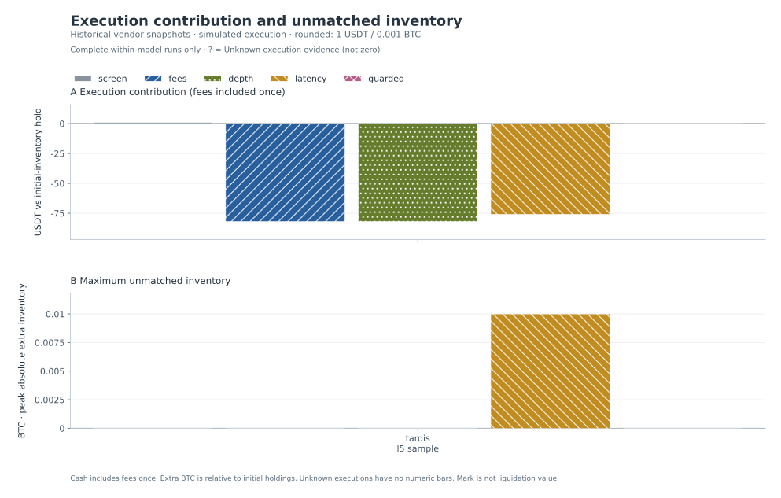

# Cross-Venue Execution Lab

**Snapshot-Replay / Source-Declared Experiments**

Source kinds are declared by the input, not independently certified by this report. Snapshot replays retain simulated execution, timing, depth and fill assumptions; results do not establish live profitability or production deployment. Inspect each run's source and assumptions.

Public-safe export: 5 non-synthetic run(s) expose rounded aggregate metrics and resolved parameters only. Money is rounded to 1 USDT and extra BTC to 0.001 BTC; approximate zero is not proof of exactly zero exposure. Exact ledger checked before export: only PASS/FAIL audit results are published, not exact residuals. Balances, equity, inventory PnL, marks, decisions, fills, event-level curves, raw books and file paths are redacted. This is an offline aggregate research report, not a publicly redistributable market-data replay.

5 runs · 1 scenarios · 5 models.

Exact ledger checked before export: all five private known-fill accounting identities PASS. Public monetary metrics are rounded aggregates; no exact balances or residuals are published.

## Execution assumptions change the result

Each numeric bar represents one complete-within-model run. ? = Unknown execution evidence; incomplete runs have no numeric performance or exposure bar. Missing combinations are not zero. Published values and evidence status follow.

## Settlement comparison

| Scenario | Model | Valuation | Execution USDT | Known fees USDT | Peak extra BTC | Ending extra BTC | Private ledger audit |
| --- | --- | --- | --- | --- | --- | --- | --- |
| tardis_l5_sample | screen | COMPLETE WITHIN MODEL | ≈1 | ≈0 | ≈0 | ≈0 | PASS |
| tardis_l5_sample | fees | COMPLETE WITHIN MODEL | ≈-82 | ≈84 | ≈0 | ≈0 | PASS |
| tardis_l5_sample | depth | COMPLETE WITHIN MODEL | ≈-82 | ≈84 | ≈0 | ≈0 | PASS |
| tardis_l5_sample | latency | COMPLETE WITHIN MODEL | ≈-76 | ≈77 | ≈0.01 | ≈0.01 | PASS |
| tardis_l5_sample | guarded | COMPLETE WITHIN MODEL | ≈0 | ≈0 | ≈0 | ≈0 | PASS |

## Accounting and interpretation

- Initial BTC is a real directional inventory exposure in this model. The hold benchmark retains the exact initial BTC and USDT at the same final common mark.
- Execution contribution = ending equity − hold benchmark = Δcash + ΔBTC × final mark. Total PnL = initial-inventory PnL + execution contribution.
- Fees are already deducted in cash and ending equity. The fee metric is a disclosure, not a second deduction from execution contribution.
- Common-mark equity and the equity curve are valuations, not realizable liquidation proceeds. Exit depth, fees and venue availability can change realizable value.
- Models change execution assumptions, filters and potentially fill quantities. Their differences are counterfactual comparisons, not strict additive cost attribution.
- Orders use separate prefunded venue inventories; spot borrowing and instantaneous cross-venue transfers are not assumed. Peak extra BTC is max(abs(total BTC − initial total BTC)); ending extra BTC is signed.
- Exposure peaks are sampled after both same-time leg attempts, not a measurement of intramillisecond leg risk. Parameters list actual resolved fees, latency, order size, thresholds and model switches.
- Decision-time information and subsequent execution must be separated by the simulator. This report displays supplied results and accounting checks; it does not independently certify causal replay correctness.
- round_trips_complete is the simulator's paired-leg completion counter, not proof that initial BTC inventory was liquidated or that capital completed a transfer cycle.
- Censored pairs and execution_unknown_pairs are separate from confirmed no-fill pairs. Incomplete runs expose only the known-fill ledger; complete performance, ending actual exposure and peak actual exposure remain unknown. The five arithmetic checks validate that ledger only.

## Run evidence

### tardis_l5_sample / screen

Source: tardis_l5_sample.

COMPLETE WITHIN MODEL: executions are resolved under the simulator's assumptions; this does not prove real-world fills.

Rounded aggregate export. Exact ledger checked before export; displayed rounded values are not expected to reproduce exact identities. Per-venue balances and exact financial aggregates are withheld.

#### Rounded public metrics

| Metric | Value |
| --- | --- |
| candidates | 8764 |
| submitted_pairs | 100 |
| round_trips_complete | 100 |
| partial_pairs | 0 |
| single_leg_pairs | 0 |
| no_fill_pairs | 0 |
| censored_pairs | 0 |
| execution_unknown_pairs | 0 |
| risk_halts | 0 |
| fees_usdt | ≈0 |
| execution_contribution_usdt | ≈1 |
| max_extra_btc | ≈0 |
| ending_extra_btc | ≈0 |

#### Exact ledger checked before export

| Identity | Private exact status |
| --- | --- |
| Ending equity − initial equity = total PnL | PASS |
| Hold benchmark − initial equity = inventory PnL | PASS |
| Ending equity − hold benchmark = execution contribution | PASS |
| Total PnL = inventory PnL + execution contribution | PASS |
| Final BTC − initial BTC = ending extra BTC | PASS |

#### Rejection reasons

| Reason | Count |
| --- | --- |
| edge_not_above_minimum | 1067 |
| insufficient_sell_inventory | 1075 |
| missing_venue | 1 |
| pair_budget | 7597 |

#### parameters

    {
      "depth_mode": "top",
      "fee_bps": {
        "alpha": "0",
        "beta": "0"
      },
      "latency_ms": 0,
      "max_event_skew_ms": 100,
      "max_pairs": 100,
      "max_quote_age_ms": 250,
      "max_unhedged_btc": "0.005",
      "min_edge_bps": "0",
      "order_qty": "0.005",
      "quality_gates": false,
      "require_event_time": true,
      "risk_halt": false,
      "signal_policy": "gross"
    }

#### assumptions

    {
      "configuration": "The parameters field contains validated resolved engine settings, not inferred defaults.",
      "publication": "Rounded aggregate export: money to 1 USDT and extra BTC to 0.001 BTC. Exact ledger checked before export.",
      "scope": "Historical displayed depth and simulated IOC fills; no live orders or guaranteed liquidity.",
      "valuation": "Common marks are not liquidation prices; fees are already included in cash once."
    }

#### Public export provenance

    {
      "export": "aggregate_only",
      "input_sha256": "83d9835884e68c46d3965983cf6f37efc68b0ce465ef026822526ffa9ba51167",
      "note": "Raw market data, traces, per-venue balances, equity, marks, exact financial aggregates and unapproved metadata are excluded."
    }

### tardis_l5_sample / fees

Source: tardis_l5_sample.

COMPLETE WITHIN MODEL: executions are resolved under the simulator's assumptions; this does not prove real-world fills.

Rounded aggregate export. Exact ledger checked before export; displayed rounded values are not expected to reproduce exact identities. Per-venue balances and exact financial aggregates are withheld.

#### Rounded public metrics

| Metric | Value |
| --- | --- |
| candidates | 8764 |
| submitted_pairs | 100 |
| round_trips_complete | 100 |
| partial_pairs | 0 |
| single_leg_pairs | 0 |
| no_fill_pairs | 0 |
| censored_pairs | 0 |
| execution_unknown_pairs | 0 |
| risk_halts | 0 |
| fees_usdt | ≈84 |
| execution_contribution_usdt | ≈-82 |
| max_extra_btc | ≈0 |
| ending_extra_btc | ≈0 |

#### Exact ledger checked before export

| Identity | Private exact status |
| --- | --- |
| Ending equity − initial equity = total PnL | PASS |
| Hold benchmark − initial equity = inventory PnL | PASS |
| Ending equity − hold benchmark = execution contribution | PASS |
| Total PnL = inventory PnL + execution contribution | PASS |
| Final BTC − initial BTC = ending extra BTC | PASS |

#### Rejection reasons

| Reason | Count |
| --- | --- |
| edge_not_above_minimum | 1067 |
| insufficient_sell_inventory | 1075 |
| missing_venue | 1 |
| pair_budget | 7597 |

#### parameters

    {
      "depth_mode": "top",
      "fee_bps": {
        "alpha": "10.000",
        "beta": "10.000"
      },
      "latency_ms": 0,
      "max_event_skew_ms": 100,
      "max_pairs": 100,
      "max_quote_age_ms": 250,
      "max_unhedged_btc": "0.005",
      "min_edge_bps": "0",
      "order_qty": "0.005",
      "quality_gates": false,
      "require_event_time": true,
      "risk_halt": false,
      "signal_policy": "gross"
    }

#### assumptions

    {
      "configuration": "The parameters field contains validated resolved engine settings, not inferred defaults.",
      "publication": "Rounded aggregate export: money to 1 USDT and extra BTC to 0.001 BTC. Exact ledger checked before export.",
      "scope": "Historical displayed depth and simulated IOC fills; no live orders or guaranteed liquidity.",
      "valuation": "Common marks are not liquidation prices; fees are already included in cash once."
    }

#### Public export provenance

    {
      "export": "aggregate_only",
      "input_sha256": "0bbdc1ec3ab9f7a1ffc4705abc36da20432bffa79a8ca19e0d12a2aef086305a",
      "note": "Raw market data, traces, per-venue balances, equity, marks, exact financial aggregates and unapproved metadata are excluded."
    }

### tardis_l5_sample / depth

Source: tardis_l5_sample.

COMPLETE WITHIN MODEL: executions are resolved under the simulator's assumptions; this does not prove real-world fills.

Rounded aggregate export. Exact ledger checked before export; displayed rounded values are not expected to reproduce exact identities. Per-venue balances and exact financial aggregates are withheld.

#### Rounded public metrics

| Metric | Value |
| --- | --- |
| candidates | 8764 |
| submitted_pairs | 100 |
| round_trips_complete | 100 |
| partial_pairs | 0 |
| single_leg_pairs | 0 |
| no_fill_pairs | 0 |
| censored_pairs | 0 |
| execution_unknown_pairs | 0 |
| risk_halts | 0 |
| fees_usdt | ≈84 |
| execution_contribution_usdt | ≈-82 |
| max_extra_btc | ≈0 |
| ending_extra_btc | ≈0 |

#### Exact ledger checked before export

| Identity | Private exact status |
| --- | --- |
| Ending equity − initial equity = total PnL | PASS |
| Hold benchmark − initial equity = inventory PnL | PASS |
| Ending equity − hold benchmark = execution contribution | PASS |
| Total PnL = inventory PnL + execution contribution | PASS |
| Final BTC − initial BTC = ending extra BTC | PASS |

#### Rejection reasons

| Reason | Count |
| --- | --- |
| edge_not_above_minimum | 1070 |
| insufficient_known_depth | 1 |
| insufficient_sell_inventory | 1077 |
| missing_venue | 1 |
| pair_budget | 7593 |

#### parameters

    {
      "depth_mode": "l2",
      "fee_bps": {
        "alpha": "10.000",
        "beta": "10.000"
      },
      "latency_ms": 0,
      "max_event_skew_ms": 100,
      "max_pairs": 100,
      "max_quote_age_ms": 250,
      "max_unhedged_btc": "0.005",
      "min_edge_bps": "0",
      "order_qty": "0.005",
      "quality_gates": false,
      "require_event_time": true,
      "risk_halt": false,
      "signal_policy": "gross"
    }

#### assumptions

    {
      "configuration": "The parameters field contains validated resolved engine settings, not inferred defaults.",
      "publication": "Rounded aggregate export: money to 1 USDT and extra BTC to 0.001 BTC. Exact ledger checked before export.",
      "scope": "Historical displayed depth and simulated IOC fills; no live orders or guaranteed liquidity.",
      "valuation": "Common marks are not liquidation prices; fees are already included in cash once."
    }

#### Public export provenance

    {
      "export": "aggregate_only",
      "input_sha256": "9065be286fc41106067195b85760fb4281072d5d7aa3ca2904ff9e29fd33d12b",
      "note": "Raw market data, traces, per-venue balances, equity, marks, exact financial aggregates and unapproved metadata are excluded."
    }

### tardis_l5_sample / latency

Source: tardis_l5_sample.

COMPLETE WITHIN MODEL: executions are resolved under the simulator's assumptions; this does not prove real-world fills.

Rounded aggregate export. Exact ledger checked before export; displayed rounded values are not expected to reproduce exact identities. Per-venue balances and exact financial aggregates are withheld.

#### Rounded public metrics

| Metric | Value |
| --- | --- |
| candidates | 8546 |
| submitted_pairs | 100 |
| round_trips_complete | 84 |
| partial_pairs | 0 |
| single_leg_pairs | 16 |
| no_fill_pairs | 0 |
| censored_pairs | 0 |
| execution_unknown_pairs | 0 |
| risk_halts | 0 |
| fees_usdt | ≈77 |
| execution_contribution_usdt | ≈-76 |
| max_extra_btc | ≈0.01 |
| ending_extra_btc | ≈0.01 |

#### Exact ledger checked before export

| Identity | Private exact status |
| --- | --- |
| Ending equity − initial equity = total PnL | PASS |
| Hold benchmark − initial equity = inventory PnL | PASS |
| Ending equity − hold benchmark = execution contribution | PASS |
| Total PnL = inventory PnL + execution contribution | PASS |
| Final BTC − initial BTC = ending extra BTC | PASS |

#### Rejection reasons

| Reason | Count |
| --- | --- |
| edge_not_above_minimum | 1151 |
| insufficient_known_depth | 1 |
| insufficient_sell_inventory | 1164 |
| missing_venue | 1 |
| pair_budget | 7294 |

#### parameters

    {
      "depth_mode": "l2",
      "fee_bps": {
        "alpha": "10.000",
        "beta": "10.000"
      },
      "latency_ms": 100,
      "max_event_skew_ms": 100,
      "max_pairs": 100,
      "max_quote_age_ms": 250,
      "max_unhedged_btc": "0.005",
      "min_edge_bps": "0",
      "order_qty": "0.005",
      "quality_gates": false,
      "require_event_time": true,
      "risk_halt": false,
      "signal_policy": "gross"
    }

#### assumptions

    {
      "configuration": "The parameters field contains validated resolved engine settings, not inferred defaults.",
      "publication": "Rounded aggregate export: money to 1 USDT and extra BTC to 0.001 BTC. Exact ledger checked before export.",
      "scope": "Historical displayed depth and simulated IOC fills; no live orders or guaranteed liquidity.",
      "valuation": "Common marks are not liquidation prices; fees are already included in cash once."
    }

#### Public export provenance

    {
      "export": "aggregate_only",
      "input_sha256": "1caca83d681a1c94f10f92cd6e78a287831b6fe7ffd7d760b8fa1d5fe3e7375f",
      "note": "Raw market data, traces, per-venue balances, equity, marks, exact financial aggregates and unapproved metadata are excluded."
    }

### tardis_l5_sample / guarded

Source: tardis_l5_sample.

COMPLETE WITHIN MODEL: executions are resolved under the simulator's assumptions; this does not prove real-world fills.

Rounded aggregate export. Exact ledger checked before export; displayed rounded values are not expected to reproduce exact identities. Per-venue balances and exact financial aggregates are withheld.

#### Rounded public metrics

| Metric | Value |
| --- | --- |
| candidates | 8764 |
| submitted_pairs | 0 |
| round_trips_complete | 0 |
| partial_pairs | 0 |
| single_leg_pairs | 0 |
| no_fill_pairs | 0 |
| censored_pairs | 0 |
| execution_unknown_pairs | 0 |
| risk_halts | 0 |
| fees_usdt | ≈0 |
| execution_contribution_usdt | ≈0 |
| max_extra_btc | ≈0 |
| ending_extra_btc | ≈0 |

#### Exact ledger checked before export

| Identity | Private exact status |
| --- | --- |
| Ending equity − initial equity = total PnL | PASS |
| Hold benchmark − initial equity = inventory PnL | PASS |
| Ending equity − hold benchmark = execution contribution | PASS |
| Total PnL = inventory PnL + execution contribution | PASS |
| Final BTC − initial BTC = ending extra BTC | PASS |

#### Rejection reasons

| Reason | Count |
| --- | --- |
| cross_venue_time_skew | 1376 |
| edge_not_above_minimum | 5667 |
| insufficient_known_depth | 1 |
| missing_venue | 1 |
| stale_quote | 1721 |

#### parameters

    {
      "depth_mode": "l2",
      "fee_bps": {
        "alpha": "10.000",
        "beta": "10.000"
      },
      "latency_ms": 100,
      "max_event_skew_ms": 100,
      "max_pairs": 100,
      "max_quote_age_ms": 250,
      "max_unhedged_btc": "0.005",
      "min_edge_bps": "0",
      "order_qty": "0.005",
      "quality_gates": true,
      "require_event_time": true,
      "risk_halt": true,
      "signal_policy": "net"
    }

#### assumptions

    {
      "configuration": "The parameters field contains validated resolved engine settings, not inferred defaults.",
      "publication": "Rounded aggregate export: money to 1 USDT and extra BTC to 0.001 BTC. Exact ledger checked before export.",
      "scope": "Historical displayed depth and simulated IOC fills; no live orders or guaranteed liquidity.",
      "valuation": "Common marks are not liquidation prices; fees are already included in cash once."
    }

#### Public export provenance

    {
      "export": "aggregate_only",
      "input_sha256": "9c3cc9c333193a03ad9f3a72084c283b4818f4d567a6ab9f71612f30810af185",
      "note": "Raw market data, traces, per-venue balances, equity, marks, exact financial aggregates and unapproved metadata are excluded."
    }

## Reproducibility

Canonical exported-result SHA-256: `4b88b13063b30fe92350c93d149e2e8d57495ae2814023f28fe35bf81d50d9ed`.

Exported results: [results.json](results.json). Non-synthetic public exports are aggregate-only. No generated-as-of timestamp or market freshness claim.
